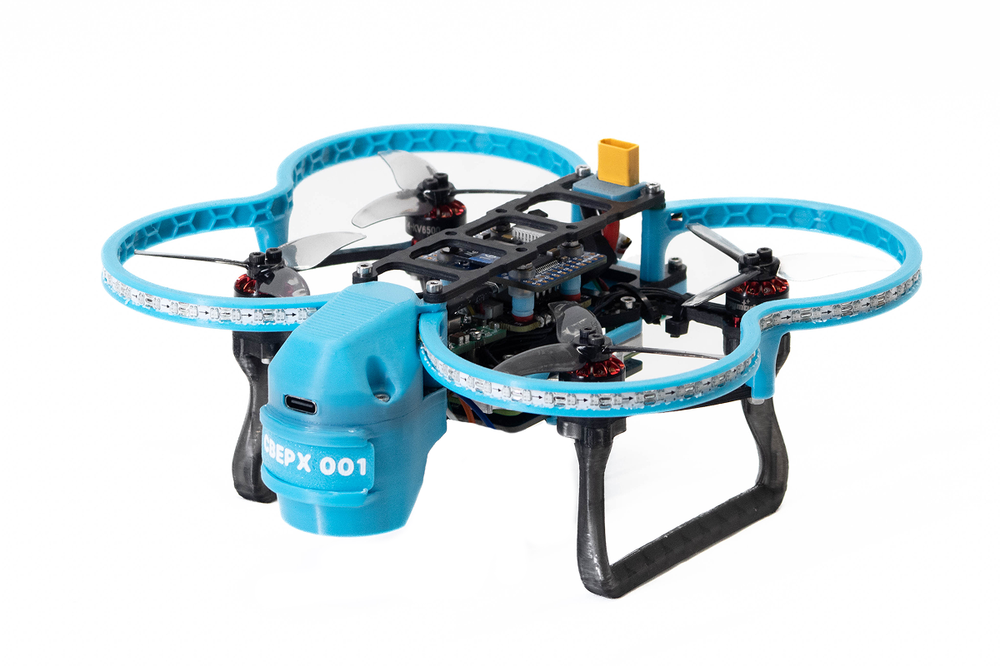
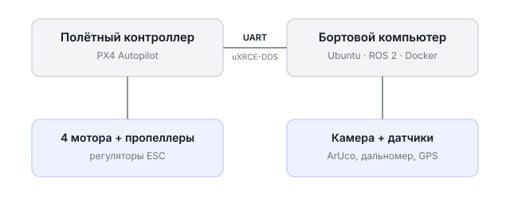

# Обрик на ROS 2

**Обрик** — образовательная платформа на базе программируемого квадрокоптера на ROS 2. Она предназначена для обучения автономным полётам, компьютерному зрению и программированию дронов.



## Устройство Обрика



- **Полётный контроллер** следит за равновесием дрона, управляет моторами и удерживает его в воздухе. Работает на прошивке **PX4**.
- **Бортовой компьютер** (Raspberry Pi CM5, Radxa CM5, Orange Pi и др.) выполняет Python-код, ROS 2 и компьютерное зрение.
- **Связь между ними** — по протоколу **uXRCE-DDS** через UART (провод на плате): бортовой компьютер отправляет команды, полётный контроллер их выполняет.

---

## Устройство документации

При первом знакомстве с платформой рекомендуется проходить разделы последовательно.

### 1. Взаимодействие с полётным контроллером

Настройка PX4 через QGroundControl: прошивка, калибровка датчиков, загрузка параметров, настройка аппаратуры управления.

→ [Начать с подключения к QGroundControl](qgc-wifi.md)

### 2. Пилотирование

Ручное управление дроном: симулятор для безопасной отработки навыков, режим POSITION для полётов с удержанием позиции.

→ [Начать с основ ручного управления](manual-flight.md)

### 3. Бортовой компьютер

Установка образа на бортовой компьютер, настройка камеры, работа с полем ArUco-маркеров, автоматическая проверка системы.

→ [Начать с установки образа](os-image-flash.md)

### 4. Программирование

Автономные полёты в режиме OFFBOARD, концепции ROS 2, примеры кода на Python, компьютерное зрение, работа с GPIO и периферией.

→ [Начать с команд OFFBOARD](offboard-commands.md)

### 5. База знаний

Справочные материалы: работа с АКБ, прошивка контроллера, калибровка ESC, бортовые компьютеры, симулятор, навигация по ArUco.

→ [Открыть базу знаний](knowledge_base/index-kb.md)

---

## Как начать работу

После установки образа и подключения к Обрику по Wi-Fi зайдите на него по SSH — вы **сразу попадаете в контейнер** `sverk_ros2`, где работают ROS 2 и весь код:

```bash
ssh sverk@<IP_ДРОНА>   # порт 22, пароль: sverk
```

Все ROS 2 команды, программы на Python и работа с периферией выполняются прямо здесь — отдельно «входить в контейнер» не нужно.

> **Подсказка** **Хост и контейнер.** По умолчанию вы всегда в контейнере (SSH на порт 22). Сама плата (хост) нужна редко — только чтобы включить аппаратный интерфейс (UART, SPI, PWM, I²C) в конфиге загрузки. На хост заходят по **порту 2222**: `ssh -p 2222 <пользователь>@<IP_ДРОНА>` (порт всегда 2222; имя пользователя зависит от платы — `pi`, `orangepi`, `rock`, `sunrise`).

---

## Перед началом работы

Обязательно прочитайте [правила техники безопасности](safety.md) — они распространяются на любую работу с Обриком.

---

## Поддержка

Если вы изучили документацию, но не нашли ответа на свой вопрос, напишите в чат техподдержки: [@sverk_support](https://t.me/sverk_support)
