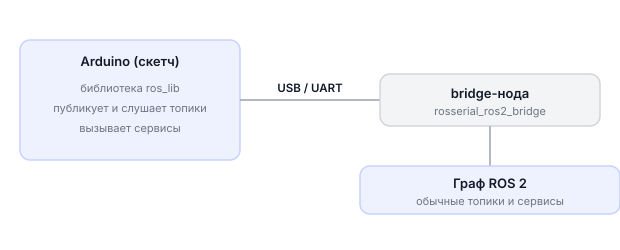
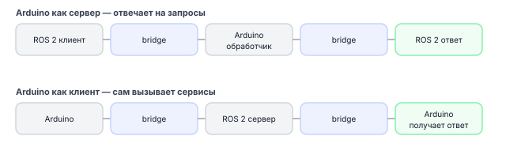

# Знакомство с rosserial_ros2

> **Примечание** На дроне два UART:
> **Примечание** Для подключения используйте `UART_B` — `UART_A` занят полётным контроллером PX4.

## Описание

**rosserial_ros2** делает Arduino полноценным узлом ROS 2: Arduino публикует топики, подписывается на них и отвечает на сервисы. В отличие от serial_bridge, где идёт простой обмен текстом, здесь Arduino работает как обычная нода ROS 2.

При этом Arduino не запускает ROS 2 напрямую — она слишком маленькая. Вместо этого на Обрике работает **bridge-нода**, которая переводит «язык Arduino» на язык ROS 2.

---

## Принцип работы



**Два компонента:**

1. **`ros_lib`** — библиотека для Arduino IDE. Устанавливается на компьютер с Arduino IDE. Содержит классы `NodeHandle`, `Publisher`, `Subscriber`, `ServiceServer`.

2. **`rosserial_ros2_bridge`** — нода на Обрике. Запускается командой `ros2 run` и читает данные от Arduino через USB или UART.

---

## Простейший пример

### Arduino-скетч: публикуем строку

**Что мы делаем:** Arduino каждую секунду отправляет сообщение в топик `/chatter`.

```cpp
#include <ros.h>           // подключаем библиотеку rosserial
#include <std_msgs/String.h>

ros::NodeHandle nh;        // создаём "узел" Arduino

std_msgs::String msg;      // сообщение типа String
ros::Publisher pub("chatter", &msg);  // публикатор для топика /chatter

void setup()
{
    nh.initNode();         // инициализация
    nh.advertise(pub);     // регистрируем публикатор
}

void loop()
{
    msg.data = (char *)"hello from arduino";  // заполняем сообщение
    pub.publish(&msg);     // отправляем в топик
    nh.spinOnce();         // обрабатываем входящие данные
    delay(1000);           // ждём секунду
}
```

### Запуск bridge на Обрике

```bash
ros2 run rosserial_ros2_bridge bridge_node --port /dev/ttyUSB0
```

После этого в ROS 2 появится топик `/chatter`. Проверить диагностически:

```bash
ros2 topic list
ros2 topic echo /chatter
```

### Чтение данных от Arduino в Python

```python
import sverk_interfaces

drone = sverk_interfaces.init(Nodename="rosserial_example")

def on_chatter(msg):
    print(f"Arduino говорит: {msg.data}")

drone.topic.subscribe('std_msgs/msg/String', '/chatter', on_chatter)
drone.topic.spin()

drone.close()
```

---

## Что умеет Arduino через rosserial

| Возможность | Что происходит |
|-------------|----------------|
| Публикует топик | Bridge создаёт ROS 2 топик, Arduino отправляет данные |
| Подписывается на топик | Bridge пересылает ROS 2 сообщения на Arduino |
| Реализует сервис | ROS 2 вызывает сервис → Arduino выполняет → отвечает |
| Вызывает сервис | Arduino запрашивает что-то у ROS 2 |
| Получает параметры | Arduino читает параметры bridge-ноды |
| Отправляет логи | Сообщения появляются в `/rosout` |
| Синхронизирует время | Arduino знает текущее время ROS 2 |

---

## Способы подключения

### USB (самый простой)

Arduino подключается к Обрику кабелем USB. Появляется как `/dev/ttyUSB0` или `/dev/ttyACM0`.

> **Примечание** Arduino подключают к свободному порту **UART_B** (или по USB). Имя UART_B зависит от платы: RPi CM5 — `/dev/ttyAMA10`, Orange Pi Zero 3W — `/dev/ttyS6`, Orange Pi 5 Pro — `/dev/ttyS1`. UART_A занят полётным контроллером — туда подключать нельзя. Полная таблица интерфейсов по платам → [Бортовые компьютеры](knowledge_base/boards-overview.md).

```bash
ros2 run rosserial_ros2_bridge bridge_node --port /dev/ttyUSB0 --baud 57600
```

### UART (пины GPIO)

TX/RX Arduino подключаются к UART-пинам бортового компьютера.

```bash
ros2 run rosserial_ros2_bridge bridge_node --port /dev/ttyAMA3 --baud 57600
```

> **Внимание** При UART-подключении Arduino Nano/Uno работает на 5 В, а GPIO Обрика — на 3.3 В. Нужен **level shifter** (согласователь уровней) или соответствующий делитель напряжения. Прямое соединение может повредить GPIO.

### TCP relay (Arduino на другом компьютере)

Если Arduino подключена к компьютер с Windows, а ROS 2 работает на Обрике:

На Windows:

```powershell
python tools\windows_serial_tcp_bridge.py `
  --serial-port COM4 `
  --baud 57600 `
  --listen-port 7777
```

На Обрике:

```bash
ros2 run rosserial_ros2_bridge bridge_node --port socket://<IP_КОМПЬЮТЕРА>:7777
```

---

## Скорость передачи (baud rate)

Скорость должна совпадать на Arduino и в bridge. В примерах используется **57600**.

В скетче Arduino скорость задаётся автоматически (библиотека ros_lib использует 57600 по умолчанию).

---

## Управление топиками

### Arduino публикует → bridge создаёт ROS 2 топик

```cpp
// Скетч Arduino объявляет публикатор
std_msgs::String msg;
ros::Publisher chatter("chatter", &msg);
nh.advertise(chatter);
```

→ В ROS 2 появляется топик `/chatter`.

### Arduino подписывается → bridge пересылает ROS 2 сообщения

```cpp
// Скетч подписывается на /led
void callback(const std_msgs::Bool& msg) {
    digitalWrite(LED_PIN, msg.data ? HIGH : LOW);
}

ros::Subscriber<std_msgs::Bool> led_sub("led", callback);
nh.subscribe(led_sub);
```

→ Bridge слушает ROS 2 топик `/led` и пересылает сообщения на Arduino.

### Управление Arduino из Python

```python
import sverk_interfaces

drone = sverk_interfaces.init(Nodename="rosserial_example")

# Создаём публикатор в топик /led
pub = drone.topic.create_publisher('std_msgs/msg/Bool', '/led')

# Включить светодиод
pub.publish({'data': True})

# Выключить светодиод
pub.publish({'data': False})

drone.close()
```

---

## Сервисы



> **Примечание** Вызов сервисов из Python и низкоуровневые примеры — см. [knowledge_base/arduino-raw.md](knowledge_base/arduino-raw.md).

---

## Логи с Arduino

Arduino может отправлять сообщения в журнал ROS 2:

```cpp
nh.loginfo("датчик инициализирован");
nh.logwarn("таймаут датчика");
nh.logerror("не удалось прочитать датчик");
```

Сообщения появляются в консоли bridge и в топике `/rosout`.

---

## Диагностика bridge

```bash
# Посмотреть состояние соединения, счётчики пакетов, ошибки
ros2 topic echo /rosserial_diagnostics
```

---

## Размеры буферов (важно для Arduino Nano/Uno!)

Arduino Nano и Uno имеют мало памяти (2 КБ RAM). Если сообщения большие — нужно увеличить буфер или уменьшить сообщение.

Проверить, сколько байт займёт сообщение:

```bash
ros2 run rosserial_ros2_bridge buffer_size std_msgs/String data:=32
ros2 run rosserial_ros2_bridge buffer_size geometry_msgs/Twist
```

В скетче задать нестандартный размер буфера:

```cpp
// 2 публикатора, 2 подписчика, входной буфер 128 байт, выходной 256 байт
ros::NodeHandle_<SerialHardware, 2, 2, 128, 256> nh;
```

---

## Следующий шаг

→ [Практические примеры: топики, сервисы, сервопривод](arduino-rosserial-tutorial.md)

---

## См. также

Низкоуровневые примеры с `ros2 service call`, `ros2 topic pub` и прямым rclpy:
→ [knowledge_base/arduino-raw.md](knowledge_base/arduino-raw.md)
