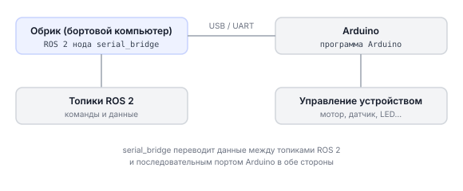

# Работа с Arduino через serial_bridge

> **Примечание** На дроне два UART:
> **Примечание** Для подключения используйте `UART_B` — `UART_A` занят полётным контроллером PX4.

## Описание

**Arduino** — маленькая плата-микроконтроллер. Она умеет управлять моторами, светодиодами, читать датчики. Но сама по себе не умеет в ROS 2.

**serial_bridge** — пакет, который соединяет Arduino с Обриком через USB (или UART). Arduino и бортовой компьютер обмениваются командами в текстовом виде, а пакет превращает их в ROS 2 топики и сервисы.

Это простой и надёжный способ подключить любое Arduino-устройство к дрону.

---

## Применение на дроне

Через Arduino к дрону можно подключить:
- Датчики (температура, давление, влажность)
- Реле и электромагниты
- Сервоприводы (альтернативный способ)
- Кнопки и концевики
- Собственные исполнительные устройства

---

## Где находится пакет

```bash
~/sverk_ws/src/sverk_drone/peripheral/serial_bridge
```

---

## Схема работы



---

## Проверка подключения Arduino

Подключите Arduino по USB и убедитесь, что система её видит:

```bash
ls /dev/ttyACM*    # Arduino обычно появляется здесь
ls /dev/ttyUSB*    # или здесь, если через USB-UART адаптер
```

> **Примечание** Arduino подключают к свободному порту **UART_B** (или по USB). Имя UART_B зависит от платы: RPi CM5 — `/dev/ttyAMA10`, Orange Pi Zero 3W — `/dev/ttyS6`, Orange Pi 5 Pro — `/dev/ttyS1`. UART_A занят полётным контроллером — туда подключать нельзя. Полная таблица интерфейсов по платам → [Бортовые компьютеры](knowledge_base/boards-overview.md).

Запомните путь — например `/dev/ttyACM0` — он понадобится при запуске ноды.

---

## Пример: управление сервоприводом через Arduino

В пакете уже есть готовый пример — сервопривод подключён к пину D2 на Arduino.

### Файлы примера

| Файл | Назначение |
|------|-----------|
| `serial_bridge/arduino_servo_node.py` | ROS 2 нода |
| `launch/arduino_servo.launch.py` | launch-файл |
| `config/arduino_servo.yaml` | настройки |
| `examples/serial_servo_bridge_d2/serial_servo_bridge_d2.ino` | скетч Arduino |

### Шаг 1: Залить скетч на Arduino

**Что мы делаем:** прошиваем Arduino скетчем, который принимает команды по USB.

Откройте файл `serial_servo_bridge_d2.ino` в Arduino IDE и загрузите его на плату.

Скетч ждёт байты:
- `0..180` — повернуть на этот угол
- `0xFD` (253) — в центр
- `0xFE` (254) — включить сервопривод
- `0xFF` (255) — выключить сервопривод

### Шаг 2: Запустить ноду на Обрике

```bash
# Запуск через launch-файл
ros2 launch serial_bridge arduino_servo.launch.py

# Или напрямую с указанием порта
ros2 run serial_bridge arduino_servo_node --ros-args -p port:=/dev/ttyACM0
```

### Шаг 3: Управление из Python

**Что мы делаем:** публикуем угол в топик, Arduino поворачивает сервопривод.

```python
import sverk_interfaces
from std_msgs.msg import Float32

drone = sverk_interfaces.init(Nodename="serial_bridge_example")

# Создаём публикатор в топик управления сервоприводом
pub = drone.topic.create_publisher(Float32, '/arduino_servo_node/target_angle_deg')

# Поворот на 45°
msg = Float32()
msg.data = 45.0
pub.publish(msg)

# Поворот на 90°
msg.data = 90.0
pub.publish(msg)

drone.close()
```

---

## Arduino-скетч (C++) — шаблон

**Что мы делаем:** Arduino читает команды из Serial и управляет устройством.

```cpp
// Простой пример: Arduino читает текстовые команды и отвечает
// Команды: "ON\n" — включить, "OFF\n" — выключить, "STATUS\n" — спросить состояние

const int LED_PIN = 13;   // встроенный светодиод
bool ledState = false;

void setup() {
    Serial.begin(115200);          // скорость должна совпадать с настройками ноды
    pinMode(LED_PIN, OUTPUT);
    Serial.println("READY");       // сообщаем, что готовы к работе
}

void loop() {
    if (Serial.available() > 0) {
        String cmd = Serial.readStringUntil('\n');  // читаем строку до переноса
        cmd.trim();                                 // убираем пробелы

        if (cmd == "ON") {
            ledState = true;
            digitalWrite(LED_PIN, HIGH);
            Serial.println("OK LED_ON");            // ответ ноде
        }
        else if (cmd == "OFF") {
            ledState = false;
            digitalWrite(LED_PIN, LOW);
            Serial.println("OK LED_OFF");
        }
        else if (cmd == "STATUS") {
            // Отправляем текущее состояние
            Serial.println(ledState ? "STATE 1" : "STATE 0");
        }
    }
}
```

---

## Чтение данных от Arduino

Если Arduino публикует данные (например, показания датчика) в ROS 2 топик через serial_bridge, подписаться на них можно так:

```python
import sverk_interfaces
from std_msgs.msg import String

drone = sverk_interfaces.init(Nodename="arduino_sub_example")

def on_arduino_data(msg):
    print(f"Данные от Arduino: {msg.data}")

drone.topic.subscribe(String, '/arduino_data', on_arduino_data)
drone.topic.spin()

drone.close()
```

Для однократного чтения (например, проверить состояние):

```python
import sverk_interfaces
from std_msgs.msg import String

drone = sverk_interfaces.init(Nodename="arduino_read_example")

msg = drone.topic.wait_for_message(String, '/arduino_data', timeout=5.0)
if msg:
    print(f"Состояние Arduino: {msg.data}")
else:
    print("Нет данных от Arduino")

drone.close()
```

---

## Как проверить

1. Загрузите скетч на Arduino
2. Подключите Arduino к Обрику по USB
3. Проверьте, что порт появился: `ls /dev/ttyACM*`
4. Запустите ноду: `ros2 launch serial_bridge arduino_servo.launch.py`
5. Выполните программа на Python управления — сервопривод должен повернуться

---

## Другой способ: rosserial_ros2

Если нужно, чтобы Arduino сам публиковал топики ROS 2 и был полноценным узлом — используйте rosserial:

→ [Обзор rosserial_ros2](arduino-rosserial.md)
→ [Практические примеры](arduino-rosserial-tutorial.md)

---

## См. также

Низкоуровневые примеры с `ros2 service call`, `ros2 topic pub` и прямой работой с serial-портом:
→ [knowledge_base/arduino-raw.md](knowledge_base/arduino-raw.md)
