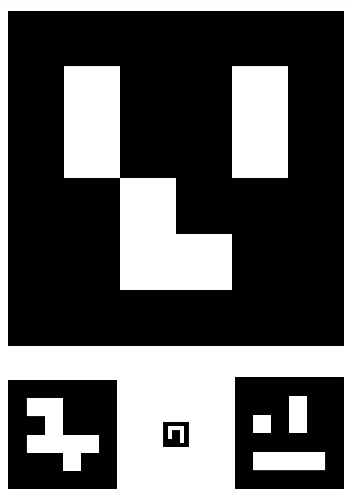
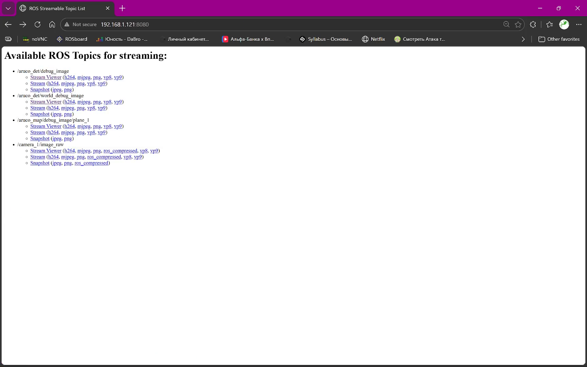
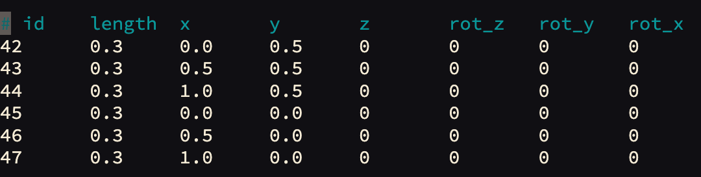
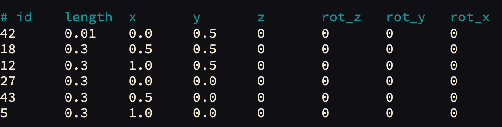

# Работа с полем ArUco-маркеров

В комплект Обрика входит готовая распечатанная карта меток. Она уже записана в систему бортового компьютера при установке образа.

ArUco-маркер — это специальный чёрно-белый квадратик (похожий на QR-код), который компьютер может точно распознать и вычислить расстояние до него. Дрон видит маркеры на полу и понимает, где он находится.

<p align="center">
  
</p>

> **Примечание** Точность навигации напрямую зависит от качества калибровки камеры, освещённости и физического состояния меток. Регулярно проверяйте систему. Подробнее о калибровке: [Настройка камеры](camera-focus.md).

Убедитесь, что ваш компьютер подключён к Wi-Fi сети Обрика.

---

## Проверка ArUco-карты

Откройте [СВЕРХ WEB](web-interface.md) → **Web video server**. В списке топиков найдите `/aruco/vis/map_debug_image/plane_1` и нажмите **Stream Viewer** — топик выводит рендер карты ArUco, настроенной в системе как основная.



---

## Генерация файла карты

> **Примечание** Подробности описаны в статье [«Навигация по ArUco-маркерам»](knowledge_base/aruco-navigation.md).

Чтобы создать файл карты, выполните команду с параметрами своей карты:

- `LENGTH` — размер маркера (в метрах)
- `X` — количество маркеров по оси X (столбцов)
- `Y` — количество маркеров по оси Y (строк)
- `DIST_X` — расстояние между центрами маркеров по оси X (в метрах)
- `DIST_Y` — расстояние между центрами маркеров по оси Y (в метрах)
- `FIRST_ID` — ID первого маркера
- `--bottom-left` (опционально) — нумерация с левого нижнего угла

```bash
ros2 run aruco_pose genmap.py LENGTH X Y DIST_X DIST_Y FIRST_ID [--bottom-left] [-o MAP_NAME]
```

### Пример для карты из комплекта

Параметры карты из комплекта:
- `LENGTH` — 0.3 м
- `X` — 3 столбца
- `Y` — 2 строки
- `DIST_X` — 0.5 м
- `DIST_Y` — 0.5 м
- `FIRST_ID` — 42

```bash
ros2 run aruco_pose genmap.py 0.3 3 2 0.5 0.5 42 -o sverk.txt
```

> **Примечание** Первая метка — №42, поэтому карта создастся с метками 42, 43, 44, 45, 46, 47. Если номера отличаются, отредактируйте файл вручную (см. ниже).

---

## Редактирование карты вручную

Откройте файл карты:

```bash
nano ~/sverk_ws/src/sverk_drone/odomerty/aruco/aruco_map/config/sverk.txt
```

Измените первый столбец (ID меток) и при необходимости размер первой метки для взлёта.

Для перемещения по файлу используйте стрелки на клавиатуре.

Было:



Стало:



Сохраните и выйдите: `Ctrl+X`, затем `Y`, затем `Enter`.

Перезапустите сервис, чтобы изменения применились:

```bash
sudo systemctl restart sverk-ros2-docker.service
```

!!! Перезапуск на хосте не в контейнере !!!

> **Примечание** Эта команда выполняется на бортовом компьютере вне Docker-контейнера (через SSH или терминал).

---

## Проверка навигации

После запуска системы проверьте, что ArUco-навигация работает:

```bash
ros2 topic echo /aruco_map/pose
```

Если дрон видит маркеры, в терминале появится поток сообщений с координатами.

Убедитесь, что карта сгенерировалась корректно — в веб-интерфейсе откройте **Web video server** и выберите топик `/aruco/vis/map_debug_image/plane_1`.

---

Описание всех инструментов веб-интерфейса → [Веб-интерфейс Обрика](web-interface.md).
