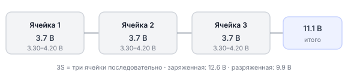
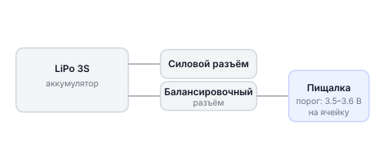
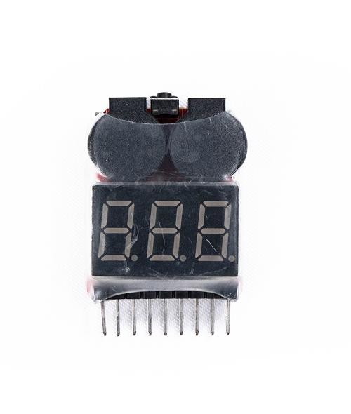
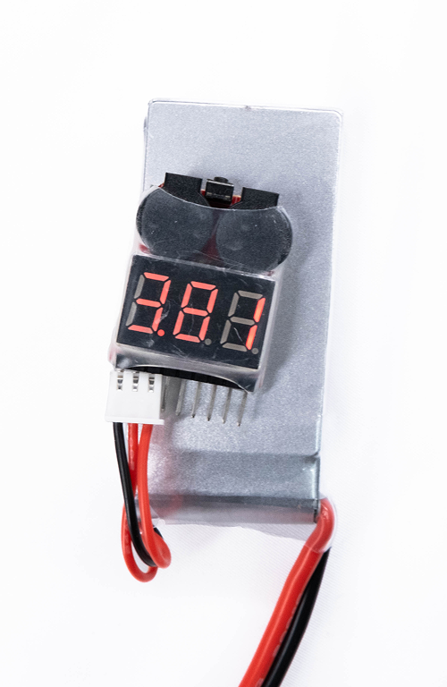
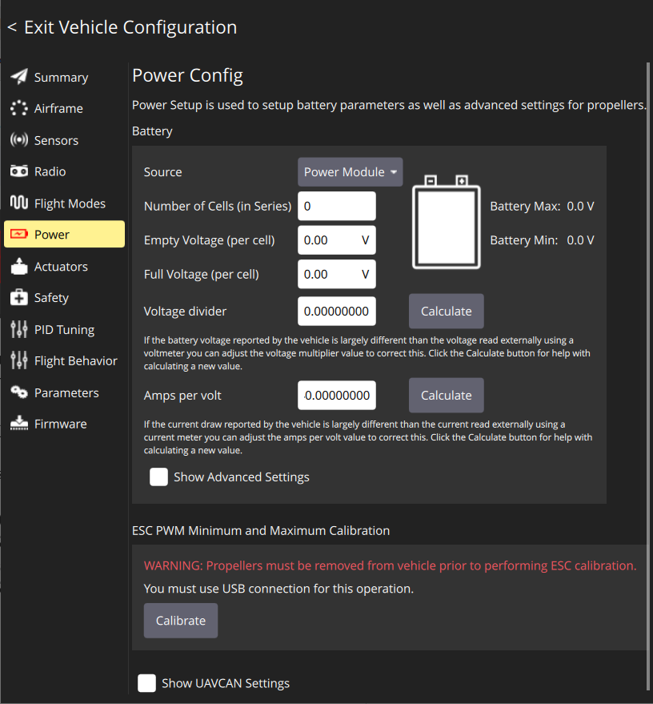
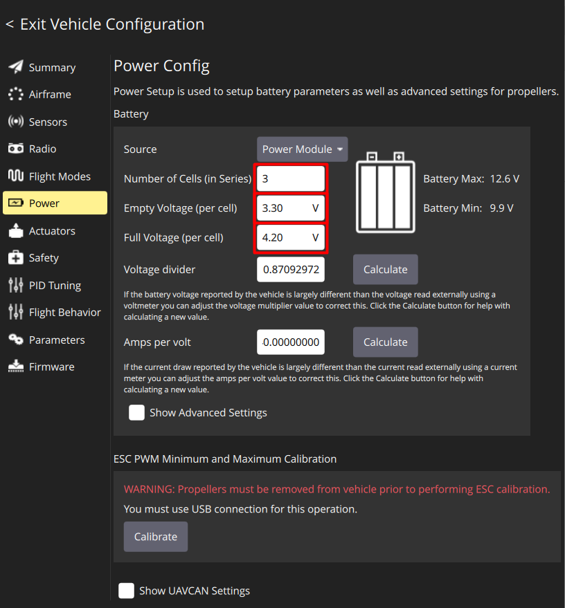
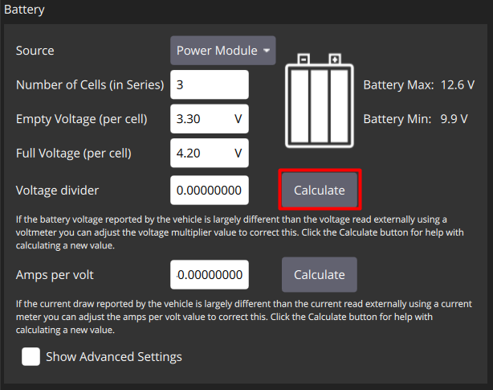
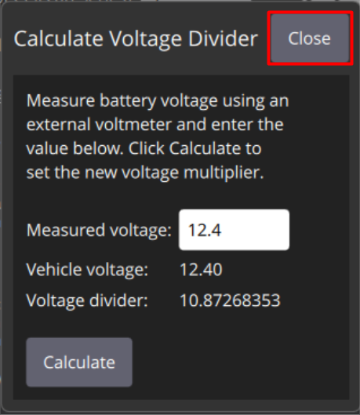
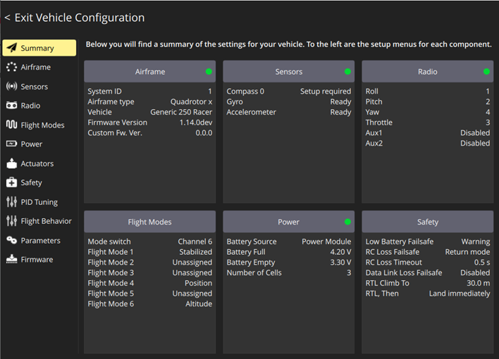

# Настройка питания и мониторинга АКБ

Полётный контроллер PX4 следит за уровнем заряда АКБ и предупреждает о разрядке. Этот раздел описывает настройку мониторинга батареи в QGC и допустимые напряжения LiPo-аккумулятора — следить за ними важно и для безопасности полёта, и для сохранности батареи.

---

## Физика LiPo аккумуляторов

Обрик питается от **LiPo аккумулятора** (Lithium Polymer — литий-полимерный). Это тот же тип батарей, что стоит в смартфонах и ноутбуках, но специально оптимизированный для высокого тока и лёгкого веса.

### Устройство LiPo-аккумулятора

Батарея состоит из **ячеек** (cells), соединённых последовательно. Обозначение **3S** означает «3 ячейки в серии»:



### Напряжение ячейки

Каждая ячейка имеет допустимый диапазон напряжения:

| Состояние | Напряжение ячейки | Что означает |
|-----------|------------------|-------------|
| Полностью заряжена | **4.20 В** | Максимум — выше нельзя |
| Рабочий диапазон | 3.7–4.2 В | Нормальный полёт |
| Предупреждение | ~3.5 В | Нужно садиться |
| Минимум (разряжена) | **3.30 В** | Ниже нельзя — повреждение батареи |
| Глубокий разряд | < 3.0 В | Батарея безвозвратно испорчена |

> **Внимание** При глубоком разряде литий в ячейке кристаллизуется — батарея теряет ёмкость, вздувается и может воспламениться. Это уже не ремонтируется.

### Контроль напряжения в полёте

При нагрузке (работающих моторах) напряжение батареи **резко падает**, а когда нагрузка снимается — немного восстанавливается. Это значит, что в воздухе батарея «выглядит» более разряженной, чем она есть. PX4 учитывает это и заранее предупреждает о низком заряде.

Если не следить за зарядом:
- Батарея может умереть прямо в воздухе → дрон упадёт
- Глубокий разряд → батарея повреждена навсегда

---

## Индикатор напряжения (пищалка)

**Пищалка** — маленькое устройство, которое подключается к **балансировочному разъёму** батареи и пищит, когда напряжение любой ячейки падает ниже заданного порога.



Нажимая кнопку на основании пищалки, можно изменить пороговое напряжение. **Оптимальное значение: 3.5–3.6 В** на ячейку.

<p></p>

---

## Настройка питания в QGC

> **Внимание** Перед настройкой убедитесь, что пропеллеры **не установлены** на моторах.

Откройте вкладку **Power** в Vehicle Configuration.



> **Примечание** Сверьте маркировку АКБ — сверьтесь с [допустимыми напряжениями](knowledge_base/battery-li-po.md#напряжение-ячеек-что-можно-что-нельзя) своей батареи

### Основные параметры

Установите следующие значения (для стандартной 3S LiPo батареи Обрика):

- **Number of cells** → `3` (три ячейки, батарея 3S)
- **Empty Voltage** → `3.30 В` (минимально допустимое напряжение ячейки)
- **Full Voltage** → `4.20 В` (максимальное напряжение ячейки — полный заряд)



> **Примечание** PX4 получает от измерительной схемы суммарное напряжение батареи (для 3S — до 12.6 В) и делит его на число ячеек, чтобы получить напряжение каждой. Эти значения используются для расчёта процента заряда и отображения в QGC.

---

## Калибровка делителя напряжения

**Делитель напряжения** — это электрическая схема, которая уменьшает напряжение батареи (например, 12.6 В) до уровня, который может измерить микроконтроллер (обычно 0–3.3 В). Если коэффициент делителя настроен неправильно — PX4 будет показывать неверное напряжение.

!!! Вроде бы пищалка это жаргонное название стоит этот момент уточнить !!!

### Вариант 1: Калибровка по пищалке (точный метод)

1. Подключите пищалку к балансировочному разъёму батареи — она покажет суммарное напряжение
2. Нажмите кнопку **Calculate** напротив надписи **Voltage Divider**

   

3. Введите в открывшееся поле суммарное напряжение с пищалки (например, `11.4`)
4. Нажмите **Close** — QGC сохранит рассчитанный коэффициент

   

### Вариант 2: Усреднённое значение (без пищалки)

Если пищалки нет, установите **Voltage divider = 11** — это среднее проверенное значение для Обрика.

---

## Итоговая проверка

После настройки и всех калибровок перейдите на вкладку **Summary**. Все пункты должны быть отмечены **зелёным маркером**.



Если какой-то пункт красный — вернитесь к соответствующей вкладке и повторите настройку.

```
Чеклист перед первым полётом:
  - Airframe — выбрана конфигурация Quadrotor X
  - Sensors — все три калибровки выполнены (зелёные)
  - Radio — пульт откалиброван
  - Flight Modes — режимы назначены на SB, SA, SD
  - Power — параметры батареи настроены
  - Summary — всё зелёное
```
