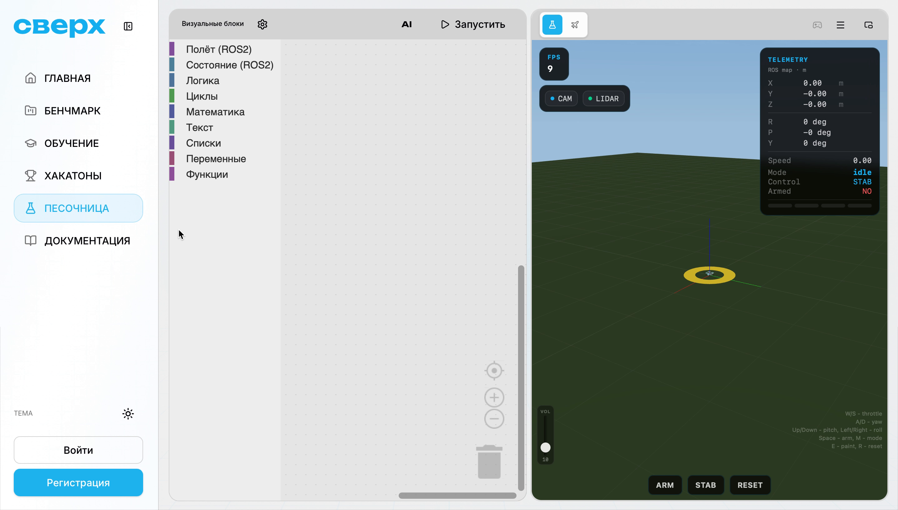
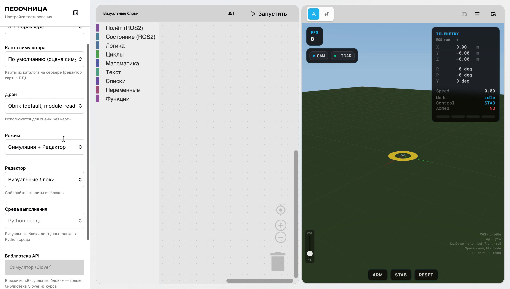
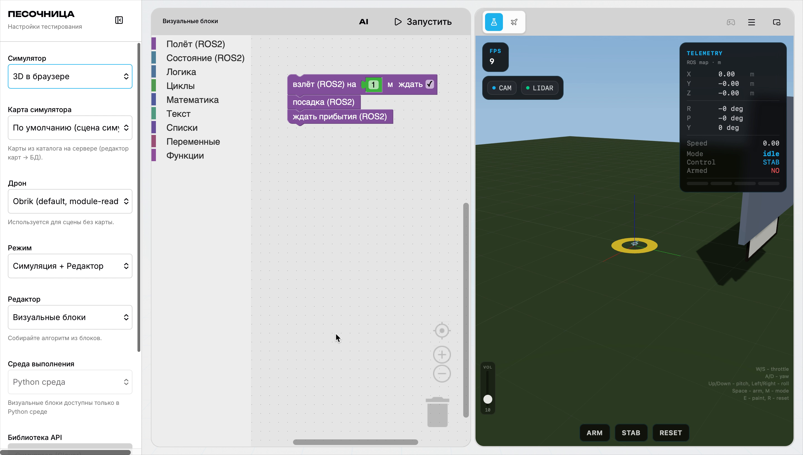
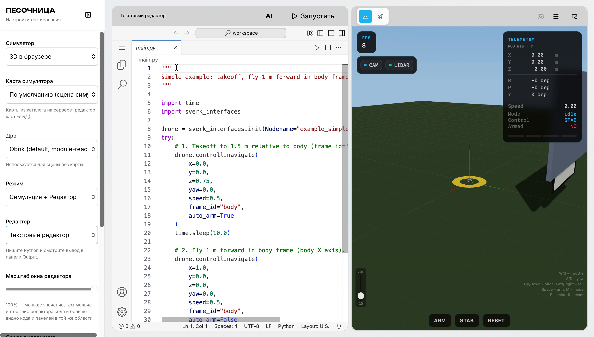

# Блочное программирование

Блочное программирование — способ собирать программы из готовых цветных блоков, как конструктор: каждый блок — одна команда. Блоки автоматически переводятся в Python-код, и наоборот.

На Обрике блочное программирование доступно в [Песочнице](https://edu.sverk.tech/sandbox) на платформе «Сверх».

---

## Интерфейс Песочницы

В основном виде Песочница состоит из двух частей: редактор (слева) и симулятор (справа).

Симулятор показывает дрон в реальном времени: X, Y, Z — координаты, скорость, режим и статус вооружения. Кнопки **ARM**, **STAB**, **RESET** управляют дроном в симуляторе.

---

## Настройка окружения

Панель настроек открывается через значок шестерёнки или иконку слева. В ней выберите:

- **Дрон** — `Obrik (default, module-read)`
- **Режим** — `Симуляция + Редактор`
- **Редактор** — `Визуальные блоки`
- **Среда выполнения** — `Python среда`

> **Примечание** Режим «Только симуляция» скрывает редактор и оставляет только 3D-вид. Режим «Только редактор» убирает симулятор — удобно для написания кода без запуска.

---

## Визуальные блоки

В режиме «Визуальные блоки» слева отображается панель категорий: **Полёт (ROS2)**, **Состояние (ROS2)**, **Циклы**, **Логика**, **Текст** и другие. Перетащите блок из панели на рабочее поле, чтобы добавить его в программу.

На скриншоте — программа из двух блоков: взлёт на 1 м и ожидание прибытия. Блоки соединяются вертикально сверху вниз — это порядок выполнения.

### Основные блоки из категории «Полёт (ROS2)»

| Блок | Что делает |
|---|---|
| **взлёт (ROS2)** | Взлетает на заданную высоту в метрах |
| **посадка (ROS2)** | Садится на месте |
| **ждать прибытия (ROS2)** | Ждёт, пока дрон не достигнет заданной точки |
| **навигация (ROS2)** | Летит в точку с заданными координатами |

Нажмите **Запустить** в верхней панели — программа выполнится в симуляторе.

---

## Python-код

Переключите **Редактор** на «Текстовый редактор» — среда покажет Python-код, который соответствует собранным блокам.

Код использует ту же библиотеку `sverk_interfaces`, что и при программировании реального Обрика. Когда блоков не хватает для нужной логики — переходите к Python: код уже готов как отправная точка.

> **Подсказка** Запустить программу из текстового редактора можно той же кнопкой **Запустить** — она работает в обоих режимах.

---

## С чего начать

1. Зарегистрируйтесь на [edu.sverk.tech/sandbox](https://edu.sverk.tech/sandbox).
2. Выберите дрон **Obrik**, режим **Симуляция + Редактор**, редактор **Визуальные блоки**.
3. Из категории **Полёт (ROS2)** перетащите блок **взлёт** на рабочее поле.
4. Добавьте блок **ждать прибытия**.
5. Нажмите **Запустить** и наблюдайте в симуляторе.

Подробнее про Python-управление Обриком: [Команды управления полётом](offboard-commands.md)
