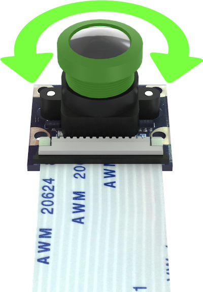
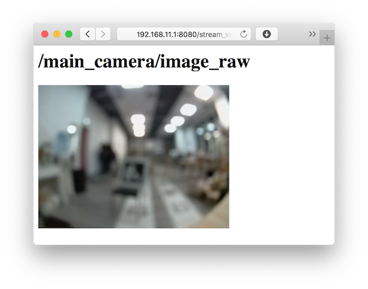
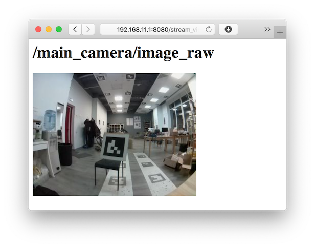

# Настройка камеры

Перед первыми полётами с компьютерным зрением нужно настроить фокус камеры и откалибровать её. Без этого дрон не сможет точно определять своё положение по ArUco-маркерам.

- настраивать резкость объектива
- проверять правильное положение камеры
- запускать калибровку и получать файл с параметрами камеры

---

## Что такое калибровка и зачем она нужна

!!! Поправить формулировки !!!

Каждая камера немного «кривая» — линза искажает изображение. Если посмотреть на прямую линию через край кадра, она может казаться чуть изогнутой. Для человека это почти незаметно, но для программы, которая вычисляет расстояние до маркера, это важная погрешность.

Калибровка — это процесс измерения этих искажений, чтобы потом исправлять их в программе. В результате получается файл `latest_calibration.yaml` с матрицей камеры K и коэффициентами дисторсии.

!!! Название файла поменять взять описание выходного файла из sverk_ws\src\sverk_drone\peripheral\camera_calibration !!!

---

## Настройка фокуса

Камера Обрика имеет регулируемый фокус: объектив можно вращать вручную.



1. Включите Обрик и откройте веб-интерфейс по IP-адресу в браузере.
2. Перейдите в раздел просмотра изображения с камеры.
3. Положи под камеру любой объект с мелкими деталями на расстоянии 1-2 м (примерно на высоте полёта).
4. Вращайте объектив до получения максимальной резкости.

> **Примечание** Удобнее делать вдвоём: один вращает объектив, второй смотрит на экран.

Ориентируйся на резкость мелких деталей: слева — расфокусированное изображение, справа — правильно сфокусированное.

|Расфокусированное изображение|Сфокусированное изображение|
|-|-|
|||

---

## Положение камеры

Камера должна смотреть строго вниз, перпендикулярно земле. Проверьте крепление и при необходимости поправь угол. Если камера наклонена, система навигации будет неправильно вычислять высоту.

---

## Калибровка камеры

Для калибровки используется пакет `camera_calibration` из репозитория.

> **Примечание** Два способа калибровки. Ниже — быстрый вариант через команды в терминале (`ros2 service call`): удобно для разовой калибровки прямо на месте. Если нужна основательная работа, те же шаги доступны из Python через `drone.image.calibration` (`set_config`, `capture`, `calibrate`, `save`…) — подробно с примерами в разделе [Калибровка камеры (Python API)](camera-calibration.md).

### Что понадобится

Распечатайте одну из калибровочных досок из папки:
```
peripheral/camera_calibration/boards_examples_a4/
```

Или создайте свою на сайте [calib.io](https://calib.io/pages/camera-calibration-pattern-generator).

### Проверьте камеру перед стартом

Убедитесь, что камера работает:

```bash
ros2 topic list | grep image
```

> **Примечание** Эти команды выполняются **внутри контейнера** `sverk_ros2`. Устройства видны благодаря пробросу `/dev` через docker compose.

> **Примечание** Драйвер CSI-камеры зависит от платы (RPi CM5 — `cam0`, Orange Pi Zero 3W — `vin_v4l2`, Orange Pi 5 Pro — `rkisp1`), но ROS 2 топик `/camera_1/image_raw` одинаков на всех — код от платы не зависит. Полная таблица интерфейсов по платам → [Бортовые компьютеры](knowledge_base/boards-overview.md).

Откройте веб-интерфейс и убедитесь, что изображение с камеры приходит. Если изображения нет, калибровку начинать не стоит: сначала проверьте драйвер камеры.

### Запуск

```bash
cd ~/sverk_ws
source install/setup.bash
ros2 launch camera_calibration calibration.launch.py
```

Если нужно указать свой топик камеры или папку для сохранения:

```bash
ros2 launch camera_calibration calibration.launch.py image_topic:=/camera/image_raw output_dir:=~/camera_calibrations
```

По умолчанию результаты сохраняются в `~/camera_calibrations`.

> **Примечание** Команды калибровки ниже — это **утилиты настройки**, не управление полётом. Их запускают один раз из терминала. То же самое можно сделать из Python через `drone.image.calibration` — см. [Калибровка камеры (Python API)](camera-calibration.md).

### Проверка состояния ноды

```bash
ros2 service call /calibration/get_state camera_calibration/srv/GetState "{}"
```

Если сервис недоступен, подождите несколько секунд и попробуйте снова.

### Порядок калибровки

**Шаг 1.** Начните новую сессию:

```bash
ros2 service call /calibration/start_session std_srvs/srv/Trigger "{}"
```

Если нужно полностью сбросить начатую сессию:

```bash
ros2 service call /calibration/reset_session std_srvs/srv/Trigger "{}"
```

**Шаг 2.** Задайте параметры калибровочной доски.

Пример для шахматной доски (10x7 клеток, размер клетки 22 мм):

```bash
ros2 service call /calibration/set_config camera_calibration/srv/SetCalibrationConfig \
"{board_type: 'chessboard', camera_model: 'pinhole', board_width: 10, board_height: 7, square_size: 0.022, marker_size: 0.0, aruco_dict: '', min_frames: 15, save_captures: true}"
```

Пример для доски ChArUco (это шахматная доска с ArUco-маркерами внутри, удобна при плохом освещении):

```bash
ros2 service call /calibration/set_config camera_calibration/srv/SetCalibrationConfig \
"{board_type: 'charuco', camera_model: 'pinhole', board_width: 11, board_height: 8, square_size: 0.022, marker_size: 0.016, aruco_dict: 'DICT_4X4_50', min_frames: 10, save_captures: true}"
```

Пример для круговой сетки:

```bash
ros2 service call /calibration/set_config camera_calibration/srv/SetCalibrationConfig \
"{board_type: 'circles', camera_model: 'pinhole', board_width: 11, board_height: 8, square_size: 0.022, marker_size: 0.0, aruco_dict: '', min_frames: 10, save_captures: true}"
```

**Шаг 3.** Включите автоматический захват кадров (раз в 2 секунды):

```bash
ros2 service call /calibration/set_auto_capture camera_calibration/srv/SetAutoCapture \
"{enable: true, period_sec: 2.0}"
```

Или захватывайте кадры вручную по одному:

```bash
ros2 service call /calibration/capture std_srvs/srv/Trigger "{}"
```

Нода публикует превью в топик `/calibration/processed_image` — откройте его в веб-интерфейсе, чтобы видеть, как находится доска.

**Шаг 4.** Медленно перемещайте доску перед камерой. Нужно набрать минимум 15 кадров, в которых доска:
- находится под разными углами
- смещена в разные части кадра
- видна полностью и не размыта
- находится на разном расстоянии от камеры

Не сохраняйте много почти одинаковых кадров.

**Шаг 5.** Отключите автозахват:

```bash
ros2 service call /calibration/set_auto_capture camera_calibration/srv/SetAutoCapture \
"{enable: false, period_sec: 1.0}"
```

**Шаг 6.** Если часть кадров неудачная, посмотрите список:

```bash
ros2 service call /calibration/list_captures camera_calibration/srv/ListCaptures "{}"
```

Удалите плохой кадр по индексу:

```bash
ros2 service call /calibration/remove_capture camera_calibration/srv/RemoveCapture "{index: 0}"
```

**Шаг 7.** Запустите калибровку:

```bash
ros2 service call /calibration/calibrate std_srvs/srv/Trigger "{}"
```

**Шаг 8.** Сохраните результат:

```bash
ros2 service call /calibration/save std_srvs/srv/Trigger "{}"
```

Файл `latest_calibration.yaml` сохранится в директорию, указанную при запуске ноды (по умолчанию `~/camera_calibrations`).

---

## Как понять, что калибровка хорошая

После калибровки система выводит среднеквадратичную ошибку репроекции (RMS error). Это число показывает, насколько точно модель описывает реальную камеру.

- **RMS < 1.0 пикселя** — хорошая калибровка, можно использовать.
- **RMS 1.0-1.5 пикселя** — приемлемо, но лучше повторить с более разнообразными кадрами.
- **RMS > 1.5 пикселя** — плохо. Удалите размытые или некачественные кадры через `/calibration/remove_capture`, добавьте новые с разных ракурсов и повторите калибровку.
