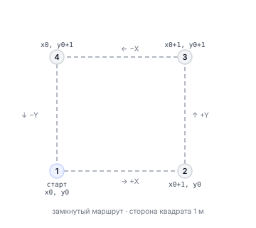

# Примеры кода

Здесь собраны рабочие Python-программы для управления Обриком. Каждый пример можно запустить напрямую. Все используют одну и ту же библиотеку `sverk_interfaces`.

Все программы строятся по одному шаблону:

```python
import sverk_interfaces

drone = sverk_interfaces.init(Nodename="my_program")
try:
    # весь код полёта здесь
    pass
finally:
    drone.close()  # выполнится даже при ошибке или Ctrl+C
```

---

## Взлёт и посадка

**Что мы делаем:** дрон взлетает на 1.5 м, летит вперёд на 1 м, садится.

```python
import time
import sverk_interfaces

drone = sverk_interfaces.init(Nodename="takeoff_land")
try:
    # взлёт на 1.5 м относительно корпуса, auto_arm=True — сам заармируется
    drone.control.navigate(
        x=0.0, y=0.0, z=1.5,    # точка: 0 м вперёд, 0 м влево, 1.5 м вверх
        yaw=0.0,                  # не менять курс
        speed=0.5,                # скорость 0.5 м/с
        frame_id="body",          # относительно корпуса
        auto_arm=True             # взлетайте сам
    )
    time.sleep(10.0)              # ждём 10 секунд (дрон набирает высоту)

    # полёт на 1 м вперёд, не меняя высоту
    drone.control.navigate(
        x=1.0, y=0.0, z=0.0,     # 1 м вперёд, высота не меняется
        yaw=0.0, speed=0.5,
        frame_id="body",
        auto_arm=False            # уже заармирован
    )
    time.sleep(5.0)               # ждём 5 секунд

    drone.control.land()         # посадка
finally:
    drone.close()
```

После запуска: дрон поднимается, ждёт, летит вперёд, садится. Если нажать Ctrl+C — `finally` всё равно вызовет `close()`.

---

## Монитор телеметрии

**Что мы делаем:** выводим данные о дроне каждые 0.5 секунды. Остановка по Ctrl+C.

```python
import time
import sverk_interfaces

drone = sverk_interfaces.init(Nodename="telemetry_monitor")
try:
    while True:
        # запрашиваем телеметрию в мировой системе координат
        t = drone.control.get_telemetry(frame_id="map")

        # выводим всё интересное
        print(
            f"connected={t.connected} armed={t.armed} mode={t.mode} "
            f"pos=({t.x:.2f}, {t.y:.2f}, {t.z:.2f}) yaw={t.yaw:.2f} "
            f"vel=({t.vx:.2f}, {t.vy:.2f}, {t.vz:.2f}) "
            f"bat={t.voltage:.1f}V"
        )
        time.sleep(0.5)           # пауза 0.5 секунды между запросами
except KeyboardInterrupt:
    pass                          # Ctrl+C — выходим из цикла
finally:
    drone.close()
```

Пример вывода:
```
connected=True armed=False mode=MANUAL pos=(0.00, 0.00, 0.00) yaw=0.00 vel=(0.00, 0.00, 0.00) bat=12.4V
```

---

## Полёт по квадрату

**Что мы делаем:** взлетаем, облетаем квадрат 1x1 м в мировой системе координат, садимся.

```python
import time
import sverk_interfaces

side = 1.0   # сторона квадрата в метрах
z = 1.0      # высота полёта в метрах

drone = sverk_interfaces.init(Nodename="square_mission")
try:
    # узнаём, где мы сейчас (чтобы потом вернуться)
    start = drone.control.get_telemetry(frame_id="map")
    x0, y0 = start.x, start.y    # стартовые координаты

    # взлёт и ожидание прилёта в стартовую точку
    drone.control.navigate_wait(
        x=x0, y=y0, z=z,
        yaw=start.yaw, speed=0.5,
        frame_id="map",
        auto_arm=True,
        tolerance=0.25,           # считаем «прилетел», если ближе 0.25 м
        timeout=60.0              # не ждать дольше минуты
    )

    # четыре угла квадрата относительно старта
    waypoints = [
        (x0 + side, y0),          # правый нижний угол
        (x0 + side, y0 + side),   # правый верхний
        (x0, y0 + side),          # левый верхний
        (x0, y0),                 # возврат в старт
    ]

    for x, y in waypoints:
        # летим к следующей точке и ждём
        drone.control.navigate_wait(
            x=x, y=y, z=z,
            yaw=start.yaw, speed=0.5,
            frame_id="map",
            auto_arm=False,
            tolerance=0.25, timeout=60.0
        )
        time.sleep(1.0)           # зависаем на секунду в каждом углу

    drone.control.land()
finally:
    drone.close()
```

Маршрут дрона:



---

## Полёт по кругу

**Что мы делаем:** взлетаем, затем летим по кругу через частое обновление цели через `set_position`.

```python
import math
import time
import sverk_interfaces

radius = 0.6    # радиус круга в метрах
omega = 0.3     # угловая скорость (рад/с) — скорость облёта
duration = 20   # сколько секунд летим по кругу

drone = sverk_interfaces.init(Nodename="circle_trajectory")
try:
    # взлёт
    drone.control.navigate(
        x=0.0, y=0.0, z=1.5,
        yaw=0.0, speed=0.5,
        frame_id="body",
        auto_arm=True
    )
    time.sleep(10.0)              # ждём набора высоты

    # запоминаем центр круга
    start = drone.control.get_telemetry(frame_id="map")
    target_z = start.z            # летим на той же высоте

    # цикл: 10 раз в секунду обновляем целевую точку
    start_time = time.monotonic()
    dt = 1.0 / 10.0              # интервал 0.1 с = 10 Гц

    while time.monotonic() - start_time < duration:
        t = time.monotonic() - start_time
        angle = omega * t         # текущий угол на окружности
        # считаем новую точку на окружности
        x = start.x + math.sin(angle) * radius
        y = start.y + math.cos(angle) * radius

        # задаём цель — нода offboard_control сразу летит туда
        drone.control.set_position(
            x=x, y=y, z=target_z,
            yaw=start.yaw,
            frame_id="map",
            auto_arm=False
        )
        time.sleep(dt)            # пауза 0.1 с

    drone.control.land()
finally:
    drone.close()
```

---

## Полёт по кубу

**Что мы делаем:** взлетаем, облетаем нижний и верхний квадрат куба относительно корпуса.

Это упрощённая версия `test_fly_cube.py` — оригинал в `offboard_control/examples/`.

```python
import time
import sverk_interfaces

SIDE = 0.5     # сторона куба в метрах
HEIGHT = 0.5   # высота куба в метрах
SPEED = 0.5    # скорость в м/с
DELAY = 5      # секунд между точками

drone = sverk_interfaces.init(Nodename="cube_mission")
try:
    # взлёт на 0.5 м
    drone.control.navigate(
        x=0.0, y=0.0, z=0.5,
        yaw=0.0, speed=1.0,
        frame_id="body", auto_arm=True
    )
    time.sleep(15)               # ждём взлёта

    # точки нижнего и верхнего квадрата
    # каждая точка — смещение ОТНОСИТЕЛЬНО ПРЕДЫДУЩЕЙ (frame_id='body')
    cube_points = [
        # нижний квадрат
        (SIDE, 0.0, 0.0),        # вперёд
        (0.0, SIDE, 0.0),        # влево
        (-SIDE, 0.0, 0.0),       # назад
        (0.0, -SIDE, 0.0),       # вправо (замкнули квадрат)
        # переход на верхний уровень
        (0.0, 0.0, HEIGHT),      # вверх
        # верхний квадрат
        (SIDE, 0.0, 0.0),
        (0.0, SIDE, 0.0),
        (-SIDE, 0.0, 0.0),
        (0.0, -SIDE, 0.0),
        # вниз
        (0.0, 0.0, -HEIGHT),
    ]

    for i, (x, y, z) in enumerate(cube_points):
        drone.control.navigate(
            x=x, y=y, z=z,
            yaw=0.0, speed=SPEED,
            frame_id="body"       # каждое смещение — относительно текущей позиции
        )
        time.sleep(DELAY)        # ждём прилёта в точку

    drone.control.land()
finally:
    drone.close()
```

---

## Дизарм и калибровка

**Что мы делаем:** показываем команды безопасности. Калибровки всегда выполняются на земле, до полёта.

```python
import sverk_interfaces

drone = sverk_interfaces.init(Nodename="safety_tools")
try:
    # штатное выключение моторов (только когда дрон на земле)
    resp = drone.fcu.disarm()
    print("disarm:", resp.success, resp.message)

    # калибровка датчиков (до полёта, дрон стоит неподвижно)
    drone.fcu.calibrate_gyro()    # гироскоп — стоять неподвижно
    drone.fcu.calibrate_accel()   # акселерометр — потребует 6 положений
    drone.fcu.calibrate_level()   # горизонт — поставить ровно

    # аварийное отключение (только в экстренных ситуациях!)
    # drone.fcu.kill_switch()
finally:
    drone.close()
```

---

## Диагностика из терминала

Для просмотра данных и отладки (не управления) можно использовать команды ROS 2:

```bash
# смотреть сырые данные PX4
ros2 topic echo /fmu/out/vehicle_status

# с какой частотой работает камера
ros2 topic hz /camera_1/image_raw

# список всех активных топиков
ros2 topic list

# список всех сервисов
ros2 service list
```

> **Примечание** Эти команды выполняются **внутри контейнера** `sverk_ros2`.

> **Примечание** Полные примеры вызовов сервисов из терминала (для глубокой отладки) → [база знаний: ros2-raw.md](knowledge_base/ros2-raw.md)

---

## Запуск готовых примеров из репозитория

```bash
cd ~/sverk_ws
source install/setup.bash

# взлёт, 1 м вперёд, посадка
python3 src/sverk_drone/sverk_interfaces/examples/simple_takeoff_land.py

# квадрат в плоскости map
python3 src/sverk_drone/sverk_interfaces/examples/square_mission.py

# куб в системе body
python3 src/sverk_drone/sverk_interfaces/examples/cube_mission.py

# полёт по кругу
python3 src/sverk_drone/sverk_interfaces/examples/circle_trajectory.py

# монитор телеметрии
python3 src/sverk_drone/sverk_interfaces/examples/telemetry_monitor.py

# проверка калибровок и дизарма
python3 src/sverk_drone/sverk_interfaces/examples/safety_and_calibration.py
```
