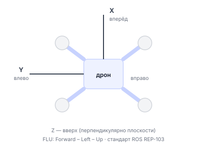
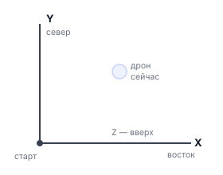

# Системы координат

Когда вы говорите дрону «лети в точку (1, 0, 1.5)» — он спросит: «Относительно чего?». Один метр вперёд от корпуса — это не то же самое, что один метр на восток от точки старта. Для этого в Обрике используют несколько систем координат, и каждая подходит для своей задачи.

---

## Основные системы координат

| frame_id | Описание |
|----------|----------|
| `body` | Связана с корпусом дрона: X — вперёд, Y — влево, Z — вверх |
| `map` | Локальная навигационная система PX4, представленная в ROS как ENU |
| `terrain` | Высота относительно поверхности прямо под дроном |
| `aruco_map` | Система координат карты ArUco-маркеров |
| `aruco_<N>` | Координаты относительно конкретного маркера (N — его ID) |

---

## body — «куда я смотрю»

Система координат `body` привязана к корпусу дрона. Куда повёрнут нос — туда и смотрит ось X.



По [соглашению ROS (REP-103)](http://www.ros.org/reps/rep-0103.html) тело дрона использует FLU-ориентацию: Forward-Left-Up. Это означает: X вперёд, Y влево, Z вверх.

Когда использовать `body`:
- Взлёт на нужную высоту (x=0, y=0, z=1.5)
- Движение «вперёд по курсу», не зная GPS-координат
- Простые манёвры: «отлети на 2 метра вперёд, потом поверни»

```python
# взлёт на 1.5 м — вверх относительно корпуса
drone.control.navigate(x=0.0, y=0.0, z=1.5, yaw=0.0, speed=0.5, frame_id="body")

# полёт на 1 м вперёд, сохраняя курс (yaw=0 = не менять курс в body)
drone.control.navigate(x=1.0, y=0.0, z=0.0, yaw=0.0, speed=0.5, frame_id="body")
```

Важно: при `frame_id='body'` и `yaw=0.0` курс дрона НЕ меняется. Он летит вперёд, не поворачиваясь.

---

## map — «где я на карте»

`map` — локальная оценка PX4 EKF2, преобразованная из NED в ROS ENU: X —
восток, Y — север, Z — вверх. `offboard_control` строит TF `map→base_link` по
`/fmu/out/vehicle_odometry`. Начало координат задаётся при инициализации PX4;
дрейф и сбросы EKF2 отражаются в `map`.



Когда использовать `map`:
- Облёт квадрата с фиксированными углами
- Возврат в точку старта
- Миссии с конкретными GPS-координатами

```python
import sverk_interfaces

drone = sverk_interfaces.init(Nodename="square_demo")

# сначала узнаём, где мы сейчас
start = drone.control.get_telemetry(frame_id="map")
x0, y0 = start.x, start.y

# взлёт на 1 м
drone.control.navigate_wait(x=x0, y=y0, z=1.0, frame_id="map", auto_arm=True)

# летим к точке в 1 м на восток от старта
drone.control.navigate_wait(x=x0 + 1.0, y=y0, z=1.0, frame_id="map")

drone.control.land()
drone.close()
```

---

## terrain — «сколько метров до пола»

Система координат `terrain` задаёт высоту относительно поверхности прямо под дроном. Удобна, когда пол неровный или нужно держать постоянную высоту над объектами.

```python
# держаться на 1.5 м над землёй, даже если рельеф меняется
drone.control.set_altitude(z=1.5, frame_id="terrain")
```

---

## aruco_map — «где я относительно маркеров»

`aruco_map` задаётся координатами и ориентациями маркеров в файле карты. Его
ноль не связан с местом включения дрона или ID маркера.

`aruco_loc` вычисляет позу камеры в `aruco_map`. `aruco_tf` учитывает положение
камеры на корпусе и offset `map→aruco_map`, затем публикует позу корпуса в
`/aruco/world_pose` для PX4 external vision.

При `initialize_at_origin=true` первая устойчивая ArUco-поза становится
локальным `(0,0,0)` с нулевым yaw. При `false` она совмещается с текущей позой
PX4 в `map`.

```python
# лететь в точку (1, 2) общего aruco_map; используйте только если этот TF
# опубликован и миссия действительно задана в абсолютной карте маркеров
drone.control.navigate(x=1.0, y=2.0, z=1.0, yaw=0.0, speed=0.5, frame_id="aruco_map")
```

---

## aruco_N — относительно конкретного маркера

Если нужно зависнуть прямо над маркером с ID=5:

```python
# лететь к центру маркера 5, на 0.5 м выше него
drone.control.navigate(x=0.0, y=0.0, z=0.5, yaw=0.0, speed=0.3, frame_id="aruco_5")
```

---

## Как это работает внутри — tf2

За пересчёт координат между системами отвечает пакет [tf2](https://docs.ros.org/en/humble/Tutorials/Intermediate/Tf2/Tf2-Main.html). Основная цепочка ArUco выглядит так:

```text
map → aruco_map                     сохранённый offset координат
map → base_link                     текущая оценка PX4
map → base_link_aruco               независимое измерение ArUco
base_link → camera_optical_1        положение камеры на корпусе
aruco_map → aruco_<id>              известные положения маркеров
```

`map→base_link` приходит из PX4. `map→base_link_aruco` — измерение ArUco,
которое после ENU/FLU→NED/FRD преобразования отправляется в EKF2.

Нода `offboard_control` сама делает все нужные пересчёты. Когда вы вызываете `navigate(frame_id='body')`, нода через tf2 переводит координаты в мировую систему и отправляет в PX4.

Посмотреть текущую позицию в нужной системе координат:

```python
t = drone.control.get_telemetry(frame_id="map")    # в мировой
t = drone.control.get_telemetry(frame_id="aruco_map")  # относительно маркеров
```

3D-визуализацию всех систем координат можно посмотреть в RViz — там видно, как фреймы двигаются вместе с дроном.

---

## Таблица: что выбрать для задачи

| Задача | frame_id |
|--------|----------|
| Взлёт/посадка | `body` |
| Движение «вперёд на 2 м» | `body` |
| Облёт квадрата с фиксированными точками | `map` |
| Удержание высоты над неровным полом | `terrain` |
| Посадка по ArUco-маркеру | `aruco_<N>`; `aruco_map`, если используется общая абсолютная карта |
| Полёт по заранее известным координатам | `map` |
