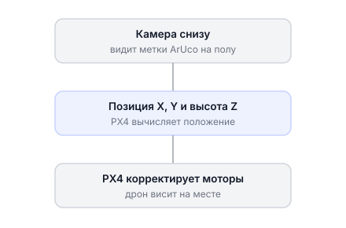
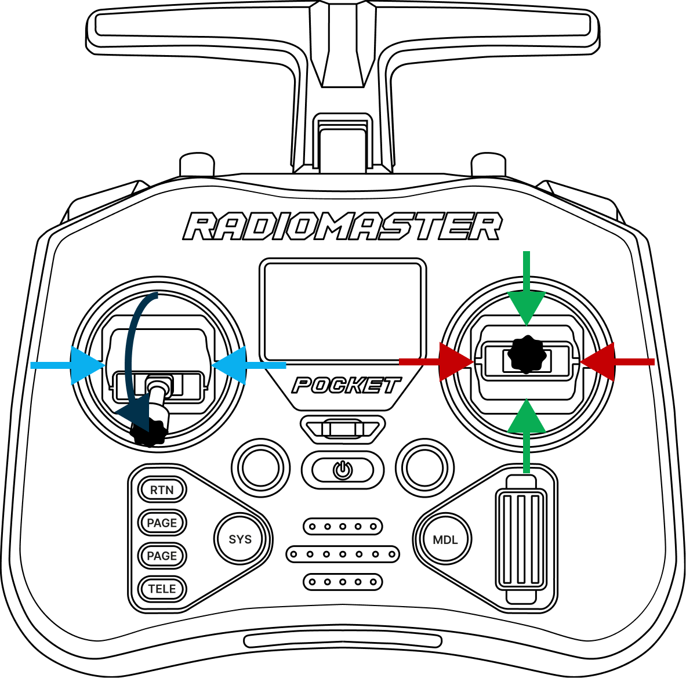
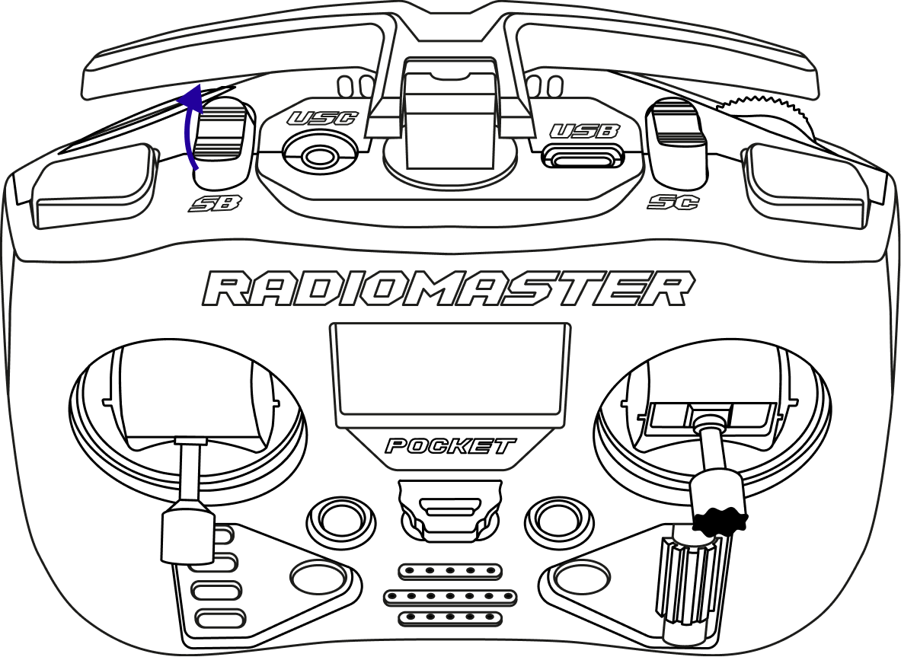
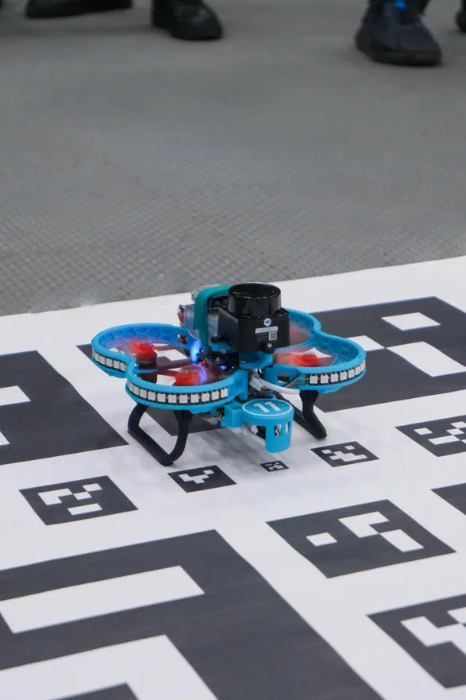
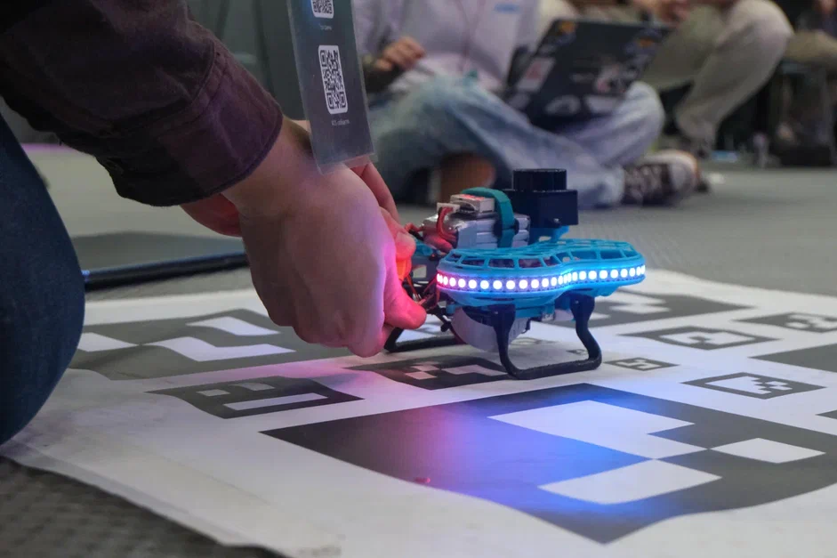
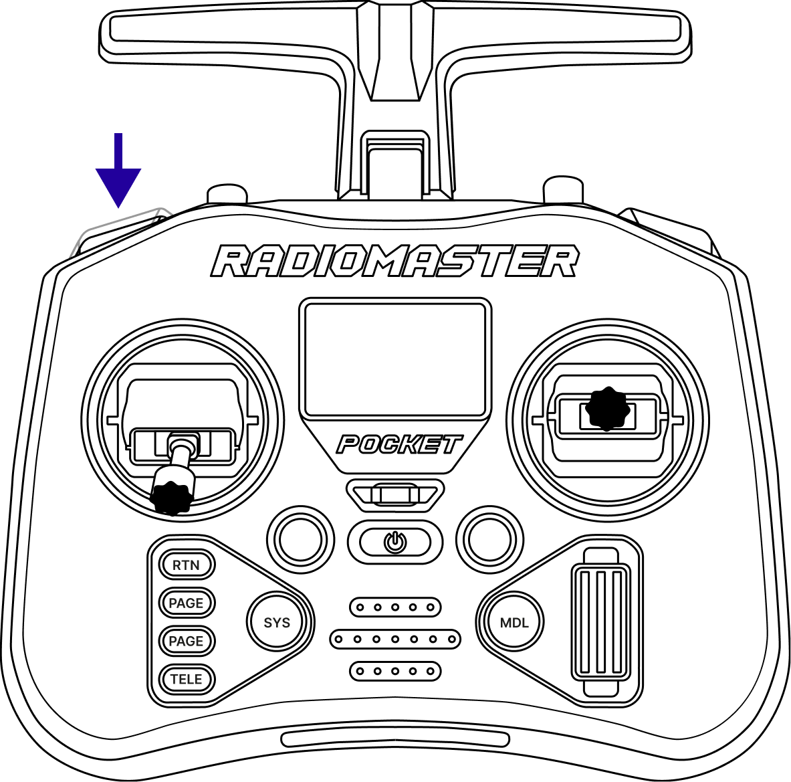
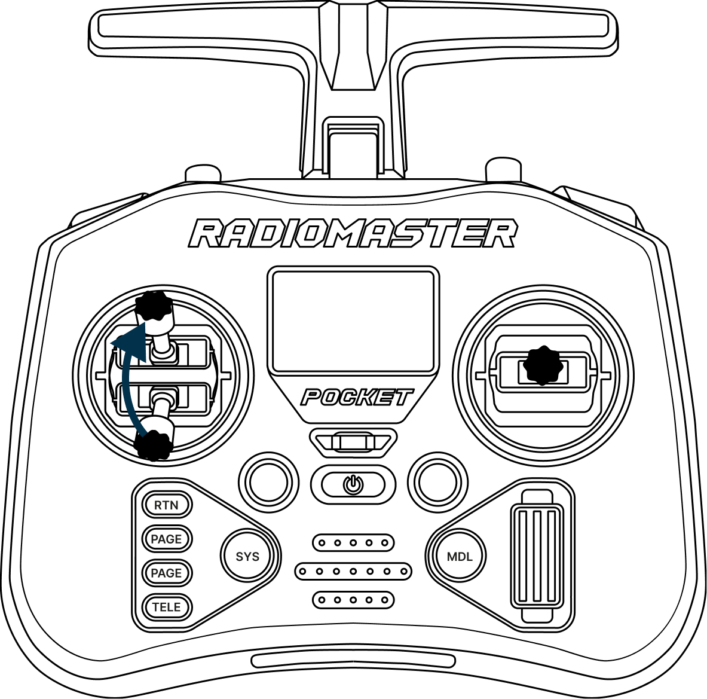

# Полёт в режиме Position

Режим Position удерживает Обрик в точке по данным камеры нижнего обзора и ArUco-меток. Этот раздел описывает первый реальный полёт — от включения пульта до посадки.

!!! Стоит пометить что Position работает не только по данным с Aruco а впринципе по всем данным которые принимает фильтр калмана (датчики и Aruco работают в симбиозе) !!!

> **Внимание** Обязательно прочитайте [правила техники безопасности](safety.md) перед первым полётом, если ещё не сделали этого.

---

## Режим Position

В режиме **Position** Обрик использует данные с камеры нижнего обзора и ArUco-маркеров, чтобы точно знать своё положение в пространстве. Это позволяет дрону висеть на месте без вашего участия — он сам компенсирует ветер и другие воздействия.

Именно поэтому режим Position — лучший для первого полёта и обязательный шаг перед автономным программированием.

---

## Подготовка к полёту

Выполняйте шаги строго по порядку:

**Шаг 1.** Включите аппаратуру управления → [Как включить пульт](transmitter-bind.md)

**Шаг 2.** Переведите **левый стик вниз**, правый — в центральное положение.

> **Подсказка** Левый стик вниз = газ на нуле. Это безопасное положение для подключения батареи.

**Шаг 3.** Переведите переключатель **SB** в положение **Position** (как было настроено в разделе [Настройка аппаратуры управления](transmitter-calibration.md)).

**Шаг 4.** Установите Обрик на точку взлёта — в центре поля ArUco-меток.

**Шаг 5.** Подключите [АКБ](knowledge_base/battery-li-po.md).

**Шаг 6.** Дождитесь полного включения Обрика.

> **Подсказка** Обрик полностью включён, когда в списке Wi-Fi сетей появилась его точка доступа.

---

## Запуск и взлёт

Познакомьтесь с кнопками пульта перед взлётом:

| Кнопка | Назначение |
|--------|-----------|
| **SA** | Arm / Disarm — запуск / остановка моторов |
| **SB** | Выбор режима полёта (Position / Altitude / Stabilized) |
| **SD** | Kill Switch — **экстренное** отключение моторов |

> **Внимание** Перед взлётом убедитесь, что кнопка **SD (Kill Switch)** отжата — она не должна быть заблокирована в нажатом положении.

---

**Arm (запуск моторов):**

Нажмите и отпустите кнопку **SA (Arm)** — моторы начнут вращаться на минимальных оборотах.

> **Внимание** Кнопка SA должна заблокироваться в нажатом положении — это значит, что Arm активен.

---

**Взлёт:**

Плавно поднимите **левый стик (Throttle)** вверх. Обрик взлетит и автоматически зависнет на высоте около 1 метра — режим Position сам удержит его.

---

**Управление в воздухе:**

Попробуйте немного подвигать **правым стиком (Pitch/Roll)**. Обрик будет двигаться в пространстве, а при отпускании стика — снова зависать на месте.

> **Внимание** Не улетайте далеко от поля ArUco-меток. Если камера перестанет видеть метки, Обрик потеряет ориентацию и может вести себя непредсказуемо.

---

## Посадка и выключение

Выполняйте строго по порядку:

**Шаг 1.** Плавно опустите **левый стик (Throttle) вниз** до полной посадки. Не торопитесь — дайте дрону мягко сесть.

**Шаг 2.** Нажмите и отпустите кнопку **SA (Disarm)**.

> **Внимание** Кнопка SA должна выйти из заблокированного положения — моторы остановятся.

**Шаг 3.** В целях безопасности нажмите и отпустите кнопку **SD (Kill Switch)**.

> **Внимание** Кнопка SD должна заблокироваться в нажатом положении.

**Шаг 4.** Отключите АКБ.

**Шаг 5.** Выключите аппаратуру управления.
