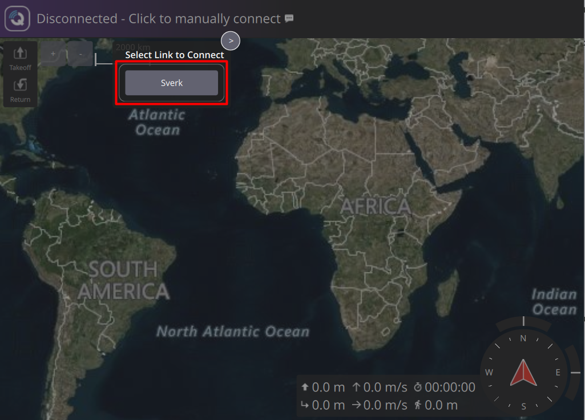
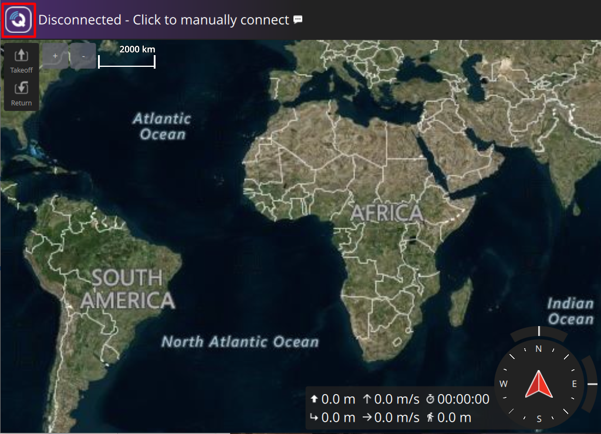
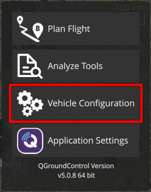
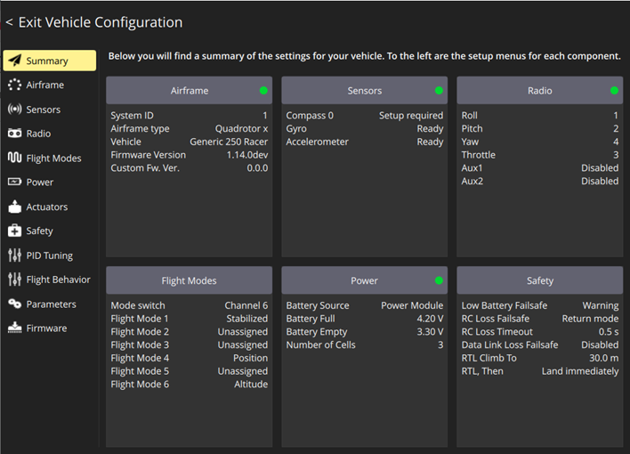
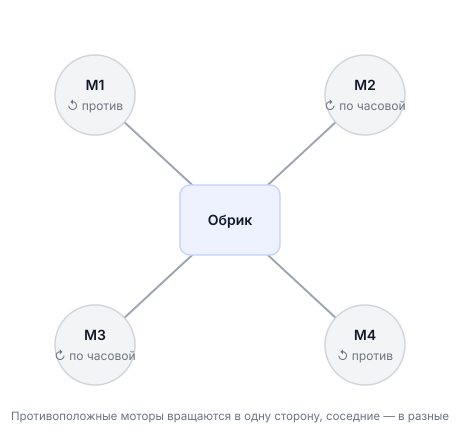

# Настройка полётного контроллера

Раздел Vehicle Configuration в QGC содержит основные настройки полётного контроллера. Этот раздел описывает каждый его пункт, который нужно пройти перед первым полётом.

!!! Не хватает картинки из QGC с выбором Airframe для обрика !!!
---

## Перед началом — скачайте нужное заранее

Во время настройки через Wi-Fi Обрика у вас **не будет интернета**. Поэтому заранее:

- Скачайте и установите [QGroundControl (QGC)](https://docs.qgroundcontrol.com/master/en/qgc-user-guide/getting_started/download_and_install.html)
- Скачайте [файл с базовыми параметрами](https://drive.google.com/file/d/1392MPugvBD1SA4eytPBsy4nv05whPwLh/view?usp=drive_link) полётного контроллера

> **Примечание** QGC (QGroundControl) — программа для настройки и мониторинга дрона. Подробнее о подключении к ней читайте в [предыдущем разделе](qgc-wifi.md).

---

## Подготовка

Перед открытием QGC убедитесь, что:

- В Обрике вставлена SD-карта (PX4 сохраняет логи на неё)
- Обрик подключён к QGC по Wi-Fi

---

## Открываем Vehicle Configuration

1. Нажмите на **логотип QGC** в левом верхнем углу

2. Выберите **Vehicle Configuration**

---

## Что внутри Vehicle Configuration

Перед вами откроется список вкладок. Каждая отвечает за свою часть настройки:

| Вкладка | Что делает |
|---------|-----------|
| **Summary** | Общий статус: зелёный маркер — система настроена, красный — требует внимания |
| **Airframe** | Тип летательного аппарата — сообщаем PX4, что перед ним квадрокоптер |
| **Sensors** | Калибровка датчиков: гироскоп, акселерометр, компас, уровень горизонта |
| **Radio** | Калибровка пульта управления (RadioMaster Pocket) |
| **Flight Modes** | Назначаем режимы полёта на переключатели пульта |
| **Power** | Настройка батареи: количество ячеек, пороги напряжения |
| **Parameters** | Все параметры PX4 вручную — для опытных пользователей |

### Вкладка Summary — ваша «приборная панель»

Вкладка **Summary** — первое, что стоит проверять перед полётом. Зелёный маркер рядом с пунктом означает «настроено», красный — «нужна настройка».

### Вкладка Airframe — тип платформы

Здесь нужно выбрать **Quadrotor x** и найти профиль Обрика. Это говорит PX4, как управлять моторами: сколько их, где они расположены, как они вращаются.

