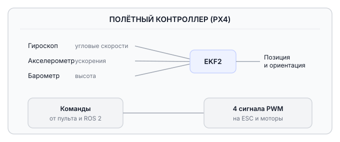
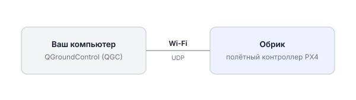

# Взаимодействие с полётным контроллером

Полётный контроллер на прошивке PX4 отвечает за стабилизацию дрона в воздухе. Этот раздел описывает его настройку и подготовку Обрика к первому полёту.

---

## Назначение полётного контроллера

Полётный контроллер удерживает дрон в равновесии: считывает данные с датчиков, вычисляет положение в пространстве и управляет моторами через регуляторы оборотов (ESC).

!!! Схема странная и не понятная нужно переделать !!!

**EKF2** (Extended Kalman Filter 2) — алгоритм внутри PX4, который объединяет данные всех датчиков и вычисляет положение дрона. Если один датчик даёт погрешность, EKF2 компенсирует её за счёт остальных.

---

## Настройка через QGroundControl

Настройка выполняется через программу **QGroundControl (QGC)**. Она подключается к Обрику по Wi-Fi и позволяет менять параметры, калибровать датчики и следить за состоянием дрона.

---

## Этапы настройки

Пройдите эти этапы по порядку при первой настройке Обрика. В дальнейшем повторять их не нужно — только если параметры сбились.

### 1. Подключение к QGroundControl

Включите Обрик, подключитесь к его Wi-Fi сети и настройте соединение QGC с полётным контроллером.

→ [Подключение к QGroundControl](qgc-wifi.md)

---

### 2. Настройка аппаратуры управления

Настройте пульт RadioMaster Pocket: вставьте аккумуляторы, загрузите профиль, выполните сопряжение с Обриком.

→ [Настройка аппаратуры управления](transmitter-bind.md)

---

### 3. Настройка полётного контроллера

Откройте QGC и перейдите в Vehicle Configuration для базовой настройки — тип рамы, порядок пропеллеров и другие базовые параметры.

→ [Настройка полётного контроллера](flight-controller-setup.md)

---

### 4. Загрузка параметров

Вместо долгой ручной настройки можно загрузить готовый файл параметров, специально подготовленный для Обрика.

→ [Загрузка параметров](params-upload.md)

---

### 5. Калибровка датчиков

Откалибруйте гироскоп, акселерометр и горизонт — это нужно делать при первом запуске или после сильных ударов.

> **Подсказка** Калибровка компенсирует заводскую погрешность датчиков: она задаёт PX4 точку отсчёта горизонтали для конкретного дрона.

!!! Она еще правит дефекты и неточности сборки (становка полетного контроллера, изготовка узлов, полежние компонентов и развесовка) !!!

→ [Калибровка датчиков](sensor-calibration.md)

---

### 6. Калибровка аппаратуры управления

Откалибруйте стики и назначьте режимы полёта и Kill Switch на переключатели пульта.

→ [Калибровка аппаратуры управления](transmitter-calibration.md)

---

### 7. Настройка питания

Настройте параметры мониторинга АКБ — чтобы PX4 знал уровень заряда и предупреждал о разрядке.

→ [Настройка питания](battery-settings.md)
