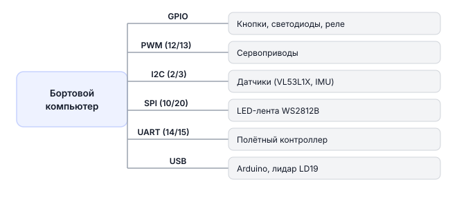

# Подключение внешних устройств к Обрику

К бортовому компьютеру Обрика можно подключать самую разную периферию: кнопки, концевики, реле, электромагниты, индикаторы, Arduino-устройства, датчики по I2C и SPI.

На этой странице описаны все доступные интерфейсы. Для конкретных устройств есть отдельные подробные страницы:

- [Лазерные дальномеры VL53L1X](sensor-vl53l1x.md)
- [Сервоприводы](servo-control.md)

---

!!! Схема странная !!!

## Схема интерфейсов



---

Управление цифровыми пинами (OUTPUT/INPUT) из Python — в статье [Работа с GPIO](gpio.md).

---

## PWM — управление сервоприводами

**PWM** (Широтно-импульсная модуляция) — способ управлять мощностью через быстрое включение/выключение. Сервопривод понимает, в какое положение повернуться, по длительности импульса.

Подробнее: [Использование сервоприводов](servo-control.md)

---

## I2C — подключение датчиков

**I2C** — шина для датчиков, когда надо подключить несколько устройств к двум проводам. По одной паре (SDA + SCL) можно повесить несколько датчиков с разными адресами.

Проверить, что устройство видно на шине (диагностика):

```bash
# Покажет адреса всех подключённых I2C-устройств
i2cdetect -y 1
```

> **Примечание** Эти команды выполняются **внутри контейнера** `sverk_ros2`. Устройства видны благодаря пробросу `/dev` через docker compose.

**Что мы делаем:** сканируем шину I2C и печатаем адреса найденных устройств.

```python
import board
import busio

# Инициализируем шину I2C
i2c = busio.I2C(board.SCL, board.SDA)

# Захватываем шину перед работой
while not i2c.try_lock():
    pass

try:
    # Получаем список адресов всех подключённых устройств
    addresses = [hex(addr) for addr in i2c.scan()]
    print(f"Найдено устройств: {addresses}")
finally:
    i2c.unlock()  # освобождаем шину
```

Если подключаете лазерный дальномер VL53L1X — смотрите сюда: [Использование VL53L1X](sensor-vl53l1x.md)

---

## SPI — быстрый обмен данными

SPI используется, например, для LED-ленты. Сначала убедитесь, что устройство видно (диагностика):

```bash
# Должны появиться файлы /dev/spidev0.0 или похожие
ls /dev/spidev*
```

> **Примечание** Эти команды выполняются **внутри контейнера** `sverk_ros2`. Устройства видны благодаря пробросу `/dev` через docker compose.

> **Примечание** GPIO-контроллер одинаков на всех платах — `/dev/gpiochip0`. Различия по другим интерфейсам (UART, SPI, камера) → [Бортовые компьютеры](knowledge_base/boards-overview.md).

После этого используйте библиотеку, подходящую для вашего модуля.

---

## UART и USB — связь с Arduino

В системе доступны UART-интерфейсы и USB-порты для подключения Arduino и других последовательных устройств.

> **Примечание** Для подключения используйте `UART_B` — `UART_A` занят полётным контроллером PX4.

Проверить, что устройство подключено (диагностика):

```bash
ls /dev/ttyAMA*   # UART-порты бортового компьютера
ls /dev/ttyUSB*   # USB-serial адаптеры
ls /dev/ttyACM*   # Arduino по USB
```

> **Примечание** Эти команды выполняются **внутри контейнера** `sverk_ros2`. Устройства видны благодаря пробросу `/dev` через docker compose.

### Получение данных от Arduino через serial_bridge

Arduino данные приходят в ROS 2 через пакет `arduino-serial`. Нода-мост читает последовательный порт и публикует сообщения в топик. В программе подписываемся на этот топик через `drone.topic.subscribe()` — не нужно работать с портом напрямую.

**Что мы делаем:** подписываемся на данные от Arduino (например, показания датчика расстояния) и обрабатываем их в коллбэке.

```python
import time
import sverk_interfaces
from std_msgs.msg import String

drone = sverk_interfaces.init(Nodename="gpio_example")

def on_arduino_data(msg):
    """Вызывается при каждом сообщении от Arduino."""
    # msg.data — строка с данными, которые отправил Arduino
    print(f"Данные от Arduino: {msg.data}")

# Подписываемся на топик serial_bridge
# Топик '/serial/rx' — данные, пришедшие с Arduino в Обрик
sub = drone.topic.subscribe(String, '/serial/rx', on_arduino_data)

try:
    # Крутим спин 5 секунд, получаем данные
    end = time.time() + 5.0
    while time.time() < end:
        drone.topic.spin_once()
        time.sleep(0.01)
finally:
    drone.topic.unsubscribe(sub)
    drone.close()
```

**Отправить команду на Arduino** (публикуем в топик):

```python
import sverk_interfaces
from std_msgs.msg import String

drone = sverk_interfaces.init(Nodename="gpio_example")

# Создаём публикатор в топик '/serial/tx' — данные уйдут из Обрика на Arduino
pub = drone.topic.create_publisher(String, '/serial/tx')

msg = String()
msg.data = "ping\n"          # строка, которую получит Arduino
pub.publish(msg)

drone.close()
```

> **Примечание** Пакет `arduino-serial` должен быть запущен отдельно: `ros2 launch arduino-serial bridge.launch.py`. Смотрите [arduino-rosserial-tutorial.md](arduino-rosserial-tutorial.md).

---

!!! Странно сделаны подсказки !!!

> **Подсказка** Подробнее о реализации GPIO → [gpio-raw.md](knowledge_base/gpio-raw.md).
