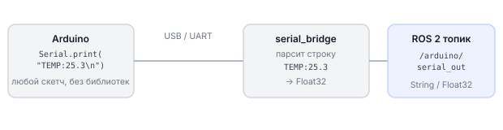
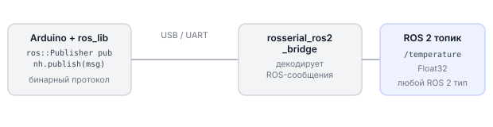

# Как подключается Arduino

Arduino не поддерживает ROS 2 напрямую: между ней и бортовым компьютером стоит мост — программа, которая переводит данные из последовательного порта в ROS 2 топики. Обрик поддерживает два таких моста: **serial_bridge** (простой текстовый протокол) и **rosserial_ros2_bridge** (Arduino выглядит как полноценный ROS 2 узел). В обоих случаях данные читаются через `drone.topic.subscribe(...)` — разница только в том, что именно отправляет Arduino и какой формат сообщений.

---

## Способ 1: serial_bridge (текстовый протокол)



**Плюсы:** прост, не требует библиотеки на стороне Arduino, работает с любым микроконтроллером через Serial.
**Минусы:** нужно самому описать протокол (формат строк).

### Запуск serial_bridge

```bash
# USB-подключение
ros2 run serial_bridge bridge_node --ros-args \
  -p port:=/dev/ttyUSB0 \
  -p baud:=115200

# UART-подключение (пины GPIO)
ros2 run serial_bridge bridge_node --ros-args \
  -p port:=/dev/ttyAMA3 \
  -p baud:=115200
```

### Шаблон скетча Arduino для serial_bridge

```cpp
// Что мы делаем: Arduino отправляет данные датчика в Обрик по протоколу serial_bridge

void setup() {
    Serial.begin(115200);   // скорость должна совпадать с параметром baud в bridge_node
}

void loop() {
    // Читаем команды от Обрика
    if (Serial.available()) {
        String cmd = Serial.readStringUntil('\n');  // получаем строку до символа новой строки
        cmd.trim();

        if (cmd == "LED_ON") {
            digitalWrite(LED_BUILTIN, HIGH);
            Serial.println("OK:LED_ON");    // подтверждаем команду
        }
        else if (cmd == "LED_OFF") {
            digitalWrite(LED_BUILTIN, LOW);
            Serial.println("OK:LED_OFF");
        }
    }

    // Отправляем данные датчика каждые 100 мс
    static unsigned long last = 0;
    if (millis() - last >= 100) {
        last = millis();
        float temp = analogRead(A0) * 3.3 / 1023.0 * 100.0;  // условный пример
        Serial.print("TEMP:");
        Serial.println(temp, 2);   // например: "TEMP:25.30\n"
    }
}
```

### Чтение данных Arduino через sverk_interfaces

```python
# Что мы делаем: подписываемся на топик от Arduino и выводим температуру
import sverk_interfaces
from std_msgs.msg import String   # serial_bridge обычно публикует String

drone = sverk_interfaces.init(Nodename="arduino_reader")

def on_arduino_data(msg):
    # msg.data содержит строку, например "TEMP:25.30"
    if msg.data.startswith("TEMP:"):
        temp = float(msg.data.split(":")[1])
        print(f"Температура от Arduino: {temp:.2f} °C")

# подписываемся на топик, куда serial_bridge публикует данные
sub = drone.topic.subscribe(String, "/arduino/serial_out", on_arduino_data)

try:
    drone.topic.spin()   # ждём сообщений
finally:
    drone.close()
```

---

## Способ 2: rosserial_ros2_bridge (Arduino как ROS 2 узел)



**Плюсы:** Arduino выглядит как полноценный ROS 2 узел — публикует топики, подписывается, вызывает сервисы.
**Минусы:** нужна библиотека `ros_lib` в Arduino IDE, немного сложнее настроить.

### Запуск rosserial_ros2_bridge

```bash
# через USB
ros2 run rosserial_ros2_bridge bridge_node --port /dev/ttyUSB0 --baud 57600

# через UART (пины GPIO)
ros2 run rosserial_ros2_bridge bridge_node --port /dev/ttyAMA3 --baud 57600
```

### Шаблон скетча Arduino для rosserial_ros2

```cpp
// Что мы делаем: Arduino публикует показания датчика в ROS 2 топик
#include <ros.h>              // библиотека rosserial (ros_lib)
#include <std_msgs/Float32.h>

ros::NodeHandle nh;           // объект «ноды» Arduino в ROS 2

std_msgs::Float32 temp_msg;   // сообщение, которое будем отправлять
ros::Publisher temp_pub("temperature", &temp_msg);   // публикатор

void setup() {
    nh.initNode();            // инициализация: устанавливает связь с bridge
    nh.advertise(temp_pub);   // регистрируем топик /temperature
}

void loop() {
    temp_msg.data = analogRead(A0) * 3.3 / 1023.0 * 100.0;   // условный датчик
    temp_pub.publish(&temp_msg);   // публикуем значение

    nh.spinOnce();      // обрабатываем входящие сообщения от Обрика
    delay(100);         // 10 Гц
}
```

### Чтение данных через sverk_interfaces

```python
# Что мы делаем: читаем температуру из топика, который опубликовала Arduino
import sverk_interfaces
from std_msgs.msg import Float32

drone = sverk_interfaces.init(Nodename="rosserial_reader")

def on_temperature(msg):
    # msg.data — float, значение с Arduino
    print(f"Температура: {msg.data:.2f} °C")

sub = drone.topic.subscribe(Float32, "/temperature", on_temperature)

try:
    drone.topic.spin()
finally:
    drone.close()
```

---

## Как узнать, что Arduino подключилась

```bash
# список устройств
ls /dev/ttyUSB* /dev/ttyACM*

# логи bridge — там видно, какие топики зарегистрировала Arduino
ros2 run rosserial_ros2_bridge bridge_node --port /dev/ttyUSB0 --baud 57600

# убедиться, что топик появился
ros2 topic list
ros2 topic echo /temperature
```

---

## Сравнение двух способов

| Критерий | serial_bridge | rosserial_ros2 |
|----------|--------------|----------------|
| Сложность Arduino-кода | Простой `Serial.print()` | Нужна `ros_lib` |
| Типы сообщений | Только строки | Любые ROS 2 типы |
| Arduino подписывается на топики | Нужно разобрать вручную | Встроено |
| Использование в sverk_interfaces | `drone.topic.subscribe(String, ...)` | `drone.topic.subscribe(Float32, ...)` |
