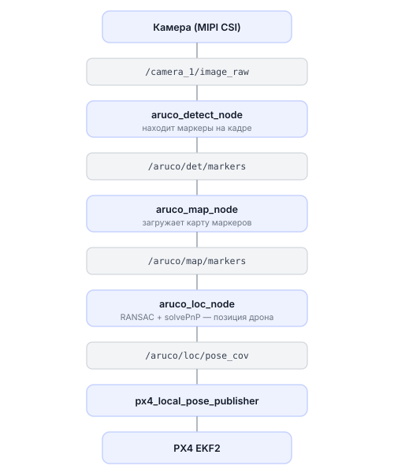

# Навигация по ArUco-маркерам

Описание `aruco_map`, `aruco_det_loc`, `aruco_tf` и VPE: как они определяют
позу, согласуют системы координат и передают external vision в PX4.

Практическая работа с полем маркеров — в статье [Работа с полем ArUco-маркеров](../aruco-field.md).

---

## Как это работает

Маркеры разложены по полу в заранее известных местах — это карта маркеров. Дрон смотрит вниз камерой, распознаёт видимые маркеры и по их положению в кадре вычисляет собственное положение в пространстве.

Математически это задача PnP (Perspective-n-Point): зная координаты точек в пространстве и их пиксельные координаты на изображении, находим положение камеры. Алгоритм RANSAC при этом отфильтровывает плохие измерения (например, маркер частично перекрыт).

Схема работы всей навигационной цепочки:



---

## От изображения до PX4

```text
camera image
  → aruco_detect: ID и углы маркеров в пикселях
  → aruco_loc: поза камеры в aruco_map + covariance
  → aruco_tf: поза base_link в локальном ROS map
  → /aruco/world_pose
  → px4_local_pose_publisher: ENU/FLU → NED/FRD
  → /fmu/in/vehicle_visual_odometry
  → PX4 EKF2
```

uXRCE-DDS экспортирует данные PX4 uORB в `/fmu/out/*` и принимает измерения из
`/fmu/in/*`. TF `map→base_link` строится по `/fmu/out/vehicle_odometry`; `map`
является ENU-представлением локальной оценки EKF2.

### `map`, `aruco_map` и origin

- `base_link` — корпус дрона в ROS FLU.
- camera optical frame — камера с известным статическим положением на корпусе.
- `aruco_map` — координаты физической карты из файла маркеров.
- `map` — локальный navigation frame PX4, представленный в ROS ENU.

`aruco_tf` хранит transform `map→aruco_map`, поэтому координаты карты, например
`(17,3)`, преобразуются в локальные координаты PX4.

`initialize_at_origin=true` делает первую устойчивую ArUco-позу локальным
нулём. При `false` она совмещается с текущей позой PX4. ID 0 не требуется.

Offset принимается после 15 кандидатов с расхождением до `0.10 m` и `0.10 rad`.

### Reset counter

`/aruco/reset_counter` увеличивается при записи нового `map→aruco_map` offset.
Так EKF2 распознаёт смену системы координат внешней оценки. При
`allow_offset_timeout_reset=false` потеря маркеров останавливает VPE, а после их
возврата сохраняются offset и counter.

PX4 `xy_reset_counter` и `delta_xy` относятся к сбросу состояния EKF2 и размеру
скачка его XY-оценки.

### Covariance

Перед публикацией `/aruco/world_pose` применяются минимальные variance:

| Компонента | Floor variance | Эквивалентный standard deviation |
|---|---:|---:|
| X/Y | `0.0004` | `0.02 m` |
| Z | `0.0009` | `0.03 m` |
| roll/pitch/yaw | `0.0027415568` | около `3°` |

Значения ограничивают covariance PnP снизу, чтобы не завышать точность
измерения для EKF2.

### Запуск в SITL

В SITL PX4 стартует с simulated GPS. После 10 стабильных состояний ArUco XY/yaw
и range height launch отключает GPS и проверяет ещё 10 состояний. Готовность:
`GPS-to-ArUco handoff complete`.

Handoff, настройка EKF2 и очистка `parameters.bson` применяются только в SITL.
Квалификация offset, covariance floors и reset counter работают также на
реальном дроне.

Практические команды: [SITL: модели обрика и навигация](../dev/sitl-models-and-navigation.md).

---

## Пакет aruco_map: карта маркеров

Нода `aruco_map_node` читает описание маркеров из текстового файла и публикует карту в топик `/aruco/map/markers`. Без этого топика нода локализации не может вычислить позицию дрона.

Запуск:

```bash
ros2 run aruco_map aruco_map_node
```

Параметры запуска:

| Параметр | По умолчанию | Описание |
|---|---|---|
| `frame_id` | `map` | Имя frame карты в сообщении; верхний launch согласует его с pipeline |
| `marker_size` | `0.16` м | Размер маркеров по умолчанию |
| `topic_name` | `/aruco/map/markers` | Имя топика для публикации |
| `map_file` | `config/markers.txt` | Файл с описанием маркеров |

---

## Формат файла карты

Текстовый файл, по одному маркеру на строку. Комментарии начинаются с `#`.

```text
# id  size   x    y    z   yaw  pitch  roll
0   0.16   1.0  0.0  0.5   0    0     1.57
1   0.16   2.0  1.0  0.5   0    0     0.0
```

- `id` — номер маркера
- `size` — размер стороны маркера в метрах
- `x`, `y`, `z` — положение центра маркера в метрах
- `yaw`, `pitch`, `roll` — ориентация маркера в радианах

---

## Генерация файла карты (genmap.py)

Вместо того чтобы писать файл вручную, можно сгенерировать карту для прямоугольной сетки маркеров:

```bash
ros2 run aruco_pose genmap.py LENGTH X Y DIST_X DIST_Y FIRST_ID [--bottom-left] [-o MAP_NAME]
```

Параметры:
- `LENGTH` — размер маркера (в метрах)
- `X` — количество маркеров по оси X (столбцов)
- `Y` — количество маркеров по оси Y (строк)
- `DIST_X` — расстояние между центрами маркеров по оси X (в метрах)
- `DIST_Y` — расстояние между центрами маркеров по оси Y (в метрах)
- `FIRST_ID` — ID первого маркера
- `--bottom-left` — начинать нумерацию с левого нижнего угла
- `-o MAP_NAME` — сохранить в файл (например, `new_map.txt`)

Пример: сетка 2x4 маркеров, размер маркера 33 см, расстояние между ними 1 метр:

```bash
ros2 run aruco_pose genmap.py 0.33 2 4 1 1 0 --bottom-left -o new_map.txt
```

Утилита сохранит файл в директорию пакета `aruco_map` (путь через `ament_index_python`) и попробует сделать копию в исходниках репозитория: `sverk_ws/src/sverk_drone/odometry/aruco/aruco_map/config/`.

Справка по утилите:

```bash
ros2 run aruco_pose genmap.py -h
```

---

## Просмотр и редактирование карты в веб-интерфейсе

В [веб-интерфейсе](../web-interface.md) откройте **Web video server** → выберите топик `/aruco/vis/map_debug_image/plane_1` → нажмите **Stream Viewer**. Топик выводит рендер карты ArUco, настроенной в системе как основная, с осями координат.

Нода поддерживает параметры `publish_debug_images` и `debug_draw_origin` (по умолчанию оба `true`):
- `publish_debug_images` — публикует рендер карты в отдельный топик для каждой плоскости.
- `debug_draw_origin` — рисует оси системы координат там, где проходит нулевая точка карты.

---

## Редактирование файла карты вручную

Откройте файл карты в текстовом редакторе:

```bash
nano ~/sverk_ws/src/sverk_drone/odometry/aruco/aruco_map/config/sverk.txt
```

Измените нужные строки. Сохраните: `Ctrl+X`, затем `Y`, затем `Enter`.

Для применения изменений перезапустите сервис Обрика:

```bash
sudo systemctl restart sverk-ros2-docker.service
```

> **Примечание** Эта команда выполняется на бортовом компьютере вне Docker-контейнера (через SSH или терминал).

---

## Смена карты

Нода `aruco_map_node` читает файл карты один раз при запуске (параметр `map_file`). Динамического переключения карты во время работы нет — чтобы загрузить другую карту, укажите её при запуске ноды и перезапустите.

Указать другой файл при запуске:

```bash
ros2 run aruco_map aruco_map_node --ros-args -p map_file:=config/markers2.txt
```

Если Обрик запускается как сервис, путь к карте задаётся в его конфигурации. Чтобы применить новый файл, отредактируйте карту (см. раздел выше) или замените `map_file`, затем перезапустите сервис:

```bash
sudo systemctl restart sverk-ros2-docker.service
```

---

## Проверка навигации

После запуска системы проверьте, что ArUco-навигация работает:

```bash
ros2 topic echo /aruco/loc/pose_cov
```

Если дрон видит маркеры, в терминале появится поток сообщений с координатами. Поле `pose.pose.position` содержит x, y, z в метрах.

---

## Пакет aruco_det_loc: детектор маркеров

Пакет содержит три ноды:

**aruco_detect_node** — находит маркеры на кадре камеры и публикует их ID, пиксельные координаты и (опционально) позу каждого маркера относительно камеры. Подписывается на топики изображения и информации о камере.

**aruco_loc_node** — принимает найденные маркеры и карту, вычисляет положение камеры (и значит, дрона) в мировых координатах через RANSAC + solvePnP. Публикует позицию в `PoseWithCovarianceStamped`.

**aruco_tf_node** — применяет положение камеры на корпусе и offset между
`map`/`aruco_map`, публикует `/aruco/world_pose`, TF и reset counter для VPE.

Запуск трёх нод в одном процессе (рекомендуется для производительности):

```bash
ros2 launch aruco_det_loc aruco_composed.launch.py \
  image_topic:=/camera_1/image_raw \
  camera_info_topic:=/camera_1/camera_info
```

Основные параметры `aruco_detect_node`:

| Параметр | По умолчанию | Описание |
|---|---|---|
| `marker_size` | `0.5` м | Размер маркера, если не найден в карте |
| `dictionary_id` | `3` | ID словаря ArUco. Используйте `0` (DICT_4X4_50) если все маркеры с ID < 50 |
| `use_map_markers` | `true` | Использовать карту для фильтрации маркеров |
| `use_aruco3_detection` | `false` | Ускоренный детектор (2-5x быстрее, но маленькие маркеры может не видеть) |

Основные параметры `aruco_loc_node`:

| Параметр | По умолчанию | Описание |
|---|---|---|
| `world_frame_id` | `"map"` | Имя мировой системы координат |
| `pnp.reprojection_error_px` | `4.0` | Порог ошибки RANSAC в пикселях |
| `pnp.min_used_markers` | `0` | Auto: одна метка использует IPPE_SQUARE, две и более — RANSAC |

---

## Включение отладочных изображений

Чтобы увидеть, что именно видит детектор, включите публикацию отладочных изображений:

```bash
ros2 service call /toggle_debug std_srvs/srv/SetBool "{data: true}"
```

Выберите соответствующий топик в веб-интерфейсе или в RViz. После отключения топики остаются в `ros2 topic list`, но перестают обновляться.
