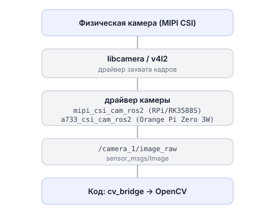

# Как работает камера

Описание внутреннего устройства работы с камерой: от драйвера libcamera до ROS 2 топиков и методов библиотеки `sverk_interfaces`.

---

## Стек камеры Обрика



---

## Проверка камеры из терминала

```bash
# список V4L2-устройств (поддерживаются ли вообще)
v4l2-ctl --list-devices

# посмотреть форматы камеры
v4l2-ctl --device=/dev/video0 --list-formats-ext

# снять один кадр в JPEG (быстрая проверка)
libcamera-jpeg -o /tmp/test.jpg

# потоковое видео (MJPEG) для просмотра через браузер
libcamera-vid -t 0 --codec mjpeg --listen -o - | nc -l 8080

# тест через gstreamer
gst-launch-1.0 libcamerasrc ! videoconvert ! autovideosink
```

---

## Как drone.image.take_picture() работает внутри

```python
# Что делает take_picture() внутри (упрощённо)
import rclpy
from sensor_msgs.msg import Image

received = []

def frame_callback(msg):
    received.append(msg)       # сохраняем кадр

# создаём временную подписку
sub = node.create_subscription(
    Image,                     # тип сообщения
    "/camera_1/image_raw",     # топик камеры
    frame_callback,
    10
)

import time
deadline = time.monotonic() + 5.0   # ждём не более 5 секунд

while not received and time.monotonic() < deadline:
    rclpy.spin_once(node, timeout_sec=0.1)  # обрабатываем одно событие

node.destroy_subscription(sub)  # отписываемся

frame = received[0] if received else None  # None если таймаут
```

> **Примечание** Это «сырой» уровень: `received[0]` — это `sensor_msgs/Image`. По умолчанию `take_picture()` сразу пропускает его через `to_cv2()` и возвращает вам numpy-массив BGR. Вызов с `raw=True` вернёт именно этот `sensor_msgs/Image` без конвертации.

---

## Конвертация ROS Image → OpenCV

Топик `/camera_1/image_raw` содержит кадр в формате `sensor_msgs/Image` — структура ROS 2. OpenCV работает с numpy-массивами. `cv_bridge` переводит между ними.

```python
# Что мы делаем: берём кадр с камеры и конвертируем в формат OpenCV
import cv2
import numpy as np
from sensor_msgs.msg import Image

# frame — это sensor_msgs/Image (например, drone.image.take_picture(raw=True))
# Ровно это делает drone.image.to_cv2() внутри. Конвертация вручную, без cv_bridge:
def ros_image_to_cv2(frame):
    # frame.encoding содержит формат: "bgr8", "rgb8", "mono8"
    dtype = np.uint8
    channels = 3 if "rgb" in frame.encoding or "bgr" in frame.encoding else 1

    img = np.frombuffer(frame.data, dtype=dtype)   # байты → массив
    img = img.reshape((frame.height, frame.width, channels))  # плоский → матрица

    if frame.encoding == "rgb8":
        img = cv2.cvtColor(img, cv2.COLOR_RGB2BGR)  # RGB → BGR (OpenCV использует BGR)
    return img

# или через cv_bridge (рекомендуется):
from cv_bridge import CvBridge
bridge = CvBridge()

def process_frame(frame):
    cv_img = bridge.imgmsg_to_cv2(frame, desired_encoding="bgr8")
    # теперь cv_img — обычный numpy-массив
    gray = cv2.cvtColor(cv_img, cv2.COLOR_BGR2GRAY)
    cv2.imwrite("/tmp/frame.png", cv_img)
```

---

## Просмотр кадров из ROS 2 топика

```bash
# список топиков с изображениями
ros2 topic list | grep image

# частота публикации кадров
ros2 topic hz /camera_1/image_raw

# посмотреть один кадр (формат, размер)
ros2 topic echo --once /camera_1/image_raw

# открыть rqt_image_view для просмотра видео в GUI
ros2 run rqt_image_view rqt_image_view
```

---

## Публикация обработанного изображения обратно в ROS 2

```python
# Что мы делаем: берём кадр, рисуем на нём, публикуем в /out_detection
import rclpy
from sensor_msgs.msg import Image
from cv_bridge import CvBridge
import cv2

bridge = CvBridge()

# получаем кадр (через свой callback или drone.image.take_picture())
def process_and_publish(frame, pub):
    cv_img = bridge.imgmsg_to_cv2(frame, "bgr8")

    # рисуем крест по центру
    h, w = cv_img.shape[:2]
    cv2.line(cv_img, (w//2, 0), (w//2, h), (0, 255, 0), 2)
    cv2.line(cv_img, (0, h//2), (w, h//2), (0, 255, 0), 2)

    # конвертируем обратно в ROS Image и публикуем
    out_msg = bridge.cv2_to_imgmsg(cv_img, "bgr8")
    pub.publish(out_msg)
```

> **Примечание** `drone.image.publish(img)` делает то же самое за вас: принимает numpy-картинку (или готовый `sensor_msgs/Image`) и публикует — конвертацию `to_ros()` библиотека берёт на себя.
