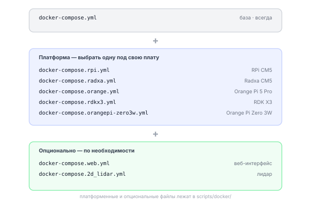
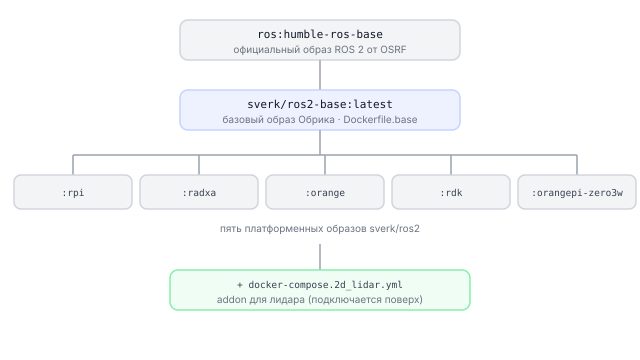
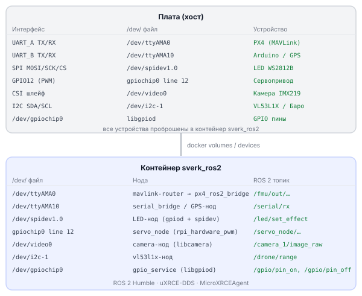
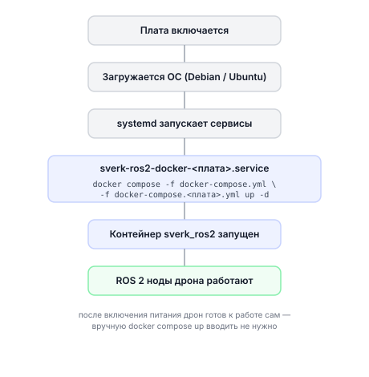

# Как устроен Docker

Описание архитектуры Docker на Обрике: как устроен контейнер `sverk_ros2` и как периферия платы пробрасывается внутрь.

---

## 1. Что такое Docker

В этом разделе мы узнаем, что такое Docker и почему без него было бы сложнее работать с дроном.

### Аналогия: комната, снимок и инструкция

Установить Python, ROS 2, библиотеки камеры и драйверы GPIO напрямую в систему сложно: такую настройку трудно повторить на другом компьютере, а ошибка может нарушить работу всей операционной системы.

Docker решает эту проблему тремя понятиями:

| Понятие | Аналогия | Что это в реальности |
|---------|----------|----------------------|
| **Образ (image)** | Сохранённый снимок комнаты | Файл со всем нужным ПО, зафиксированный раз и навсегда |
| **Контейнер (container)** | Живая изолированная комната | Запущенный образ: программы работают, но не трогают ОС хоста |
| **Compose-файл** | Инструкция «как запустить несколько комнат» | YAML-файл с настройками: какой образ, какие устройства, какие порты |

### Docker на дроне

1. **Одинаковое окружение на любой плате.** Raspberry Pi CM5, Radxa CM5, Orange Pi — железо разное, но контейнер внутри одинаковый. Код дрона не знает, на чём он запущен.
2. **Не засоряет ОС хоста.** Всё, что нужно ROS 2 и PX4, живёт внутри контейнера. Система платы остаётся чистой.
3. **Легко обновлять.** Вышла новая версия — скачал новый образ, запустил. Старый образ можно оставить как резервную копию.

---

## 2. Устройство Docker

В этом разделе мы узнаем, из каких частей состоит Docker-конфигурация дрона Обрик.

### Три уровня Compose-файлов



Базовый файл задаёт общие параметры. Платформенный файл добавляет то, что специфично для конкретной платы. Опциональные файлы подключаются, только если нужна эта функция.

### Пять платформенных образов

| Образ | Чип | Особенность камеры |
|-------|-----|--------------------|
| `sverk/ros2:rpi` | BCM2712 (Raspberry Pi CM5) | RPi-форк libcamera, VideoCore pipeline |
| `sverk/ros2:radxa` | RK3588S (Radxa CM5) | Upstream libcamera, rkisp1 pipeline |
| `sverk/ros2:orange` | RK3588S (Orange Pi 5 Pro) | Upstream libcamera, rkisp1 pipeline |
| `sverk/ros2:rdk` | Horizon RDK X3 | Vendor runtime через volumes |
| `sverk/ros2:orangepi-zero3w` | Allwinner A733 | SHM-based камера через V4L2 |

### Имя контейнера и пользователь

- Контейнер называется **`sverk_ros2`** — это имя, по которому к нему обращаются команды.
- Внутри контейнера всё работает от пользователя **`sverk`**.

---

## 3. Сборка образов

В этом разделе мы узнаем, как образы «наследуют» друг друга и что содержит каждый уровень.

### Схема наследования



Каждый уровень добавляет что-то своё и не убирает то, что было до него.

### Что есть в базовом образе (`sverk/ros2-base`)

Это «общая начинка», которая одинакова на всех платах:

- **ROS 2 Humble** — фреймворк для работы с дроном
- **PX4** — прошивка полётного контроллера (библиотеки для связи)
- **mavlink-router** — маршрутизатор MAVLink-сообщений
- **libcamera-deps** — зависимости для работы с камерой
- **ROS workspace** — папка со всеми пакетами дрона
- **Пользователь `sverk`** — от его имени запускается всё
- **Python-пакеты:** `gpiod` (GPIO), `spidev` (SPI/LED-лента), `tornado`/`fastapi` (веб-слой)

### Что добавляет каждая платформа

| Образ | Что добавляет сверх base |
|-------|--------------------------|
| `rpi` | RPi-форк libcamera, rpi/vc4 pipeline для VideoCore, rpi-lgpio + spidev |
| `radxa` | Upstream libcamera, rkisp1 pipeline для RK3588S |
| `orange` | Upstream libcamera, rkisp1 pipeline для RK3588S |
| `orangepi-zero3w` | SHM-буфер для камеры, V4L2-совместимый pipeline |

### Addon-образ для лидара

Если к дрону подключён 2D-лидар (например, LD19), то при запуске добавляют ещё один compose-файл. Он не меняет основной образ, а добавляет дополнительный сервис поверх платформенного.

---

## 4. Доступ к периферии в контейнере

В этом разделе мы узнаем, каким образом железо платы (GPIO, UART, камера) становится доступным внутри изолированного контейнера.

### Принцип: железо на хосте, контейнер видит его через /dev

В Linux почти любое устройство представлено как файл в папке `/dev`. Камера — это `/dev/video0`, UART — `/dev/ttyAMA0`, GPIO — `/dev/gpiochip0`. Docker умеет «пробросить» эти файлы из хоста внутрь контейнера так, что контейнер думает, будто устройство находится прямо в нём.

### Два способа пробрасывать устройства

**Способ 1 — явный список (RPi CM5 и Radxa CM5):**

В compose-файле перечислены конкретные файлы устройств:

```yaml
devices:
  - /dev/ttyAMA0     # UART для полётного контроллера
  - /dev/ttyAMA10    # UART для доп. устройств
  - /dev/spidev1.0   # SPI для LED-ленты
  - /dev/video0      # камера
  - /dev/gpiomem     # GPIO
  # ... и так далее
```

Плюс: контейнер видит только нужные устройства. Безопаснее.

**Способ 2 — весь /dev (Orange Pi 5 Pro и Orange Pi Zero 3W):**

```yaml
volumes:
  - /dev:/dev        # весь /dev хоста проброшен в контейнер
```

Плюс: проще настраивать. Минус: контейнер видит абсолютно все устройства хоста.

### `privileged: true` — что это значит

Все платформы запускают контейнер с флагом `privileged: true`. Это значит, что контейнер получает расширенные права — почти как суперпользователь root на хосте. Без этого флага многие операции с GPIO, UART и камерой были бы заблокированы ядром Linux.

### Группы пользователя `sverk` — зачем каждая

Пользователь `sverk` внутри контейнера добавлен в несколько групп. Каждая группа открывает доступ к определённым устройствам:

| Группа | Что открывает |
|--------|---------------|
| `dialout` (GID 20) | Доступ к `/dev/tty*` — UART-порты (полётный контроллер, Arduino) |
| `video` (GID 44) | Доступ к `/dev/video*` — камера |
| `gpio` (GID 986) | Доступ к `/dev/gpiochip*` — GPIO пины |
| `spi` (GID 154/153/995) | Доступ к `/dev/spidev*` — SPI (LED-лента WS2812B) |
| `i2c` (GID 988) | Доступ к `/dev/i2c-*` — I2C датчики (vl53l1x, барометр) |
| `render` (GID 109) | Доступ к DRM/NPU — аппаратное ускорение на Radxa и Orange Pi |

Без групп пришлось бы запускать всё через `sudo`, что неудобно и небезопасно.

### Схема: как железо видно в контейнере

Имя устройства внутри контейнера то же, что и на хосте — Docker пробрасывает файл `/dev` как есть:

| Железо на плате | Файл на хосте | Тот же файл в контейнере | Доступ из кода |
|---|---|---|---|
| GPIO пины | `/dev/gpiochip0` | `/dev/gpiochip0` | `drone.gpio.*` |
| UART | `/dev/ttyAMA0` | `/dev/ttyAMA0` | PX4 / Arduino |
| SPI | `/dev/spidev1.0` | `/dev/spidev1.0` | LED-лента |
| PWM (GPIO12) | — | GPIO12 | сервопривод |
| Камера (CSI) | `/dev/video0` | `/dev/video0` | `drone.image.*` |
| I2C | `/dev/i2c-1` | `/dev/i2c-1` | vl53l1x, барометр |

---

## 5. Стандартная периферия дрона

В этом разделе мы узнаем, какое железо подключено к дрону Обрик и какую роль выполняет каждый интерфейс.

| Интерфейс | Путь `/dev` по платам | Назначение |
|---|---|---|
| **UART_A** | RPi `/dev/ttyAMA0` · Radxa и Zero 3W `/dev/ttyS2` · Orange 5 Pro `/dev/ttyS0` | Полётный контроллер PX4 — MAVLink, 921600 бод |
| **UART_B** | RPi `/dev/ttyAMA10` · Radxa и Zero 3W `/dev/ttyS6` · Orange 5 Pro `/dev/ttyS1` | Свободен: Arduino, GPS, лидар, любое устройство по UART |
| **SPI** | RPi и Orange 5 Pro `/dev/spidev1.0` · Zero 3W `/dev/spidev3.0` | LED-лента WS2812B (адресные RGB-светодиоды) |
| **PWM** | GPIO12 (аппаратный PWM, канал pwm0) — на всех платах одинаково | Сервопривод (сигнальный провод) |
| **CSI** | `/dev/video0` → libcamera → топик `/drone/image/raw` | Камера IMX219 или OV5647 |
| **I2C** | `/dev/i2c-1` | Датчики: VL53L1X (дальномер), барометр (высота), другие |

> **Внимание** UART_A занят системой. Не подключайте сюда другие устройства и не меняйте настройки — дрон потеряет связь с полётным контроллером.

### Полная схема всех подключений



---

## 6. Таблица устройств /dev

В этом разделе мы узнаем, какой файл `/dev/...` соответствует каждому интерфейсу на каждой плате.

| Интерфейс | Назначение | RPi CM5 | Orange Pi Zero 3W | Orange Pi 5 Pro |
|-----------|-----------|---------|-------------------|-----------------|
| UART_A | Полётный контроллер PX4 | `/dev/ttyAMA0` | `/dev/ttyS2` | `/dev/ttyS0` |
| UART_B | Доп. устройства | `/dev/ttyAMA10` | `/dev/ttyS6` | `/dev/ttyS1` |
| SPI | LED-лента WS2812B | `/dev/spidev1.0` | `/dev/spidev3.0` | `/dev/spidev1.0` |
| PWM | Сервопривод | GPIO12 (pwm0) | GPIO12 (pwm0) | GPIO12 (pwm0) |
| CSI | Камера IMX219/OV5647 | cam0 (videocore) | CAM1 (vin_v4l2) | CAM1 (rkisp1) |
| GPIO chip | Все пины | `/dev/gpiochip0` | `/dev/gpiochip0` | `/dev/gpiochip0` |

> **Примечание** Все эти пути видны **внутри контейнера** точно так же, как и на хосте — благодаря пробросу устройств. Причём без `sudo`, потому что пользователь `sverk` состоит в нужных группах.

---

## 7. Вход в контейнер

В этом разделе мы узнаем два способа попасть внутрь контейнера и проверить, что мы действительно внутри.

### Способ 1 — через терминал платы

Если вы подключён к плате напрямую (через HDMI + клавиатура или через USB-serial):

```bash
# Войти в уже запущенный контейнер sverk_ros2
docker exec -it sverk_ros2 bash
```

Флаги: `-i` (интерактивный режим) и `-t` (выделить терминал). `bash` — это командная оболочка, которую мы запустим внутри.

### Способ 2 — через SSH по сети

Если плата и ваш компьютер находятся в одной Wi-Fi сети:

```bash
# Подключиться к плате по SSH
# Замените <IP_дрона> на реальный IP-адрес (например, 192.168.1.100)
ssh sverk@<IP_дрона>
# Пароль: sverk
```

После входа по SSH вы попадаете сразу внутрь контейнера (так настроен `.bashrc` пользователя).

### Как проверить, что вы внутри контейнера

```bash
# Эта команда покажет имя компьютера (hostname)
# Внутри контейнера оно будет sverk_ros2
hostname
```

Если видите `sverk_ros2` — вы внутри. Если видите что-то другое (например, `raspberrypi`) — вы ещё на хосте.

---

## 8. Проверка доступа к периферии

В этом разделе мы узнаем, как убедиться, что все устройства (UART, камера, GPIO, SPI, I2C) видны внутри контейнера.

> **Примечание** Все команды ниже выполняются **внутри контейнера** — они видят устройства хоста благодаря пробросу через `/dev`.

```bash
# ── UART (полётный контроллер и доп. устройства) ──────────────────

# RPi CM5: проверяем оба UART-порта
ls /dev/ttyAMA0     # UART_A — полётный контроллер PX4
ls /dev/ttyAMA10    # UART_B — свободный порт

# Radxa CM5 и Orange Pi Zero 3W
ls /dev/ttyS2       # UART_A
ls /dev/ttyS6       # UART_B

# Orange Pi 5 Pro
ls /dev/ttyS0       # UART_A
ls /dev/ttyS1       # UART_B

# ── SPI (LED-лента WS2812B) ───────────────────────────────────────

# Показать все доступные SPI-устройства
ls /dev/spidev*
# Должны увидеть что-то вроде: /dev/spidev1.0

# ── Камера ────────────────────────────────────────────────────────

# Показать все video-устройства
ls /dev/video*
# Обычно появляется несколько: /dev/video0, /dev/video1, ...

# Проверить, что libcamera видит камеру
cam --list
# Должна появиться строка с IMX219 или OV5647

# ── GPIO (цифровые пины) ──────────────────────────────────────────

# Показать список GPIO-чипов
gpiodetect
# Должна появиться строка: gpiochip0 [...]

# Показать все пины чипа 0
gpioinfo gpiochip0

# ── I2C (датчики: vl53l1x, барометр и т.д.) ─────────────────────────

# Показать все I2C-шины
ls /dev/i2c-*
# Обычно: /dev/i2c-1 или /dev/i2c-0, /dev/i2c-1, ...

# Сканировать устройства на шине i2c-1
i2cdetect -y 1
# Таблица покажет адреса найденных устройств (например, 0x29 — это vl53l1x)
```

Если какое-то устройство не появляется — проверьте:
1. Физическое подключение (кабель, разъём).
2. Что compose-файл включает нужный `/dev/...` в секции `devices:` или `volumes:`.
3. Что контейнер перезапущен после изменений.

---

## 9. Автозапуск контейнера

В этом разделе мы узнаем, почему код дрона начинает работать сам при включении платы — без ручного запуска.

### systemd-сервис

В Linux за автозапуск программ отвечает система **systemd**. На плате дрона зарегистрирован специальный сервис — независимо от платформы (RPi/Radxa/Orange/RDK) он всегда называется одинаково, `sverk-ros2-docker.service`; платформа влияет только на то, какие `-f docker-compose.<плата>.yml` подставлены внутрь юнита (см. `image_builder/systemd/sverk-ros2-docker.service.template` — общий шаблон для всех плат, автосборщик и ручная установка рендерят его через `sed`, а не хранят по копии на плату).

### Что происходит при включении



### Полезные команды для работы с сервисом

```bash
# Посмотреть статус сервиса (выполнять НА ХОСТЕ, не в контейнере)
systemctl status sverk-ros2-docker.service

# Перезапустить сервис (и контейнер вместе с ним)
sudo systemctl restart sverk-ros2-docker.service

# Остановить контейнер
sudo systemctl stop sverk-ros2-docker.service

# Запустить снова
sudo systemctl start sverk-ros2-docker.service
```

> **Примечание** После перезагрузки платы контейнер поднимется сам — не нужно вручную вводить `docker compose up`. Это важно: дрон должен быть готов к работе сразу после включения питания.

---

## Смотрите также

- [Как работает ROS 2](ros2-raw.md)
- [Как работает GPIO](gpio-raw.md)
- [Как работает камера](camera-raw.md)
