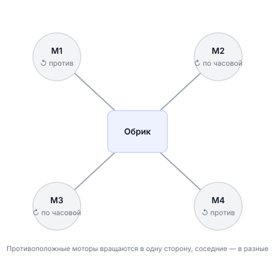
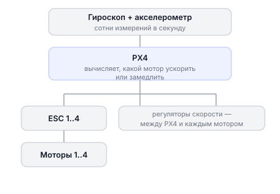
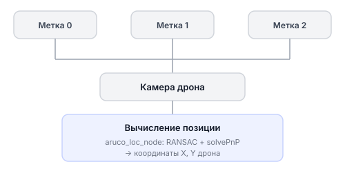
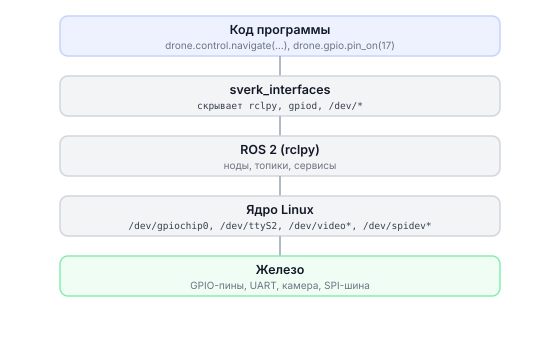

# База знаний по дрону «Обрик»

Здесь собраны объяснения по всем частям Обрика. Это справочник, а не учебник: открывайте нужный раздел, когда он понадобится.

---

## Как устроен квадрокоптер

Прежде чем работать с Обриком, полезно понять, за счёт чего он держится в воздухе.

### Почему четыре мотора

Квадрокоптер держится в воздухе за счёт тяги пропеллеров. Чтобы дрон не заваливался в стороны и не крутился вокруг себя, нужно управлять движением по трём осям одновременно: вперёд-назад (тангаж), влево-вправо (крен) и вращение вокруг вертикальной оси (рыскание).

Вертолёт решает эту задачу через механический шарнир на голове ротора, что сложно и ломается. Квадрокоптер делает то же самое проще: меняет скорость каждого из четырёх моторов отдельно. Никаких подвижных частей, только скорость вращения.



CW = по часовой стрелке, CCW = против часовой.

### Как пропеллер создаёт подъёмную силу

Пропеллер работает как крыло, только вращающееся. Лопасть имеет особый профиль: снизу более плоская, сверху — изогнутая. Когда пропеллер крутится, воздух над лопастью проходит больший путь и движется быстрее. По закону Бернулли, где скорость выше, давление ниже. Получается разница давлений: снизу давление больше, сверху меньше. Эта разница и тянет дрон вверх.

Чем быстрее крутится пропеллер, тем сильнее тяга.

### Зачем два мотора крутятся в разные стороны

Когда мотор крутит пропеллер, по третьему закону Ньютона возникает реактивный момент: сам корпус дрона хочет повернуться в противоположную сторону. Если бы все четыре пропеллера крутились в одну сторону, Обрик бесконтрольно вращался бы вокруг вертикальной оси.

Решение: два мотора крутятся по часовой, два против часовой. Их реактивные моменты компенсируют друг друга. Дрон остаётся стабильным. Чтобы намеренно повернуть дрон влево или вправо, контроллер чуть ускоряет одну пару и замедляет другую.

### Как батарея влияет на время полёта

Обрик несёт аккумулятор ёмкостью 1300 мАч. Это запас энергии. Все четыре мотора постоянно потребляют ток, и чем сильнее нагрузка (ветер, резкие манёвры, тяжёлый груз), тем быстрее расходуется заряд.

Простая формула: время полёта (в часах) = ёмкость батареи (мАч) / средний потребляемый ток (мА). Если Обрик в среднем тянет 20 А (20 000 мА), то 1300 мАч хватит примерно на 4 минуты. Это реальная цифра для небольших гоночных квадрокоптеров.

Вот почему важно следить за напряжением батареи во время полёта и садиться заблаговременно.

---

## Питание

Аккумулятор (АКБ) питает всё: моторы, полётный контроллер и бортовой компьютер. От правильного обращения зависит и безопасность, и срок службы.

- [Аккумуляторные батареи](battery-li-po.md) — что значит маркировка «3S HV», допустимые напряжения, как заряжать, как хранить, как восстановить глубоко разряженную батарею.

---

## Аппаратура управления

Пульт отправляет команды дрону по радиоканалу. Обрик работает с пультом RadioMaster Pocket по протоколу ELRS (ExpressLRS). Это современный открытый протокол с низкой задержкой и хорошей дальностью.

- [Русская озвучка RadioMaster Pocket](transmitter-voice.md) — как загрузить профиль настроек и переключить пульт на русский язык.

---

## Полётный контроллер

Полётный контроллер (FMU) — специальная плата с прошивкой PX4. Она читает данные гироскопа и акселерометра несколько сотен раз в секунду и управляет каждым мотором так, чтобы дрон держал нужное положение в воздухе.



ESC (Electronic Speed Controller) — это электронный регулятор скорости. Он стоит между полётным контроллером и каждым мотором. Контроллер говорит ESC: «крути на 70% мощности», а ESC уже сам управляет током, который идёт в мотор. Без ESC мотор просто не будет работать правильно.

MAVLink — это протокол, на котором говорят полётный контроллер, QGC и бортовой компьютер между собой. Что-то вроде языка, который они все понимают.

QGroundControl (QGC) — программа на компьютере для настройки и мониторинга полётного контроллера. Через неё можно откалибровать датчики, посмотреть телеметрию и обновить прошивку.

- [Прошивка PX4](px4-firmware.md) — как перепрошить контроллер в режиме DFU, если нужна другая версия PX4.
- [Калибровка ESC](esc-calibration.md) — зачем нужна калибровка и как её провести через QGC.
- [Подключение к QGC по проводу](qgc-usb.md) — если Wi-Fi недоступен, можно подключиться через USB-кабель.

---

## Бортовой компьютер

Бортовой компьютер Обрика — небольшой одноплатный компьютер, на котором работают Ubuntu, Docker и Python-код. Именно здесь живут программы, которые делают Обрик автономным. Обрик поддерживает несколько вариантов бортового компьютера.

- [Бортовые компьютеры](boards-overview.md) — обзор всех поддерживаемых вариантов и общая архитектура.
  - [Raspberry Pi CM5](board-rpi-cm5.md) — инструкция для оригинального Raspberry Pi CM5.
  - [Radxa CM5](board-radxa-cm5.md) — инструкция для модуля Radxa CM5.
  - [Orange Pi Zero 3W](board-opi-zero3w.md) — инструкция для Orange Pi Zero 3W.
  - [Orange Pi 5 Pro](board-opi-5pro.md) — инструкция для Orange Pi 5 Pro.
  - [RDK X3](board-rdk-x3.md) — инструкция для Horizon Robotics RDK X3.

---

## Пример: мониторинг батареи через ROS 2

Когда Обрик летит в автономном режиме, программа должна следить за зарядом батареи и сажать дрон заблаговременно. Вот простой пример на Python:

```python
import rclpy
from rclpy.node import Node
from sensor_msgs.msg import BatteryState

class BatteryMonitor(Node):
    def __init__(self):
        super().__init__('battery_monitor')
        # Подписываемся на топик с данными батареи от PX4
        self.sub = self.create_subscription(
            BatteryState,
            '/fmu/out/battery_status',
            self.battery_callback,
            10
        )

    def battery_callback(self, msg):
        voltage = msg.voltage          # напряжение в вольтах
        percentage = msg.percentage    # заряд от 0.0 до 1.0

        self.get_logger().info(
            f'Батарея: {voltage:.2f} В ({percentage * 100:.0f}%)'
        )

        # Предупреждение при напряжении ниже 3.5 В на банку (3S = 10.5 В)
        if voltage < 10.5:
            self.get_logger().warn('Низкий заряд! Готовимся к посадке.')

def main():
    rclpy.init()
    node = BatteryMonitor()
    rclpy.spin(node)

if __name__ == '__main__':
    main()
```

Запустите командой:
```bash
ros2 run <ваш_пакет> battery_monitor
```

---

## Навигация

Чтобы Обрик знал, где он находится в помещении без GPS, используются ArUco-маркеры. Это квадратные чёрно-белые метки на полу, похожие на QR-коды. Камера снизу видит эти метки, программа вычисляет позицию дрона.



- [Навигация по ArUco](aruco-navigation.md) — как устроена карта маркеров, как её сгенерировать, как переключать наборы меток.

---

## Симулятор

Прежде чем запускать реальный дрон, потренируйтесь в симуляторе — ошибка в симуляторе ничего не повредит.

- Веб-симулятор для быстрого старта: [edu.sverk.tech/sandbox](https://edu.sverk.tech/sandbox)
- [Симулятор Gazebo](simulation.md) — среда на базе Gazebo и PX4 SITL (Software In The Loop): как запустить, как подключить ROS 2, как тестировать автономные программы.

---

## Устройство Обрика: техническая база

Этот раздел — для тех, кто хочет понять, **что происходит внутри**, когда вы вызываете `drone.control.navigate(...)` или `drone.gpio.pin_on(17)`.

В основных гайдах весь код использует библиотеку `sverk_interfaces` — она скрывает детали и даёт простой, понятный интерфейс. Здесь объясняется, что библиотека делает за вас. Внутри неё — самый обычный ROS 2: подписки на топики, вызовы сервисов, публикация сообщений. Как только понадобится что-то нестандартное, нужно понять основу.



| Раздел | Что внутри |
|--------|-----------|
| [Как работает ROS 2](ros2-raw.md) | Как работает ROS 2 без `sverk_interfaces`: ноды, топики, сервисы через чистый `rclpy` |
| [Как работает GPIO](gpio-raw.md) | Как работает GPIO без `drone.gpio.*`: `gpiod`, `/dev/gpiochip0`, команды терминала |
| [Устройства /dev](devices-raw.md) | Файлы устройств: `/dev/ttyS2`, `/dev/video*`, `/dev/spidev*`, различия платформ |
| [Как работает камера](camera-raw.md) | Как работает камера: `libcamera`, `v4l2`, что делает `drone.image.take_picture()` внутри |
| [Как работают серво и магнит](servo-magnet-raw.md) | Сервоприводы и электромагниты без `drone.gpio.*`: PWM, `ros2 service call`, `ros2 topic pub` |
| [Как подключается Arduino](arduino-raw.md) | Связь с Arduino: `serial_bridge` (текстовый протокол) и `rosserial_ros2` |
| [Как устроен Docker](docker_architecture.md) | Как docker compose пробрасывает периферию хоста в контейнер `sverk_ros2` |

> **Подсказка** Если уверенно работаете с `sverk_interfaces` — начните с [Как работает ROS 2](ros2-raw.md). Если интересует железо — с [Устройства /dev](devices-raw.md).
