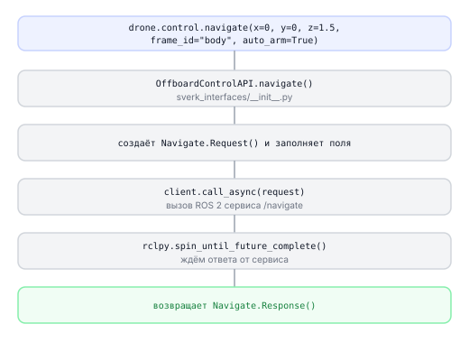
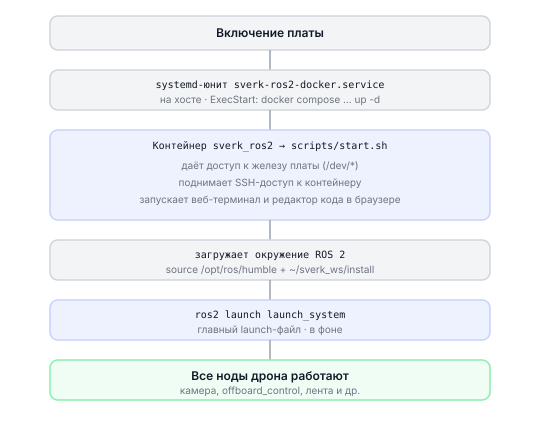

# Как работает ROS 2

Описание внутреннего устройства ROS 2 в Обрике: ноды, топики, сервисы и то, как библиотека `sverk_interfaces` работает поверх `rclpy`.

---

## Что происходит при вызове navigate()



---

## rclpy — базовые операции

### Инициализация и нода

```python
# Что мы делаем: запускаем ROS 2 и создаём ноду вручную (без sverk_interfaces)
import rclpy
from rclpy.node import Node

rclpy.init()                              # инициализация ROS 2 в процессе
node = rclpy.create_node("my_raw_node")  # создать ноду с именем my_raw_node

# ... работаем ...

node.destroy_node()  # освободить ресурсы ноды
rclpy.shutdown()     # завершить ROS 2
```

> **Примечание** `sverk_interfaces.init(Nodename="my_node")` делает ровно это: `rclpy.init()` → `rclpy.create_node("my_node")`.

---

### Публикация в топик

```python
# Что мы делаем: публикуем строку в топик /chatter каждую секунду
import time
import rclpy
from std_msgs.msg import String

rclpy.init()
node = rclpy.create_node("publisher_node")

# создаём публикатор: тип сообщения, имя топика, размер очереди
pub = node.create_publisher(String, "/chatter", 10)

try:
    while True:
        msg = String()
        msg.data = "Привет от Обрика!"
        pub.publish(msg)       # отправляем сообщение
        time.sleep(1.0)
finally:
    node.destroy_node()
    rclpy.shutdown()
```

> **Примечание** Аналог через sverk_interfaces: `drone.topic.create_publisher(String, "/chatter")`

---

### Подписка на топик

```python
# Что мы делаем: получаем данные батареи из PX4 и выводим их
import rclpy
from px4_msgs.msg import BatteryStatus

rclpy.init()
node = rclpy.create_node("battery_listener")

def battery_callback(msg):
    # msg.voltage — напряжение в вольтах
    print(f"Батарея: {msg.voltage:.2f} В, заряд: {msg.remaining * 100:.0f}%")

# подписываемся: каждый новый кадр из топика → вызов callback
sub = node.create_subscription(
    BatteryStatus,
    "/fmu/out/battery_status",
    battery_callback,
    10  # размер очереди
)

rclpy.spin(node)   # бесконечный цикл обработки событий
```

> **Примечание** Аналог через sverk_interfaces:
> ```python
> from px4_msgs.msg import BatteryStatus
> drone.topic.subscribe(BatteryStatus, "/fmu/out/battery_status", battery_callback)
> drone.topic.spin()
> ```

---

### Вызов сервиса

```python
# Что мы делаем: вызываем сервис /navigate вручную через rclpy
import rclpy
from offboard_interfaces.srv import Navigate

rclpy.init()
node = rclpy.create_node("nav_client")

client = node.create_client(Navigate, "/navigate")

# ждём, пока сервис появится (нода offboard_control должна быть запущена)
client.wait_for_service(timeout_sec=5.0)

req = Navigate.Request()
req.x = 0.0
req.y = 0.0
req.z = 1.5
req.yaw = 0.0
req.speed = 1.0
req.frame_id = "body"
req.auto_arm = True

future = client.call_async(req)               # отправляем запрос
rclpy.spin_until_future_complete(node, future) # ждём ответа
resp = future.result()
print(f"success={resp.success}, message={resp.message}")

node.destroy_node()
rclpy.shutdown()
```

---

### Регистрация сервиса (стать сервером)

```python
# Что мы делаем: создаём собственный сервис, который отвечает на запросы
import rclpy
from std_srvs.srv import Trigger

rclpy.init()
node = rclpy.create_node("my_service_node")

def handle_request(request, response):
    print("Запрос получен!")
    response.success = True
    response.message = "Готово"
    return response

srv = node.create_service(Trigger, "/my_action", handle_request)
rclpy.spin(node)  # ждём запросов
```

---

## CLI-команды ROS 2 для отладки

```bash
# посмотреть список всех активных топиков
ros2 topic list

# получить одно сообщение из топика (нажмите Ctrl+C чтобы выйти)
ros2 topic echo /fmu/out/battery_status

# частота публикации топика (сообщений в секунду)
ros2 topic hz /camera_1/image_raw

# список всех активных сервисов
ros2 service list

# вызвать сервис посадки из терминала
ros2 service call /land std_srvs/srv/Trigger "{}"

# взлёт через терминал (без Python-кода)
ros2 service call /navigate offboard_interfaces/srv/Navigate \
  "{x: 0.0, y: 0.0, z: 1.5, yaw: 0.0, speed: 1.0, frame_id: 'body', auto_arm: true}"

# аварийный стоп: остановить любой манёвр и зависнуть (land: true — сесть)
ros2 service call /emergency_stop offboard_interfaces/srv/EmergencyStop "{land: false}"

# вернуться на точку взлёта и сесть
ros2 service call /return_to_launch offboard_interfaces/srv/ReturnToLaunch "{}"

# диагностика offboard_control: что летит, busy, причина последнего отката
ros2 topic echo /offboard_control/status --once

# опубликовать угол сервопривода из терминала
ros2 topic pub --once /servo_node/target_angle_deg std_msgs/msg/Float32 "{data: 90.0}"

# список параметров ноды
ros2 param list /offboard_control

# прочитать значение параметра
ros2 param get /offboard_control default_speed

# изменить параметр
ros2 param set /offboard_control default_speed 0.3
```

> **Примечание** Эти команды — инструмент **отладки**. В коде программы используйте `sverk_interfaces`.

---

## Spin — обработка событий

ROS 2 работает через цикл событий. Пока `spin()` не запущен, callbacks не вызываются.

| Функция | Что делает |
|---------|-----------|
| `rclpy.spin(node)` | Блокирует навсегда, обрабатывает все события |
| `rclpy.spin_once(node, timeout_sec=0.1)` | Обрабатывает одну порцию событий и возвращается |
| `rclpy.spin_until_future_complete(node, future)` | Ждёт завершения конкретного вызова |

> **Примечание** `drone.topic.spin()` вызывает `rclpy.spin(node)`. `drone.topic.spin_once()` вызывает `rclpy.spin_once(node, 0.1)`.

---

## Автозапуск: как поднимается главный launch-файл

Практическое описание (флаги, рабочий цикл) — в разделе [Главный launch-файл системы](../main-launch.md). Здесь — что происходит на уровне системы.

### Цепочка запуска



Главное следствие: **главный launch-файл — это процесс внутри контейнера**. Поэтому, чтобы применить изменения, контейнер перезапускают (`systemctl restart` на хосте) — тогда `start.sh` снова сделает `source install/setup.bash` и заново запустит launch-файл уже с пересобранным кодом.

### Из чего собран launch-файл

`full_system_real.launch.py` наполняет список `actions` тремя типами действий:

| Тип действия | Что это | Чем запускается в launch-файле |
|--------------|---------|--------------------------|
| `ExecuteProcess` | обычный процесс ОС | `MicroXRCEAgent`, `mavlink-routerd` (с `respawn=True` — перезапуск при падении) |
| `Node` | одна ROS 2 нода | `offboard_control`, `web_video_server`, `rosboard`, `ros_services_bridge` |
| `IncludeLaunchDescription` | вложенный launch-файл другого пакета | камера, ArUco (`aruco_map`, `aruco_det_loc`), VIO, `led_control`, калибровки |

Флаги `ENABLE_*` в начале файла просто решают, добавлять ли соответствующий блок в `actions`. `MK_NAME` выбирает платформо-зависимые детали — прежде всего порт и скорость PX4-моста:

| `MK_NAME` | Порт PX4 (`MicroXRCEAgent`) | Скорость |
|-----------|----------------------------|----------|
| `RPI` | `/dev/ttyAMA0` | 921600 |
| `RADXA` | `/dev/ttyS2` | 921600 |
| `RDX` | `/dev/ttyS3` | 921600 |
| `ORANGE` | `/dev/ttyS0` | 921600 |
| `ORANGE_3W` | `/dev/ttyS2` | 1500000 |

### Почему ноды ядра уже запущены

Поскольку `offboard_control`, `led_control`, камера и ArUco добавлены в `actions`, они стартуют вместе с контейнером. Вот почему в коде через `sverk_interfaces` не нужно их запускать — сервисы `/navigate`, `/land`, `/led/set_effect` и топик `/camera_1/image_raw` уже подняты. Опциональная периферия (серво, дальномеры, Arduino, лидар) в `actions` не входит — её добавляют отдельно либо запускают своим `ros2 launch`.
