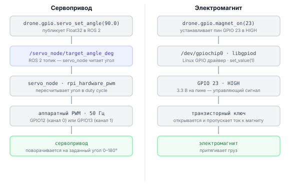

# Как работают серво и магнит

Описание внутреннего устройства двух механизмов: управление сервоприводом через ROS 2 ноду `servo_node` и управление электромагнитом напрямую через GPIO.

---

## Сервопривод: сигнальный путь



---

## Управление сервоприводом из терминала

```bash
# включить PWM-выход сервопривода (servo_node должна быть запущена)
ros2 service call /servo_node/enable std_srvs/srv/SetBool "{data: true}"

# повернуть сервопривод в 90°
ros2 topic pub --once /servo_node/target_angle_deg std_msgs/msg/Float32 "{data: 90.0}"

# повернуть в 0°
ros2 topic pub --once /servo_node/target_angle_deg std_msgs/msg/Float32 "{data: 0.0}"

# вернуть в центр (90°) через сервис
ros2 service call /servo_node/center std_srvs/srv/Trigger "{}"

# выключить PWM (чтобы серва "обмякла")
ros2 service call /servo_node/enable std_srvs/srv/SetBool "{data: false}"
```

---

## Управление сервоприводом через rpi_hardware_pwm напрямую

```python
# Что мы делаем: управляем PWM напрямую без ROS 2 (только для понимания)
# rpi_hardware_pwm работает только на Raspberry Pi (bcm2712 PWM)
from rpi_hardware_pwm import HardwarePWM

pwm = HardwarePWM(pwm_channel=0, hz=50)   # 50 Гц — стандартная частота сервы
pwm.start(0)                               # запускаем с нулевым duty cycle

def angle_to_duty(angle_deg):
    # Серва: 1 мс (5%) = 0°, 1.5 мс (7.5%) = 90°, 2 мс (10%) = 180°
    # При частоте 50 Гц период = 20 мс
    # duty_cycle = (pulse_ms / 20 ms) * 100%
    pulse_ms = 1.0 + (angle_deg / 180.0) * 1.0   # от 1.0 до 2.0 мс
    return (pulse_ms / 20.0) * 100.0               # в процентах

pwm.change_duty_cycle(angle_to_duty(90))   # 90° — центр
import time; time.sleep(0.5)
pwm.change_duty_cycle(angle_to_duty(0))    # 0° — крайнее положение
time.sleep(0.5)
pwm.stop()
```

> **Примечание** `drone.gpio.servo_enable()` вызывает `/servo_node/enable`, которая и запускает этот PWM.

---

## Электромагнит через gpiod (вручную)

```python
# Что мы делаем: включаем электромагнит через транзисторный ключ на GPIO 23
import gpiod
import time

chip = gpiod.Chip("/dev/gpiochip0")
line = chip.get_line(23)
line.request(
    consumer="magnet",
    type=gpiod.LINE_REQ_DIR_OUT,
    default_vals=[0]    # начинаем с выключенного состояния
)

# поднять груз: включить электромагнит
line.set_value(1)
print("Электромагнит включён — груз притягивается")
time.sleep(3.0)

# опустить груз: выключить электромагнит
line.set_value(0)
print("Электромагнит выключен — груз отпущен")

line.release()
chip.close()
```

> **Примечание** `drone.gpio.magnet_on(23)` — прямой вызов `drone.gpio.pin_on(23)`, то есть `chip.get_line(23).set_value(1)`.

---

## Управление электромагнитом из терминала

```bash
# включить (пин 23)
gpioset gpiochip0 23=1

# выключить
gpioset gpiochip0 23=0

# проверить состояние
gpioget gpiochip0 23
```

---

