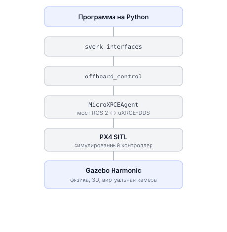

# Симулятор

На Обрике доступны два варианта симуляции: веб-симулятор в браузере и локальный симулятор на основе Gazebo.

---

## Веб-симулятор (проще всего)

Платформа «Сверх» позволяет программировать дрон прямо в браузере — без установки ROS, Python или Linux на своём компьютере.

Откройте [Песочницу](https://edu.sverk.tech/sandbox) на платформе «Сверх».

**Что умеет веб-симулятор:**

- Блочное программирование (Blockly) — собираете программу из блоков, как LEGO
- Python — пишете код и сразу запускаете
- Ручное управление с аппаратуры (режимы STABILIZED и ACRO)
- Автономные задачи: взлёт, навигация по точкам, посадка
- Виртуальная камера и ArUco-маркеры

Подходит для первого знакомства. Не нужно ничего устанавливать.

---

## Газебо — локальный симулятор (полная физика)

Локальный симулятор запускается в Docker-контейнере на вашем компьютере. Внутри работают PX4 SITL (Software-In-The-Loop) и Gazebo Harmonic с реальной физической моделью Обрика.

**Что умеет локальный симулятор:**

- Полноценная физическая симуляция с моделью квадрокоптера Обрик
- Запуск Python-программ через `sverk_interfaces` — те же команды, что и на реальном дроне
- Отработка автономных миссий: OFFBOARD, навигация по ArUco, компьютерное зрение
- Программы, написанные для симулятора, работают на реальном дроне без изменений

Это самое близкое к реальному полёту, что можно сделать без дрона.

!!! В разработке нужно пометить и дать потом ссылку на подробную по нему инструкцию !!!

---

## Пример: запустить программу в локальном симуляторе

Когда Docker-контейнер запущен, работаете точно так же, как с реальным дроном:

```python
import time
import sverk_interfaces

# создаём объект управления
drone = sverk_interfaces.init(Nodename="sim_test")
try:
    # взлёт на 1.5 м
    drone.control.navigate(
        x=0.0, y=0.0, z=1.5,
        yaw=0.0, speed=0.5,
        frame_id="body",
        auto_arm=True            # auto_arm сам переведёт в OFFBOARD
    )
    time.sleep(10.0)             # ждём взлёта

    drone.control.land()        # посадка
finally:
    drone.close()
```

Разница с реальным дроном — только в том, что при запуске ноды нужно добавить `simulator:=true`:

```bash
ros2 launch offboard_control offboard_control.launch.py simulator:=true
```

Это говорит `offboard_control`, что PX4 запущен в режиме SITL и использует немного другие имена топиков.

---

## Схема: как устроен локальный симулятор



---

## Ручное пилотирование в симуляторе

Если хотите потренировать управление стиками, читайте [Симулятор для ручного пилотирования](../manual-flight-sim.md).
