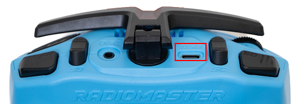
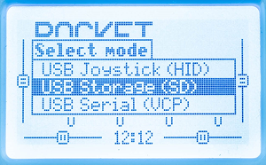
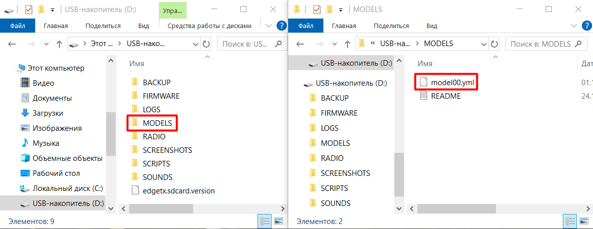
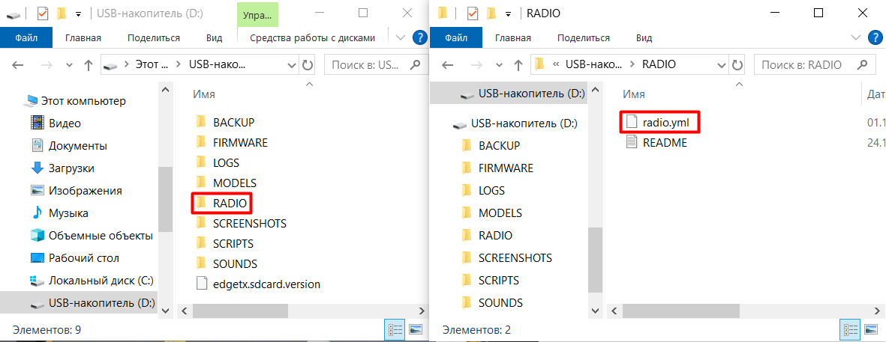
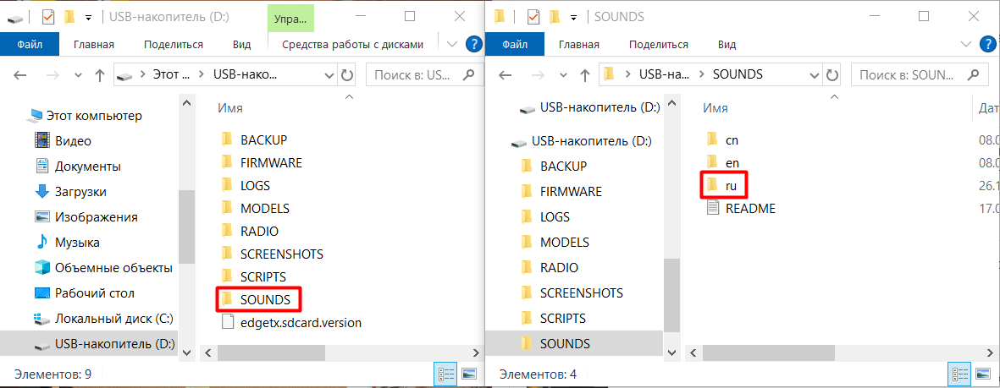
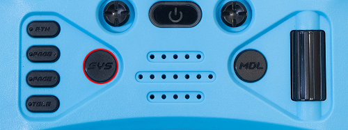
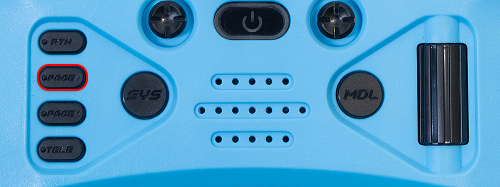

# Русская озвучка RadioMaster Pocket

RadioMaster Pocket — пульт управления Обриком, работающий по протоколу ELRS (ExpressLRS). По умолчанию системные сообщения воспроизводятся на английском. Инструкция описывает, как загрузить готовые профили и переключить озвучку на русский язык.

---

## Шаг 1. Скачайте архив с настройками

Скачайте [архив с готовыми настройками](https://www.google.com/url?q=https://drive.google.com/drive/folders/13V-xxbfMj9bZtWU3VrE0vCBnuwDvGQ82?usp%3Ddrive_link&sa=D&source=docs&ust=1773057066587064&usg=AOvVaw2IXGQhfwC7kRUnIrMfr3Ho). Внутри три файла:

| Файл | Что содержит |
|------|-------------|
| model00.yml | Профиль настроек для управления Обриком |
| radio.yml | Настройки самого передатчика (пульта) |
| ru | Папка с файлами русской озвучки |

---

## Шаг 2. Подключите пульт к компьютеру

Подключите пульт к компьютеру через верхний разъём USB-C (он находится на верхней грани пульта).

На экране пульта появится меню. Выберите **USB Storage (SD)**.

Пульт появится на компьютере как флешка.

---

## Шаг 3. Скопируйте файлы

Откройте хранилище пульта на компьютере.

В папку **MODELS** скопируйте файл `model00.yml`.

> **Примечание** Если в папке MODELS уже есть файл с таким именем, удалите его или подтвердите замену при копировании.

В папку **RADIO** скопируйте файл `radio.yml`.

> **Примечание** Если в папке RADIO уже есть файл с таким именем, удалите его или подтвердите замену при копировании.

В папку **SOUNDS** скопируйте папку `ru` целиком.

Отключите пульт от компьютера.

---

## Шаг 4. Активируйте русскую озвучку

На пульте нажмите кнопку **SYS**.

С помощью кнопки **PAGE>** перейдите в третью вкладку (3/7) **RADIO SETUP**.

Пролистайте вниз до строки **voice language** и выберите **Russian**.

Готово. Пульт будет говорить по-русски.

---

## Что означает мигание на приёмнике

Приёмник ELRS стоит на дроне и принимает сигналы от пульта. По миганию светодиода на нём можно понять, что происходит:

<table class="type_table">
    <tr>
        <td></td>
        <td>Непрерывный свет</td>
        <td>Приёмник подключён к пульту, или включён режим загрузчика</td>
    </tr>
    <tr>
        <td></td>
        <td>Медленное мигание (500 мс вкл/выкл)</td>
        <td>Ожидание сигнала от пульта</td>
    </tr>
    <tr>
        <td></td>
        <td>Быстрое мигание (25 мс вкл/выкл)</td>
        <td>Режим Wi-Fi включён (для обновления прошивки приёмника)</td>
    </tr>
</table>

Если приёмник медленно мигает, а пульт включён и рядом, значит они не связаны. Нужно выполнить привязку (binding).
