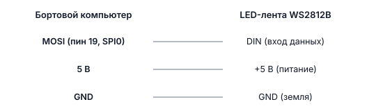

# Светодиодная лента WS2812B

## Описание

**WS2812B** — адресуемая RGB-лента. «Адресуемая» значит, что каждым светодиодом можно управлять отдельно: задать ему свой цвет. Лента подключается к Обрику по SPI и управляется через `drone.led` из библиотеки `sverk_interfaces`.

На дроне лента показывает состояние: арм, режим полёта, низкий заряд батареи, ошибки.

---

## Применение на дроне

- **Статус дрона** — по цвету и миганию сразу видно, что происходит
- **Арм** — зелёный цвет: двигатели взведены
- **Низкий заряд** — быстрое красное мигание: пора садиться
- **Offboard-режим** — фиолетовый: дрон управляется программой
- **Украшение** — радуга при включении: декоративная индикация

---

## Подключение



> **Примечание** Длинные ленты потребляют много тока. Не питайте длинную ленту от разъёма платы — используйте отдельный источник питания 5В и соедини его GND с GND Обрика.

> **Примечание** Физически устройство подключено к пинам платы (хоста). Контейнер `sverk_ros2` видит эти устройства через `/dev` благодаря пробросу в docker compose. Работайте через `drone.gpio.*` / `drone.image.*` — выходить из контейнера не нужно.

> **Примечание** SPI-устройство для ленты зависит от платы: RPi CM5 — `/dev/spidev1.0`, Orange Pi Zero 3W — `/dev/spidev3.0`, Orange Pi 5 Pro — `/dev/spidev1.0`. Полная таблица интерфейсов по платам → [Бортовые компьютеры](knowledge_base/boards-overview.md).

---

## Запуск

Нода `led_control` **уже запущена** — её поднимает [главный launch-файл](main-launch.md) при включении дрона. Для обычной работы ничего запускать не нужно: просто управляйте лентой из Python через `drone.led` (см. ниже).

Вручную лента запускается только для отладки или со своим конфигом (сначала останови копию из автозапуска):

```bash
# Запуск с настройками по умолчанию
ros2 launch led_control led.launch.py

# Запуск со своим конфигом
ros2 launch led_control led.launch.py config:=/path/to/your/led_params.yaml
```

---

## Управление из Python — эффекты

**Что мы делаем:** задаём эффект и цвет для всей ленты через `drone.led.set_effect()`.

```python
import time
import sverk_interfaces

drone = sverk_interfaces.init(Nodename="led_example")

# Вся лента красная — например, сигнал тревоги
drone.led.set_effect('fill', r=255, g=0, b=0)
time.sleep(2.0)

# Медленное мигание зелёным — режим ожидания
drone.led.set_effect('blink', r=0, g=255, b=0)
time.sleep(3.0)

# Плавное угасание к синему — режим позиционирования
drone.led.set_effect('fade', r=0, g=0, b=255)
time.sleep(2.0)

# Радуга — просто красиво, например при старте
drone.led.set_effect('rainbow', r=0, g=0, b=0)
time.sleep(3.0)

drone.close()
```

### Доступные эффекты

| Эффект | Описание |
|--------|----------|
| `fill` | Вся лента одним цветом |
| `blink` | Медленное мигание |
| `blink_fast` | Быстрое мигание |
| `fade` | Плавный переход к цвету |
| `wipe` | Заполнение по одному светодиоду |
| `flash` | Два коротких вспышки, потом предыдущий эффект |
| `rainbow` | Бегущая радуга |
| `rainbow_fill` | Вся лента плавно меняет цвет по радуге |

---

## Управление из Python — отдельные светодиоды

**Что мы делаем:** задаём разные цвета конкретным светодиодам через `drone.led.set_leds()`.

```python
import sverk_interfaces

drone = sverk_interfaces.init(Nodename="led_example")

# Первый светодиод — красный, второй — зелёный, третий — синий
# Каждый элемент: {'index': номер, 'r': красный, 'g': зелёный, 'b': синий}
drone.led.set_leds([
    {'index': 0, 'r': 255, 'g': 0,   'b': 0},    # красный
    {'index': 1, 'r': 0,   'g': 255, 'b': 0},    # зелёный
    {'index': 2, 'r': 0,   'g': 0,   'b': 255},  # синий
])

drone.close()
```

---

## Посмотреть текущее состояние ленты

```bash
# Текущее состояние всех светодиодов (обновляется 10 раз в секунду)
ros2 topic echo /led/state

# Частота публикации состояния
ros2 topic hz /led/state
```

Из Python:

```python
import sverk_interfaces

drone = sverk_interfaces.init(Nodename="led_example")

# Получаем текущее состояние ленты
state = drone.led.get_state()
print(state)

drone.close()
```

---

## Пример: подсветка по событиям полёта

**Что мы делаем:** реагируем на события дрона и меняем ленту, чтобы пилот видел состояние издалека.

```python
import time
import sverk_interfaces

drone = sverk_interfaces.init(Nodename="led_example")

# Показываем инициализацию — радуга при старте
drone.led.set_effect('rainbow', r=0, g=0, b=0)
time.sleep(2.0)

# Дрон готов к полёту — белый цвет (disarmed)
drone.led.set_effect('fill', r=255, g=255, b=255)
time.sleep(1.0)

# Арм — зелёный: осторожно, двигатели взведены!
drone.led.set_effect('fill', r=0, g=255, b=0)
time.sleep(1.0)

# Offboard-режим — фиолетовый: программа управляет дроном
drone.led.set_effect('fill', r=255, g=0, b=255)
time.sleep(1.0)

# Имитируем низкий заряд батареи — быстрое красное мигание, срочно садиться!
drone.led.set_effect('blink_fast', r=255, g=0, b=0)
time.sleep(3.0)

# Посадка — жёлтый
drone.led.set_effect('fill', r=255, g=200, b=0)
time.sleep(1.0)

# Дизарм — белый: безопасно
drone.led.set_effect('fill', r=255, g=255, b=255)

drone.close()
```

---

## Пример: мигание при ошибке

**Что мы делаем:** в случае ошибки мигаем красными вспышками — сигнал тревоги.

```python
import time
import sverk_interfaces

def signal_error(drone, duration=5.0):
    """Сигнализировать об ошибке: красные вспышки на duration секунд."""
    drone.led.set_effect('flash', r=255, g=0, b=0)
    time.sleep(duration)
    # Возвращаем в нейтральное состояние
    drone.led.set_effect('fill', r=255, g=255, b=255)

drone = sverk_interfaces.init(Nodename="led_example")

try:
    # ... основная программа ...
    pass
except Exception as e:
    print(f"Ошибка: {e}")
    signal_error(drone)
finally:
    drone.close()
```

---

## Автоматическая подсветка по состоянию дрона

Лента умеет автоматически менять цвет, когда что-то происходит на дроне. Это настраивается в файле `config/led_params.yaml`. Нода `led_control` сама следит за событиями — вам ничего не нужно писать в коде.

### События

| Событие | Когда происходит |
|---------|-----------------|
| `startup` | При запуске ноды |
| `connected` | Связь с полётным контроллером установлена |
| `disconnected` | Связь потеряна |
| `armed` | Двигатели взведены (дрон готов лететь) |
| `disarmed` | Двигатели выключены |
| `posctl` | Режим удержания позиции |
| `offboard` | Дрон управляется программой |
| `rtl` | Возврат домой |
| `land` | Посадка |
| `low_battery` | Заряд батареи критически мал |
| `error` | Ошибка в ROS 2 |

### Пример конфига

```yaml
led_node:
  ros__parameters:
    led_count: 58          # количество светодиодов в вашей ленте
    spi_bus: 0             # SPI0 (пин 19)
    led_notify: true       # включить автоматическую подсветку
    battery_min_voltage_per_cell: 3.5  # тревога при напряжении < 3.5В на банку

    events: |
      startup:        { effect: rainbow }                    # радуга при включении
      connected:      { effect: rainbow }                    # связь есть — радуга
      disconnected:   { effect: blink, r: 255, g: 50, b: 50 } # нет связи — красное мигание
      armed:          { r: 0, g: 255, b: 0 }                # взведён — зелёный
      disarmed:       { r: 255, g: 255, b: 255 }            # снят — белый
      posctl:         { r: 0, g: 0, b: 255 }                # позиционный — синий
      offboard:       { r: 255, g: 0, b: 255 }              # offboard — фиолетовый
      rtl:            { r: 255, g: 140, b: 0 }              # домой — оранжевый
      land:           { r: 255, g: 200, b: 0 }              # посадка — жёлтый
      error:          { effect: flash, r: 255, g: 0, b: 0 } # ошибка — красные вспышки
      low_battery:    { effect: blink_fast, r: 255, g: 0, b: 0 } # батарея — быстрое красное
```

---

## Сервисы и топики ноды (справочно)

| Сервис / Топик | Тип | Описание |
|----------------|-----|----------|
| `/led/set_effect` | `SetLEDEffect` | Установить эффект и цвет |
| `/led/set_leds` | `SetLEDs` | Управлять отдельными светодиодами |
| `/led/state` | `LEDStateArray` | Текущее состояние ленты (10 Гц) |

---

## Параметры ноды

| Параметр | По умолчанию | Описание |
|----------|--------------|----------|
| `led_count` | `58` | Количество светодиодов |
| `spi_bus` | `0` | Шина SPI (0 = SPI0, пин 19; 1 = SPI1, пин 38) |
| `spi_device` | `0` | Устройство SPI (обычно 0) |
| `state_publish_rate` | `10.0` | Частота публикации состояния (Гц) |
| `animation_rate` | `30.0` | Частота обновления анимации (Гц) |
| `led_notify` | `true` | Автоматическая подсветка по событиям |

---

> **Подсказка** Подробнее о реализации GPIO → [gpio-raw.md](knowledge_base/gpio-raw.md).
