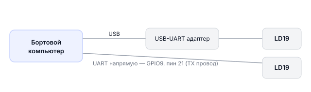
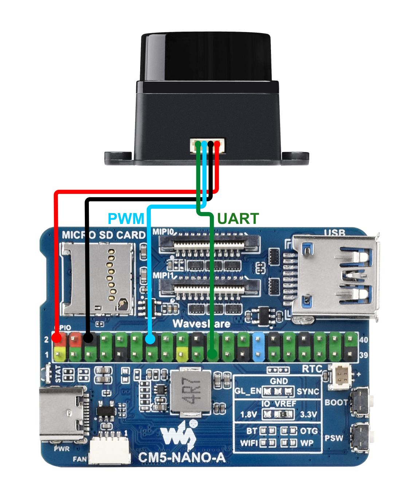

# Лидар LD19

## Описание

**LD19** — компактный лазерный сканер (лидар). Он крутится и «стреляет» лазерными лучами во все стороны, получая расстояние до объектов по всему кругу. Результат — «карта» окружения в виде облака точек.

- Угол обзора: 360°
- Скорость вращения: несколько тысяч оборотов в минуту
- Выход: ROS 2 топик `sensor_msgs/msg/LaserScan`

---

## Применение на дроне

- **Облёт препятствий** — дрон «видит» объекты вокруг себя и обходит их
- **Навигация** — строит карту помещения и ориентируется в ней
- **Посадка** — видит препятствия перед приземлением
- **Слежение** — определяет расстояние до объектов

---

## Режимы подключения

Лидар можно подключить двумя способами:



!!! Странная схема !!!

---

## Подключение по USB (простой способ)

Подключите лидар через USB-UART адаптер. Устройство появится как `/dev/ttyUSB0`.

Проверка:

```bash
ls /dev/ttyUSB*
# Должно появиться /dev/ttyUSB0 или похожее
```

> **Примечание** Эти команды выполняются **внутри контейнера** `sverk_ros2`. Устройства видны благодаря пробросу `/dev` через docker compose.

> **Примечание** Лидар подключают по USB (`/dev/ttyUSB0`) или к свободному порту **UART_B** (имя зависит от платы — см. раздел подключения по UART ниже). Полная таблица интерфейсов по платам → [Бортовые компьютеры](knowledge_base/boards-overview.md).

Запуск:

```bash
cd ~/sverk_ws
source install/setup.bash
ros2 launch lidar-ld19 ld19_usb.launch.py

# Если порт другой — указываем явно
ros2 launch lidar-ld19 ld19_usb.launch.py port_name:=/dev/ttyUSB1
```

---

## Подключение по UART (прямо в пины GPIO)

Более компактный способ — подключить провода напрямую к UART-пинам.

> **Примечание** На дроне два UART. Для подключения используйте `UART_B` — `UART_A` занят полётным контроллером PX4.

### Схема подключения

| LD19 | Бортовой компьютер |
|---|---|
| TX | GPIO9 / физический пин 21 (UART3 RX) |
| PWM | GND (когда нет внешнего управления скоростью) |
| GND | GND |
| P5V | 5V |



> **Примечание** Физически устройство подключено к пинам платы (хоста). Контейнер `sverk_ros2` видит эти устройства через `/dev` благодаря пробросу в docker compose. Работайте через `drone.gpio.*` / `drone.image.*` — выходить из контейнера не нужно.

> **Примечание** Разъём на лидаре: ZH1.5T-4P (шаг 1.5 мм).

### Включение UART3

> **Внимание** Это делается на хосте (самой плате), а не в контейнере. По обычному SSH вы попадаете сразу в контейнер `sverk_ros2` (порт 22). Чтобы выйти на хост, подключитесь на порт **2222**: `ssh -p 2222 <пользователь>@<IP_дрона>`. Имя пользователя зависит от платы: `pi` (Raspberry Pi), `orangepi` (Orange Pi), `rock` (Radxa CM5), `sunrise` (RDK X3). После `sudo reboot` снова заходите обычным `ssh` (порт 22).

Добавьте строку в файл `/boot/firmware/config.txt`:

```bash
sudo nano /boot/firmware/config.txt
```

```ini
dtoverlay=uart3-pi5
```

Перезагрузите Обрик:

```bash
sudo reboot
```

Проверка после перезагрузки:

```bash
ls -l /dev/ttyAMA*
pinctrl get 8 9
```

> **Примечание** Эти команды выполняются **внутри контейнера** `sverk_ros2`. Устройства видны благодаря пробросу `/dev` через docker compose.

### Запуск

```bash
cd ~/sverk_ws
source install/setup.bash
ros2 launch lidar-ld19 ld19_uart.launch.py

# Если нужно указать порт явно
ros2 launch lidar-ld19 ld19_uart.launch.py port_name:=/dev/ttyAMA3
```

---

## Проверка данных

После запуска лидар публикует в топик `/ld19/scan`:

```bash
# Проверить частоту обновления данных
ros2 topic hz /ld19/scan

# Получить одно сообщение и посмотреть данные
ros2 topic echo /ld19/scan --once
```

---

## Чтение данных лидара в Python

### Однократное чтение скана

```python
import sverk_interfaces
from sensor_msgs.msg import LaserScan

drone = sverk_interfaces.init(Nodename="ld19_example")

msg = drone.topic.wait_for_message(LaserScan, '/ld19/scan', timeout=5.0)
if msg:
    print(f"Угол: {msg.angle_min:.2f} — {msg.angle_max:.2f} рад")
    print(f"Точек в скане: {len(msg.ranges)}")
    # Минимальное расстояние из всего скана
    valid = [r for r in msg.ranges if 0.05 < r < 20.0]
    if valid:
        print(f"Ближайший объект: {min(valid):.2f} м")
else:
    print("Нет данных от лидара")

drone.close()
```

### Непрерывное чтение (подписка)

```python
import sverk_interfaces
from sensor_msgs.msg import LaserScan

drone = sverk_interfaces.init(Nodename="ld19_example")

def on_scan(msg):
    valid = [r for r in msg.ranges if 0.05 < r < 20.0]
    if valid:
        print(f"Ближайший объект: {min(valid):.2f} м, точек: {len(valid)}")

drone.topic.subscribe(LaserScan, '/ld19/scan', on_scan)
drone.topic.spin()

drone.close()
```

### Поиск препятствий в секторе

```python
import math
import sverk_interfaces
from sensor_msgs.msg import LaserScan

drone = sverk_interfaces.init(Nodename="ld19_example")

def find_obstacles_in_sector(msg, angle_min_deg, angle_max_deg, max_dist=2.0):
    """Найти препятствия в заданном секторе."""
    obstacles = []
    angle_min = math.radians(angle_min_deg)
    angle_max = math.radians(angle_max_deg)

    angle = msg.angle_min
    for r in msg.ranges:
        if angle_min <= angle <= angle_max:
            if msg.range_min < r < min(msg.range_max, max_dist):
                obstacles.append((math.degrees(angle), r))
        angle += msg.angle_increment

    return obstacles

def on_scan(msg):
    # Препятствия в переднем секторе ±30°
    obs = find_obstacles_in_sector(msg, -30, 30, max_dist=1.5)
    if obs:
        print(f"Препятствия впереди: {len(obs)} точек")
        closest = min(obs, key=lambda x: x[1])
        print(f"  Ближайшее: {closest[1]:.2f} м под углом {closest[0]:.1f}°")

drone.topic.subscribe(LaserScan, '/ld19/scan', on_scan)
drone.topic.spin()

drone.close()
```

---

## Отладка: нет данных

Если топик пустой — сначала проверьте частоту через диагностические команды:

```bash
ros2 topic hz /ld19/scan
```

Если частота 0 — проблема в подключении:
- Проверьте провода (TX лидара → RX Обрика)
- Проверьте, включён ли UART3 в config.txt
- Убедитесь, что нет другого процесса, который занял порт
- Проверьте, что лидар раскрутился (должен слышаться тихий звук вращения)

> **Примечание** Для диагностики на уровне сырых байт (чтение UART напрямую) — см. [knowledge_base/devices-raw.md](knowledge_base/devices-raw.md).

---

## Технические детали

- Протокол: UART, скорость **230400 бод**, 8N1 (8 бит данных, без чётности, 1 стоп-бит)
- Команды запуска не нужны: лидар сразу после подачи питания начинает вращаться и передавать данные
- Нода разбирает бинарный поток и публикует в стандартный формат `sensor_msgs/msg/LaserScan`

---

## См. также

Низкоуровневые примеры с `ros2 topic pub`, прямым rclpy и сырым чтением UART:
→ [knowledge_base/devices-raw.md](knowledge_base/devices-raw.md)
