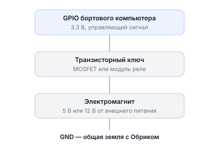
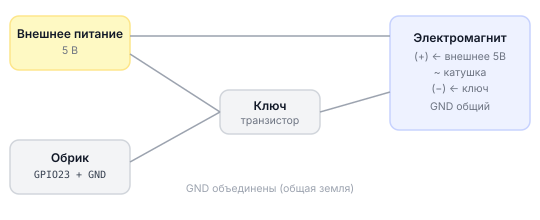

# Подключение электромагнита

## Электромагнит

**Электромагнит** — это катушка из провода вокруг железного сердечника. Когда по ней течёт ток — она притягивает металлические предметы. Ток выключили — притяжение исчезло. Простой и надёжный способ захватить и отпустить груз.

На дроне электромагнит позволяет:
- Подхватить металлический груз в воздухе
- Доставить и положить груз в нужном месте
- Выполнить задание на точность доставки

---

## Подключение

### Важно: нельзя подключать напрямую к GPIO!

GPIO Обрика работает на **3.3 В** и выдаёт очень маленький ток (не более 16 мА). Электромагнит потребляет намного больше и работает от 5 В или 12 В. Прямое подключение **сожжёт** бортовой компьютер.

Нужен **транзисторный ключ** — небольшая схема, которая позволяет слабым сигналом GPIO управлять мощной нагрузкой:



> **Внимание** Не забудь подключить **защитный диод** параллельно электромагниту — при выключении катушка даёт обратный импульс напряжения, который может повредить транзистор.

---

## Схема подключения

!!! Лучше взять старую схему из клевера !!!



> **Примечание** Физически устройство подключено к пинам платы (хоста). Контейнер `sverk_ros2` видит эти устройства через `/dev` благодаря пробросу в docker compose. Работайте через `drone.gpio.*` / `drone.image.*` — выходить из контейнера не нужно.

---

## Управление из Python

**Что мы делаем:** включаем электромагнит (захватываем груз), ждём, выключаем (отпускаем груз).

```python
import time
import sverk_interfaces

drone = sverk_interfaces.init(Nodename="magnet_example")

try:
    print("Включаем электромагнит — захватываем груз")
    # magnet_on() подаёт HIGH на пин 23 → ключ открывается → ток течёт через катушку
    drone.gpio.magnet_on(pin=23)
    time.sleep(3.0)                           # держим груз 3 секунды

    print("Выключаем электромагнит — отпускаем груз")
    # magnet_off() подаёт LOW на пин 23 → ключ закрывается → ток прекращается
    drone.gpio.magnet_off(pin=23)

finally:
    # На всякий случай убеждаемся, что магнит выключен
    drone.gpio.magnet_off(pin=23)
    drone.close()
```

---

## Управление через API дрона — полный сценарий доставки

**Что мы делаем:** взлетаем, летим к точке, включаем магнит, забираем груз, летим к цели, выключаем магнит, садимся.

```python
import time
import sverk_interfaces

drone = sverk_interfaces.init(Nodename="magnet_example")

try:
    # 1. Взлетаем на 1.5 метра и ждём стабилизации
    drone.control.navigate(z=1.5, frame_id='body', speed=0.5)
    time.sleep(3.0)

    # 2. Летим к точке забора груза
    drone.control.navigate(x=1.0, y=0.0, z=1.5, frame_id='map', speed=0.5)
    time.sleep(4.0)

    # 3. Снижаемся к грузу
    drone.control.navigate(x=1.0, y=0.0, z=0.2, frame_id='map', speed=0.3)
    time.sleep(3.0)

    # 4. Включаем магнит — захватываем груз
    drone.gpio.magnet_on(pin=23)
    print("Магнит включён — груз захвачен")
    time.sleep(0.5)                            # пауза для надёжного захвата

    # 5. Поднимаемся с грузом
    drone.control.navigate(x=1.0, y=0.0, z=1.5, frame_id='map', speed=0.3)
    time.sleep(3.0)

    # 6. Летим к точке доставки
    drone.control.navigate(x=3.0, y=0.0, z=1.5, frame_id='map', speed=0.5)
    time.sleep(5.0)

    # 7. Снижаемся для сброса груза
    drone.control.navigate(x=3.0, y=0.0, z=0.3, frame_id='map', speed=0.3)
    time.sleep(3.0)

    # 8. Выключаем магнит — груз положен
    drone.gpio.magnet_off(pin=23)
    print("Магнит выключен — груз доставлен")
    time.sleep(0.5)

    # 9. Поднимаемся и садимся
    drone.control.navigate(x=0.0, y=0.0, z=1.5, frame_id='map', speed=0.5)
    time.sleep(4.0)
    drone.control.land()

finally:
    # Безопасность: всегда убеждаемся, что магнит выключен
    drone.gpio.magnet_off(pin=23)
    drone.close()
```

---

## Как проверить

1. Подключите транзисторный ключ и электромагнит по схеме
2. Запустите простой тест из Python (раздел выше)
3. Поднеси металлический предмет к электромагниту — при включении он должен притянуться
4. Убедитесь, что при выключении предмет свободно падает

---

> **Подсказка** Подробнее о реализации серво и магнита → [servo-magnet-raw.md](knowledge_base/servo-magnet-raw.md).
