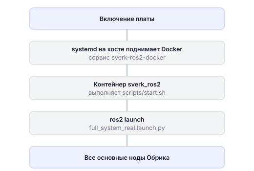

# Запуск системы

У Обрика есть **один главный launch-файл**, который запускает сразу все основные системы дрона. Он стартует **автоматически** при включении дрона — вам не нужно вручную запускать камеру, ArUco и `offboard_control`, ленту или веб-интерфейс по отдельности. Включили дрон — всё уже работает.

Файл launch-файла:

```
sverk_ws/src/sverk_drone/main_package/launch_system/launch/full_system_real.launch.py
```

---

## Как происходит автозапуск

Когда вы включаете плату, цепочка такая:



Поэтому, как только дрон включился и появилась его Wi-Fi сеть, все сервисы (`/navigate`, `/land`, лента, видеопоток, ArUco-навигация) уже доступны.

---

## Что запускает главный launch-файл

**Ядро — работает всегда:**

| Система | Что делает |
|---------|-----------|
| `MicroXRCEAgent` | мост между бортовым компьютером и PX4 (по UART) |
| `mavlink-routerd` | мост к QGroundControl по Wi-Fi |
| Камера | публикует кадры в `/camera_1/image_raw` |
| ArUco (детект, карта, локализация) | определяет позицию дрона по меткам на полу |
| VIO (`px4_local_pose_publisher`) | передаёт позицию от ArUco в PX4 |
| `offboard_control` | принимает команды полёта (`/navigate`, `/land`, телеметрия) |
| `led_control` | управление светодиодной лентой |
| Веб | видеопоток, rosboard, HTTP API, сервисы калибровки |

Именно поэтому в статьях по программированию **не нужно** запускать `ros2 run offboard_control` или `ros2 launch led_control` — эти ноды уже подняты автозапуском.

**Опциональная периферия — НЕ в автозапуске:**

Серво, лазерные дальномеры VL53L1X, Arduino и лидар главный launch-файл по умолчанию **не** запускает. Их вы запускаете сами (отдельным `ros2 launch`, как описано в их разделах) — или добавляете в главный launch-файл, если хотите, чтобы они тоже поднимались автоматически.

---

## Как настроить, что запускается

В начале файла `full_system_real.launch.py` — простые флаги-выключатели. Поставьте `True`/`False`, чтобы включить или выключить подсистему:

```python
ENABLE_ARUCO = True
ENABLE_CAMERA = True
ENABLE_VIO = True            # отправлять позицию от ArUco в PX4
ENABLE_MAVLINKROUTER = True  # мост к QGroundControl
ENABLE_WEB = True
ENABLE_LED = True
ENABLE_AI = False
ENABLE_LIDAR = False
ENABLE_PID_TUNING = False    # ассистент PID-тюнинга (веб-интерфейс :8086), диагностика
ENABLE_SELF_CHECK = True     # нода самопроверки self_check

MK_NAME = "RPI"              # тип платы: RPI | RADXA | RDX | ORANGE | ORANGE_3W
```

- **`ENABLE_*`** — включить/выключить подсистему.
- **`MK_NAME`** — какая у вас плата. От этого зависит, к какому порту подключается PX4-мост (`/dev/ttyAMA0`, `/dev/ttyS2` и т.д.) и какой драйвер камеры используется. **Поставьте значение для своей платы.**
- Ниже в файле — параметры камеры (`CAMERA_SENSOR`, `CAMERA_WIDTH`, `CAMERA_HEIGHT`, `CAMERA_FPS`).

### ArUco/VIO на реальном дроне

`ENABLE_VIO=True` запускает `px4_local_pose_publisher`: он преобразует
`/aruco/world_pose` из ENU/FLU в NED/FRD и отправляет позу в
`/fmu/in/vehicle_visual_odometry`. Параметры EKF2 берутся из профиля PX4.

ArUco pipeline ждёт 15 согласованных offset-кандидатов и ограничивает covariance
снизу. В real launch `initialize_at_origin=false`: карта ArUco совмещается с
текущим `map→base_link` от PX4.

GPS-to-ArUco handoff, rangefinder bridge и настройка EKF2 выполняются только в
`full_system_sitl.launch.py`. Подробнее: [Навигация по
ArUco](knowledge_base/aruco-navigation.md).

---

## Рабочий цикл: изменил → пересобрал → перезапустил

Главный launch-файл и весь код Обрика собираются через `colcon`. Чтобы изменения (в коде или во флагах launch-файла) вступили в силу:

**Шаг 1. Пересобрать — внутри контейнера** (по SSH вы и так в контейнере, порт 22):

```bash
cd ~/sverk_ws
colcon build --packages-select launch_system   # если менял сам launch-файл
# или colcon build — пересобрать всё, если менял код пакетов
source install/setup.bash
```

**Шаг 2. Перезапустить контейнер — на хосте** (порт 2222), чтобы автозапуск поднял системы заново:

```bash
ssh -p 2222 <пользователь>@<IP_дрона>
sudo systemctl restart sverk-ros2-docker
```

Установленный на плате сервис всегда называется одинаково — `sverk-ros2-docker.service`
(имя, под которым он стоит в `/etc/systemd/system/`, не зависит от платы). Разница
между платами — только в том, какой `docker-compose.<плата>.yml` подставлен внутрь
юнита; оба пути (ручная установка и автосборщик) рендерят его из одного общего
`image_builder/systemd/sverk-ros2-docker.service.template`, копий на плату больше нет.

Пользователь хоста зависит от платы:

| Плата | `MK_NAME` | Пользователь хоста |
|-------|-----------|--------------------|
| Raspberry Pi CM5 | `RPI` | `pi` |
| Radxa CM5 | `RADXA` | `rock` |
| Orange Pi 5 Pro | `ORANGE` | `orangepi` |
| Orange Pi Zero 3W | `ORANGE_3W` | `orangepi` |
| RDK X3 | `RDX` | (своя настройка платы) `sunrise` |

> **Подсказка** Можно просто перезагрузить плату (`sudo reboot` на хосте) — после загрузки автозапуск всё поднимет сам. `systemctl restart` быстрее, потому что не ждёт полной перезагрузки.

---

## Когда запускать ноды вручную

Ручной `ros2 run` / `ros2 launch` нужен в двух случаях:

1. **Опциональная периферия** (серво, дальномеры, Arduino, лидар) — её в автозапуске нет, поэтому запускаете сам.
2. **Отладка** — когда хотите перезапустить один узел с другими параметрами. Тогда сначала желательно остановить его копию из автозапуска (перезапуск контейнера вернёт всё как было).

Проверить, что уже запущено:

```bash
ros2 node list      # список запущенных нод
ros2 topic list     # список топиков
```
