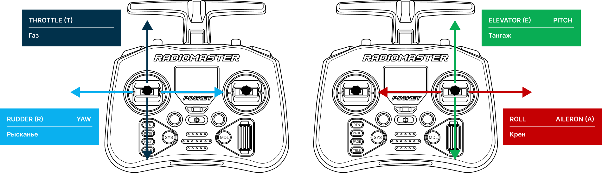
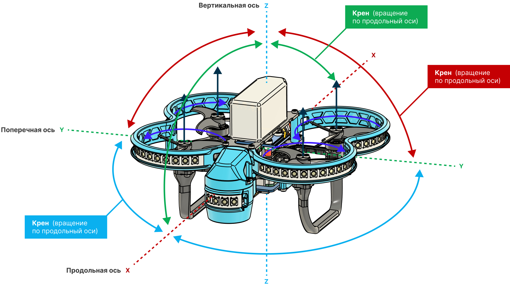
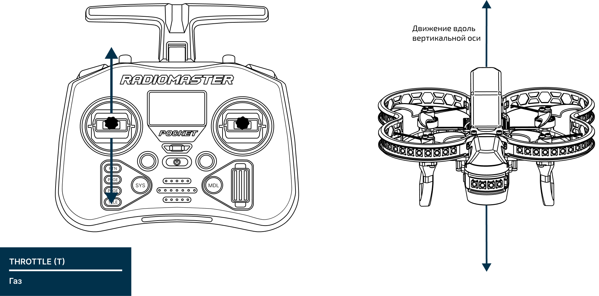
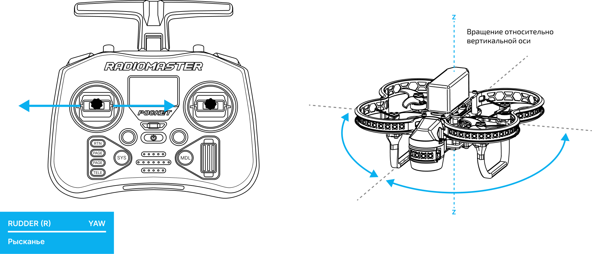
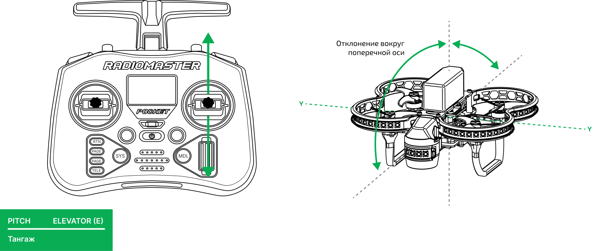
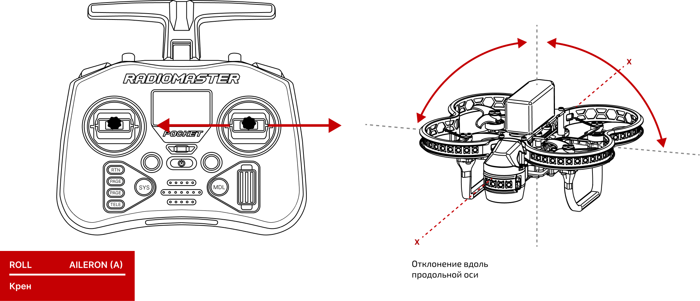

# Основы ручного пилотирования

Управление Обриком выполняется двумя стиками аппаратуры управления. Этот раздел описывает назначение стиков и отличия полётных режимов.

---

## Управление стиками

По умолчанию **левый стик** отвечает за газ и рысканье, а **правый стик** — за крен и тангаж. Эти термины используются для всех летательных аппаратов, от самолётов до квадрокоптеров.

---

### Газ (Throttle) — подъём и спуск

**Газ** отвечает за скорость вращения всех четырёх двигателей одновременно. Больше газа — дрон поднимается, меньше — опускается.

---

### Рысканье (Yaw) — поворот вокруг своей оси

**Рысканье** отвечает за повороты вокруг вертикальной оси (Z). Смещение стика вправо — дрон вращается по часовой стрелке, влево — против.

> **Примечание** «Вперёд» и «назад», «влево» и «вправо» задаются относительно носа дрона, а не оператора. Если дрон развернулся к вам спиной, стик «вперёд» уведёт его от вас.

---

### Тангаж (Pitch) — наклон вперёд и назад

**Тангаж** отвечает за наклон дрона вперёд/назад, что вызывает движение в этих направлениях.

---

### Крен (Roll) — наклон влево и вправо

**Крен** отвечает за наклон дрона влево/вправо, что вызывает движение в этих направлениях.

---

> **Внимание** «Вперёд» и «назад», «влево» и «вправо» задаются **относительно носа дрона**, а не оператора. Если дрон развернулся к вам спиной — стик «вперёд» полетит от вас. Поначалу это сбивает с толку, поэтому советуем начинать полёты, всегда держа нос дрона от себя.

---

## Режимы полёта

Обрик поддерживает три режима полёта — они отличаются тем, насколько дрон «помогает» вам удерживать позицию.

> **Примечание** Действия стиков **Yaw, Pitch и Roll** во всех режимах одинаковы — они отвечают за поворот и наклоны. Различается только поведение **Throttle** и то, насколько автоматически дрон стабилизируется.

---

### STABILIZED — ручная стабилизация

Самый базовый режим. Дрон удерживает горизонтальное положение, но **высоту держать нужно самому**.

- **Throttle** — управление газом из нижнего положения стика. Стик в середине — примерно половина газа.
- При возврате правого стика в центральное положение **Обрик выровняется**, но продолжит движение по инерции и под воздействием ветра.

> **Подсказка** Этот режим — как езда на велосипеде без рук: вертикаль держите сам. Для первых полётов лучше использовать POSITION.

---

### ALTITUDE — удержание высоты

Дрон сам удерживает высоту, вам остаётся управлять только направлением.

- **Throttle** — управление из центрального положения стика. Центр = зависание, выше центра = подъём, ниже = спуск.
- При возврате обоих стиков в центральное положение **Обрик выровняется и будет удерживать текущую высоту**, но горизонтальное смещение от ветра не компенсирует.

---

### POSITION — полное удержание позиции

Самый «умный» режим. Дрон удерживает и высоту, и горизонтальную позицию, компенсируя ветер и другие силы.

- **Throttle** — управление из центрального положения стика.
- При возврате обоих стиков в центральное положение **Обрик зависнет в точке в пространстве** и никуда не сдвинется, даже при порыве ветра.

> **Подсказка** POSITION — лучший режим для обучения и для автономного полёта. Именно в этом режиме рекомендуется выполнять первые взлёты и посадки.
