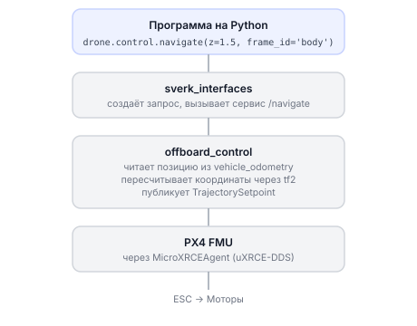

# Нода offboard_control

Нода `offboard_control` — это сердце управляющей программы Обрика. Она принимает команды через ROS 2 сервисы (`/navigate`, `/land`, `/get_telemetry` и другие), пересчитывает координаты и отправляет управляющие сигналы напрямую в PX4 через протокол uXRCE-DDS.

Вам не нужно трогать эту ноду напрямую — библиотека `sverk_interfaces` делает это за вас. Но понимать, как она устроена, полезно.

---

## Схема: от кода до моторов



---

## Требования

- ROS 2 Humble (или совместимый)
- Пакеты: `px4_msgs`, `px4_ros_com`, `offboard_interfaces`, `tf2_ros`, `tf2_geometry_msgs`, `geometry_msgs`, `std_srvs`
- PX4 с поддержкой uXRCE-DDS и запущенный `MicroXRCEAgent`

---

## Сборка

```bash
cd ~/sverk_ws
source /opt/ros/humble/setup.bash
colcon build --packages-select offboard_control
source install/setup.bash
```

---

## Запуск

> **Примечание** Нода `offboard_control` **уже работает** — её запускает [главный launch-файл](main-launch.md) при включении дрона. Для обычной работы запускать её не нужно: сразу управляйте дроном через `sverk_interfaces`. Ручной запуск ниже нужен только для отладки (например, с другими параметрами) — тогда сначала останови копию из автозапуска.

### Запуск ноды напрямую

> **Примечание** Команды запускаются **внутри контейнера** `sverk_ros2` — по SSH вы попадаете туда сразу: `ssh sverk@<IP_дрона>` (порт 22, пароль: sverk).

Обычный режим (реальный дрон):

```bash
ros2 run offboard_control offboard_control
```

Режим симулятора (PX4 SITL добавляет суффикс к топикам):

```bash
ros2 run offboard_control offboard_control --ros-args -p simulator:=true
```

### Запуск через launch-файл (рекомендуется)

```bash
ros2 launch offboard_control offboard_control.launch.py
```

С изменением параметров:

```bash
# другое имя мировой системы координат
ros2 launch offboard_control offboard_control.launch.py map_frame_id:=odom

# медленная скорость по умолчанию и длинный таймаут
ros2 launch offboard_control offboard_control.launch.py default_speed:=0.3 offboard_timeout:=15.0

# запуск с разрешением посадки только в режиме OFFBOARD
ros2 launch offboard_control offboard_control.launch.py land_only_in_offboard:=true
```

---

## Параметры ноды

| Параметр | Тип | По умолчанию | Что делает |
|----------|-----|--------------|-----------|
| `body_frame_id` | string | `base_link` | Имя фрейма корпуса в TF |
| `map_frame_id` | string | `map` | Имя мировой системы координат |
| `aruco_map_frame_id` | string | `aruco_map` | Имя системы координат маркеров |
| `transform_timeout` | double | 0.5 | Сколько секунд ждать пересчёт координат |
| `offboard_timeout` | double | 10.0 | Сколько секунд ждать перехода в OFFBOARD |
| `arming_timeout` | double | 5.0 | Сколько секунд ждать арминга |
| `default_speed` | double | 0.5 | Скорость по умолчанию для navigate (м/с) |
| `land_only_in_offboard` | bool | true | Разрешать посадку только в режиме OFFBOARD |
| `check_kill_switch` | bool | true | Учитывать kill switch с пульта |
| `local_position_timeout` | double | 2.0 | Таймаут данных о локальной позиции (с) |
| `global_position_timeout` | double | 10.0 | Таймаут данных GPS (с) |
| `battery_timeout` | double | 2.0 | Таймаут данных батареи (с) |
| `manual_control_timeout` | double | 0.0 | Таймаут ручного управления; 0 = отключено; при >0 потеря пульта в полёте → failsafe ноды |
| `simulator` | bool | false | Режим симулятора |
| `enforce_rc_in_sim` | bool | false | Включить RC-перехват и в симуляторе (SITL с джойстиком) |
| `rc_stick_abort_thresh` | double | 0.05 | Отклонение стика пульта, при котором нода отдаёт управление пилоту |
| `enforce_freshness` | bool | true | Если одометрия устарела во время полёта — авто-удержание позиции |
| `telemetry_rate_hz` | double | 0.0 | Частота топика `/offboard_control/telemetry`; 0 = выключен |
| `geofence_enable` | bool | false | Геозона: цели вне зоны отклоняются, вылет за зону → failsafe ноды |
| `geofence_radius` | double | 10.0 | Радиус геозоны (м) |
| `geofence_center_x`, `geofence_center_y` | double | 0.0 | Центр геозоны в map |
| `alt_floor`, `alt_ceil` | double | 0.0 / 50.0 | Коридор высоты геозоны (м) |
| `max_speed` | double | 0.0 | Лимит скорости для navigate/set_velocity; 0 = без лимита |
| `onboard_failsafe_action` | string | `hold` | Что делать при срабатывании защит: `hold` / `land` / `rtl` |
| `land_from_hold` | bool | false | Разрешить `land` также из режимов удержания (AUTO.LOITER и др.) |
| `zero_heading_at_start` | bool | = `simulator` | Обнулять отображаемый курс по первому сэмплу одометрии (только вывод, не управление) |

---

## Все сервисы

Нода предоставляет сервисы в глобальном пространстве имён: `/navigate`, `/land`, `/get_telemetry` и т.д.

!!! Тут нужны имено примеры вызова сервисов, а не API sverk_ws\src\sverk_drone\sverk_interfaces описывалась ранее !!!

---

### /navigate — полёт к точке

Тип: `offboard_interfaces/srv/Navigate`

Плавный полёт к целевой позиции. Курс устанавливается сразу при получении команды. Подходит для взлёта, перелёта по прямой, простых маршрутов.

| Поле | Тип | Описание |
|------|-----|----------|
| `x`, `y`, `z` | float32 | Целевая позиция в метрах |
| `yaw` | float32 | Целевой курс в радианах |
| `speed` | float32 | Скорость в м/с |
| `frame_id` | string | Система координат: `map`, `body`, `terrain`, `aruco_map` |
| `auto_arm` | bool | Перейти в OFFBOARD и заармировать перед полётом |

Ответ: `success` (bool), `message` (string).

```python
import sverk_interfaces
drone = sverk_interfaces.init(Nodename="nav_example")

# взлёт на 1.5 м относительно корпуса дрона
drone.control.navigate(x=0.0, y=0.0, z=1.5, yaw=0.0, speed=1.0,
                        frame_id="body", auto_arm=True)

# полёт к точке в мировой системе координат
drone.control.navigate(x=1.0, y=0.0, z=1.0, yaw=0.0, speed=0.5,
                        frame_id="map", auto_arm=False)
```

---

### /land — посадка

Тип: `std_srvs/srv/Trigger`

Переводит PX4 в режим AUTO.LAND. Если параметр `land_only_in_offboard:=true`, команда принимается только когда дрон уже в режиме OFFBOARD.

```python
import sverk_interfaces
drone = sverk_interfaces.init(Nodename="land_example")
drone.control.land()
drone.close()
```

---

### /get_telemetry — телеметрия

Тип: `offboard_interfaces/srv/GetTelemetry`

Возвращает полное состояние дрона.

| Поле ответа | Описание |
|-------------|----------|
| `connected` | Подключён ли PX4 |
| `armed` | Включены ли моторы |
| `mode` | Текущий режим (OFFBOARD, POSITION...) |
| `x`, `y`, `z` | Позиция в метрах (ENU) |
| `yaw` | Курс в радианах (NED, 0 = север) |
| `vx`, `vy`, `vz` | Скорость в м/с |
| `lat`, `lon`, `alt` | GPS-координаты |
| `voltage` | Напряжение батареи в вольтах |

```python
import sverk_interfaces
drone = sverk_interfaces.init(Nodename="telem_example")
telem = drone.control.get_telemetry(frame_id="map")
print(f"Позиция: x={telem.x:.2f}, y={telem.y:.2f}, z={telem.z:.2f}")
print(f"Режим: {telem.mode}, armed: {telem.armed}, батарея: {telem.voltage:.1f} В")
drone.close()
```

> **Примечание** Команды для отладки в терминале → [база знаний: ros2-raw.md](knowledge_base/ros2-raw.md)

---

### /set_altitude — сменить высоту

Тип: `offboard_interfaces/srv/SetAltitude`

Меняет только высоту в текущей миссии, не прерывая полёт.

```python
import sverk_interfaces
drone = sverk_interfaces.init(Nodename="altitude_example")
# 2 м над поверхностью (terrain)
drone.control.set_altitude(z=2.0, frame_id="terrain")
drone.close()
```

---

### /set_yaw — повернуться на угол

Тип: `offboard_interfaces/srv/SetYaw`

Меняет курс, не прерывая текущую миссию. `yaw: nan` сбрасывает ручное управление курсом.

```python
import sverk_interfaces
drone = sverk_interfaces.init(Nodename="yaw_example")
# поворот на -90° (90° по часовой) относительно корпуса
drone.control.set_yaw(yaw=-1.5708, frame_id="body")
# сбросить управление курсом
drone.control.clear_yaw_override()
drone.close()
```

---

### /set_yaw_rate — вращение с постоянной скоростью

Тип: `offboard_interfaces/srv/SetYawRate`

Задаёт угловую скорость по вертикальной оси. Положительное значение — против часовой стрелки (вид сверху).

```python
import sverk_interfaces
drone = sverk_interfaces.init(Nodename="yawrate_example")
# вращение 0.5 рад/с против часовой
drone.control.set_yaw_rate(yaw_rate=0.5)
# остановить вращение:
drone.control.clear_yaw_override()
drone.close()
```

---

### /set_position — задать точку для удержания

Тип: `offboard_interfaces/srv/SetPosition`

Удобно при частом обновлении цели (кружение, следование по траектории). Нода сразу начинает лететь к указанной точке.

```python
import sverk_interfaces
drone = sverk_interfaces.init(Nodename="setpos_example")
# зависание на текущем месте
drone.control.set_position(x=0.0, y=0.0, z=0.0, yaw=0.0,
                            frame_id="body", auto_arm=False)
# подняться на 3 м выше текущей позиции
drone.control.set_position(x=0.0, y=0.0, z=3.0, yaw=0.0,
                            frame_id="body", auto_arm=False)
drone.close()
```

---

### /set_velocity — управление скоростью

Тип: `offboard_interfaces/srv/SetVelocity`

Дрон летит с заданными скоростями по осям.

```python
import sverk_interfaces
drone = sverk_interfaces.init(Nodename="setvel_example")
# лететь вперёд 1 м/с по оси корпуса
drone.control.set_velocity(vx=1.0, vy=0.0, vz=0.0, yaw=0.0,
                            frame_id="body", auto_arm=False)
drone.close()
```

---

### /set_attitude — управление углами (продвинутое)

Тип: `offboard_interfaces/srv/SetAttitude`

Аналог режима STABILIZED: задаёте крен, тангаж, курс и газ напрямую.

| Поле | Тип | Описание |
|------|-----|----------|
| `roll`, `pitch`, `yaw` | float32 | Углы в радианах |
| `thrust` | float32 | Газ от 0 до 1 |
| `frame_id` | string | Система координат для yaw |
| `auto_arm` | bool | Перейти в OFFBOARD и заармировать |

---

### /set_rates — управление угловыми скоростями (самое низкоуровневое)

Тип: `offboard_interfaces/srv/SetRates`

Аналог режима ACRO. Задаёте скорости вращения по каждой оси и газ.

| Поле | Тип | Описание |
|------|-----|----------|
| `roll_rate`, `pitch_rate`, `yaw_rate` | float32 | Угловые скорости в рад/с |
| `thrust` | float32 | Газ от 0 до 1 |
| `auto_arm` | bool | OFFBOARD и арминг при необходимости |

Положительные направления: `yaw_rate` против часовой (вид сверху), `pitch_rate` нос вверх, `roll_rate` влево.

---

### /flip — автоматический кувырок

Тип: `offboard_interfaces/srv/Flip`

Кувырок в три фазы: подъём, вращение, возврат в исходную точку.

> **Внимание** Минимальная высота перед кувырком — 2 метра.

Как это работает внутри:

| Фаза | Что делает PX4 |
|------|----------------|
| CLIMB | Летит вверх со скоростью `vz` в течение `climb_duration` с |
| ROTATE | Вращается с угловой скоростью `rate` по оси `axis` до угла `target_angle` |
| POSITION_HOLD | Возвращается к исходной позиции и зависает |

```python
import sverk_interfaces
drone = sverk_interfaces.init(Nodename="flip_example")
# кувырок вокруг оси roll (полный оборот)
drone.control.flip(axis="roll", vz=2.0, climb_duration=0.5,
                    rate=16.0, target_angle=6.0, thrust=0.1, auto_arm=False)
drone.close()
```

Параметры:

| Поле | Описание |
|------|----------|
| `axis` | `"roll"`, `"pitch"` или `"yaw"` |
| `vz` | Скорость подъёма (м/с) |
| `climb_duration` | Время подъёма (с) |
| `rate` | Скорость вращения (рад/с), знак задаёт направление |
| `target_angle` | Целевой угол (рад); 6.28 = полный оборот, 6.0 = чуть меньше |
| `thrust` | Газ во время вращения (0.1 обычно хватает) |
| `auto_arm` | Перейти в OFFBOARD и заармировать перед кувырком |

---

### /emergency_stop — аварийный стоп любого манёвра

Тип: `offboard_interfaces/srv/EmergencyStop`

Немедленно останавливает **любой** активный манёвр. `land: false` — дрон
зависает на текущем месте; `land: true` — останавливает манёвр и садится.
Работает даже пока другой сервис ждёт арминга.

Из Python: `drone.control.emergency_stop()` / `drone.control.emergency_stop(land=True)`.

```bash
ros2 service call /emergency_stop offboard_interfaces/srv/EmergencyStop "{land: false}"
```

---

### /return_to_launch — возврат на точку старта

Тип: `offboard_interfaces/srv/ReturnToLaunch`

Останавливает активный манёвр и переводит PX4 в `AUTO.RTL`: дрон летит на
точку взлёта (home) и садится. Запрос без полей.

Из Python: `drone.control.return_to_launch()`.

```bash
ros2 service call /return_to_launch offboard_interfaces/srv/ReturnToLaunch "{}"
```

---

## Действия (actions)

### /navigate_to — полёт к точке с ожиданием прилёта

Тип: `offboard_interfaces/action/NavigateTo`

Как сервис `navigate`, но клиент получает feedback (`distance_remaining`,
`eta`, `phase`) до самого прибытия и result по факту прилёта
(`success`, `final_distance_error`).

Действие **всегда завершается**, даже если дрон физически не может долететь:

| Ситуация | Что происходит |
|----------|----------------|
| Дрон долетел (штатный допуск 0.08 м) | result `success=true` |
| `tolerance` > 0 и дрон ближе неё | result `success=true` сразу; полёт доводит дрон до точной цели |
| Прошло `timeout` секунд, а цели нет | дрон паркуется (hold), result `success=false` («Timeout») |
| Клиент отменил goal | мягкий стоп: зависание на месте, `success=false` |
| Другая команда перебила манёвр | `success=false` («superseded»), новый манёвр не трогается |

`timeout: 0.0` (по умолчанию) — автоматический лимит: тройное расчётное время
полёта + 10 с; `timeout: -1.0` — без лимита (ждать до отмены).

Из Python: `drone.control.navigate_to(...)` (result + feedback) и
`drone.control.navigate_wait(...)` (тот же action, исключения по таймауту).

```bash
ros2 action send_goal -f /navigate_to offboard_interfaces/action/NavigateTo \
  "{x: 1.0, y: 0.0, z: 1.5, yaw: 0.0, speed: 0.5, frame_id: 'map', auto_arm: false, timeout: 30.0, tolerance: 0.2}"
```

### /receive_telemetry — поток телеметрии

Тип: `offboard_interfaces/action/ReceiveTelemetry`

Стрим телеметрии в feedback с нужной частотой (`rate_hz` до 200) в течение
`duration` секунд (0 = до отмены).

```bash
ros2 action send_goal -f /receive_telemetry offboard_interfaces/action/ReceiveTelemetry \
  "{rate_hz: 10.0, frame_id: 'map', duration: 5.0}"
```

### /run_excitation — возбудитель для идентификации (PID-тюнинг)

Тип: `offboard_interfaces/action/RunExcitation`

> **Внимание** НЕ read-only: нода активно трясёт летящий дрон малыми
> возмущениями (step/doublet/3-2-1-1/chirp/multisine/prbs) по одной оси для
> идентификации контуров. Порядок ввода: SITL → стенд на привязи → помещение
> с геозоной. Goal требует фразу-подтверждение
> `confirm: "I_UNDERSTAND_WHAT_I_AM_DOING"`.

Работает в паре с анализатором `pid_tuning_assistant` (веб-интерфейс на порту
8086, включается флагом `ENABLE_PID_TUNING` главного launch-файла): нода
публикует референс `r(t)` в `/offboard_control/excitation/reference`, ассистент
записывает отклик и считает рекомендации по PID. Аварийная остановка — сервис
`/stop_excitation` (`emergency: true` — немедленный возврат в hold). Полное
описание паттернов, предохранителей и параметров `excite_*` — в
`offboard_control/Readme.md`.

---

## Топики ноды

| Топик | Что внутри |
|-------|-----------|
| `/offboard_control/telemetry` | Та же телеметрия, что `get_telemetry`, потоком; включается параметром `telemetry_rate_hz` (можно на лету: `ros2 param set /offboard_control telemetry_rate_hz 50.0`) |
| `/offboard_control/status` | Диагностика ноды ~2 раза в секунду: тип сетпоинта, busy, armed, режим, последняя цель, активный манёвр, причина последнего аварийного отката, возраст одометрии, батарея |
| `/offboard_control/excitation/reference` | Референс r(t) возбудителя для анализатора PID-тюнинга (публикуется только во время `run_excitation`) |

```bash
ros2 topic echo /offboard_control/status --once
```

---

## Встроенные защиты

Нода следит за полётом в каждом тике управления:

- **RC-перехват** — kill-switch или отклонение стика пульта (порог
  `rc_stick_abort_thresh`) немедленно останавливает манёвр и отдаёт управление
  пилоту (на стороне PX4 нужен `COM_RC_OVERRIDE=3`).
- **Потеря пульта** — при `manual_control_timeout > 0` устаревший сигнал пульта
  запускает failsafe ноды.
- **Свежесть одометрии** (`enforce_freshness`) — если позиция устарела, дрон
  паркуется на последней валидной позе.
- **Геозона** (`geofence_enable`) — цели вне цилиндра отклоняются, вылет за
  зону в полёте запускает failsafe.
- Действие failsafe выбирается параметром `onboard_failsafe_action`:
  `hold` (зависнуть, по умолчанию), `land` (сесть), `rtl` (вернуться на старт).
  Причина последнего срабатывания видна в `/offboard_control/status`
  (`last_abort_reason`).

---

## Типичный сценарий: симулятор SITL

```bash
# 1. Запустить PX4 SITL + Gazebo (в отдельном терминале)
# 2. Запустить MicroXRCEAgent (в отдельном терминале)
# 3. Запустить offboard_control
ros2 launch offboard_control offboard_control.launch.py
```

```python
# 4. Взлёт и полёт — запускаем программа на Python
import sverk_interfaces, time
drone = sverk_interfaces.init(Nodename="sitl_test")
drone.control.navigate(x=0.0, y=0.0, z=1.0, yaw=0.0, speed=0.5,
                        frame_id="body", auto_arm=True)
time.sleep(5.0)
drone.control.land()
drone.close()
```

> **Примечание** Отладочные команды терминала (echo топиков, список сервисов) → [база знаний: ros2-raw.md](knowledge_base/ros2-raw.md)

---

## Тестовые программы

В каталоге `examples/` есть программы для проверки всего функционала:

- `test_fly_cube.py` — взлёт и полёт по траектории «куб» (относительные смещения в body).
- `test_all_services.py` — последовательная проверка всех сервисов: взлёт, set_altitude, set_yaw, set_yaw_rate, set_position, set_velocity, set_attitude, set_rates, посадка.
- `test_offboard_hardening.py` — проверка новых интерфейсов: взлёт, `navigate_to`
  (feedback до прилёта), поток `receive_telemetry`, `emergency_stop`, посадка.

```bash
cd ~/sverk_ws && source install/setup.bash
python3 src/sverk_drone/offboard/offboard_control/examples/test_fly_cube.py
python3 src/sverk_drone/offboard/offboard_control/examples/test_all_services.py
python3 src/sverk_drone/offboard/offboard_control/examples/test_offboard_hardening.py
```
