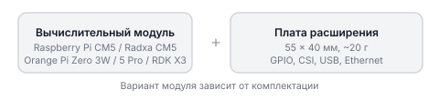
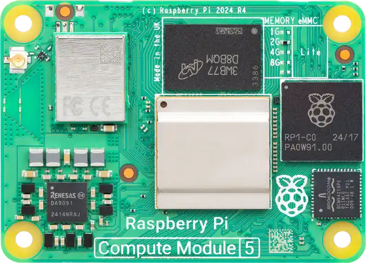
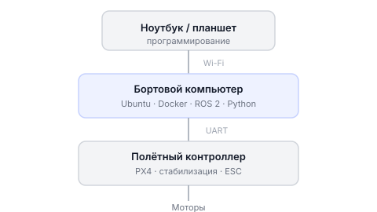

# Бортовой компьютер Обрика

Этот раздел описывает бортовой компьютер Обрика и его состав.

---

Бортовой компьютер — одноплатный компьютер на Linux, на котором работают Docker, ROS 2 и ваши программы на Python. Он связан с полётным контроллером PX4 по UART и принимает команды от вас по Wi-Fi.

!!! Не все бортовые компьютеры требуют плату расширения некоторые самодостаточные !!!

## Из чего состоит бортовой компьютер

Бортовой компьютер Обрика собран из двух частей:

Обрик поддерживает несколько вариантов бортового компьютера: **Raspberry Pi CM5**, **Radxa CM5**, **Orange Pi Zero 3W**, **Orange Pi 5 Pro**, **RDK X3**. Конкретный вариант зависит от комплектации.

Плата расширения специально сделана под Обрик: она не больше самого модуля (55 x 40 мм) и весит около 20 граммов. Это важно для дрона: каждый грамм на счету.

## Что умеет плата расширения

На плате есть несколько разъёмов для подключения оборудования:

| Разъём | Для чего нужен |
|--------|----------------|
| USB 3.1 (Type-C, до 5 Гбит/с) | Лидары, быстрые камеры |
| Ethernet (100 Мбит/с) | Надёжная связь по кабелю |
| 2x MIPI CSI (2-lane) | Две камеры одновременно (стереозрение) |
| 2x USB 2.0 | Периферия: мышь, модули |
| 40-pin GPIO (JST-SH) | Датчики, светодиодные ленты, сервоприводы |

## Как компьютер связан с дроном

Бортовой компьютер соединён с полётным контроллером по кабелю (UART). Вы подключаетесь к нему по Wi-Fi с ноутбука, пишете программу, и дрон летит по вашим инструкциям.
