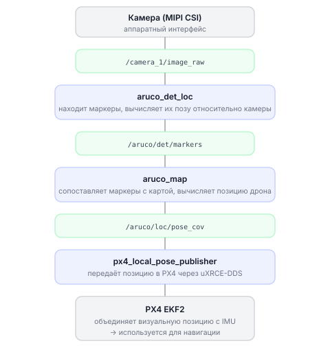

# Компьютерное зрение с OpenCV

Этот раздел для тех, кто хочет научить дрон «видеть» — распознавать цвета, находить объекты и обрабатывать изображения с камеры прямо во время полёта.

Всё взаимодействие с камерой идёт через библиотеку `sverk_interfaces` (`drone.image`) — она сама подписывается на топик камеры и **отдаёт кадр уже в формате OpenCV** (numpy-массив BGR). Вручную создавать ноды, подписки и ставить `cv_bridge` не нужно.

- получать кадры с камеры через `drone.image`
- находить объекты по цвету
- обнаруживать края и контуры
- читать QR-коды
- публиковать обработанный кадр обратно в ROS 2

---

## Как камера и ROS 2 работают вместе

> **Примечание** ROS 2 топик камеры `/camera_1/image_raw` одинаков на всех платах, поэтому код компьютерного зрения от платы не зависит. Чем платы отличаются по интерфейсам → [Бортовые компьютеры](knowledge_base/boards-overview.md).

Камера Обрика подключена к бортовому компьютеру и постоянно публикует кадры в ROS 2 топик `/camera_1/image_raw`. Любая программа может подписаться на этот топик и получать кадры.

Подписываться вручную не нужно: `drone.image.take_picture()` берёт один кадр, а `drone.image.stream()` — поток кадров. Оба сразу отдают **numpy-массив BGR** — именно то, с чем работает OpenCV.

> **Примечание** Если вам нужен исходный кадр ROS (`sensor_msgs/Image`), передайте `raw=True`: `drone.image.take_picture(raw=True)`. Перевести его в OpenCV потом можно через `drone.image.to_cv2(msg)`, а numpy обратно в ROS — через `drone.image.to_ros(img)`.

---

## Получение одного кадра

Если нужен только один снимок, а не постоянный поток:

```python
import sverk_interfaces

drone = sverk_interfaces.init(Nodename="single_frame")

img = drone.image.take_picture(timeout=5.0)   # numpy BGR (OpenCV) или None
if img is not None:
    print(f"Кадр: {img.shape[1]}x{img.shape[0]}")   # ширина x высота
    # ... обработка img ...
else:
    print("Кадр не получен. Проверьте камеру: ros2 topic hz /camera_1/image_raw")

drone.close()
```

> **Примечание** `take_picture` ждёт кадр не дольше `timeout` секунд. Если вернулось `None` — камера не публикует кадры.

---

## Поток кадров с камеры

`drone.image.stream(callback)` вызывает функцию на **каждый** пришедший кадр (callback получает numpy BGR). Аргумент `duration` ограничивает время стрима; без него стрим идёт до `drone.image.stop_stream()` или до `Ctrl+C`.

```python
import cv2
import sverk_interfaces

drone = sverk_interfaces.init(Nodename="vision_stream")

def on_frame(img):                                          # img — numpy BGR
    hsv = cv2.cvtColor(img, cv2.COLOR_BGR2HSV)
    mask = cv2.inRange(hsv, (0, 120, 70), (10, 255, 255))   # красный цвет
    print(f"Красных пикселей: {cv2.countNonZero(mask)}")

drone.image.stream(on_frame, duration=10.0)   # обрабатываем кадры 10 секунд
drone.close()
```

---

## Публикация обработанного изображения

После обработки удобно отправить результат обратно в ROS 2 — чтобы увидеть его в веб-интерфейсе Обрика. За это отвечает `drone.image.publish()`. Он принимает прямо numpy-картинку и сам упакует её в `sensor_msgs/Image`:

```python
import cv2
import sverk_interfaces

drone = sverk_interfaces.init(Nodename="detector")

def process(img):                  # img — numpy BGR
    # рисуем перекрестие в центре кадра
    h, w = img.shape[:2]
    cv2.line(img, (w // 2, 0), (w // 2, h), (0, 255, 0), 1)
    cv2.line(img, (0, h // 2), (w, h // 2), (0, 255, 0), 1)
    drone.image.publish(img)       # numpy → топик /out_detection

drone.image.stream(process)        # без duration — до Ctrl+C
drone.close()
```

> **Примечание** Результат смотрите в веб-интерфейсе Обрика (раздел просмотра топиков) или командой `ros2 run rqt_image_view rqt_image_view`, выбрав топик `/out_detection`.

---

## Детектирование объектов по цвету

OpenCV умеет находить объекты по цвету. Для этого лучше работать в цветовом пространстве HSV (оттенок, насыщенность, яркость), а не BGR: в HSV цвет меньше зависит от освещения.

```python
import cv2
import numpy as np

# img — numpy BGR, полученный из drone.image.take_picture() или в callback стрима

# шаг 1: переводим изображение из BGR в HSV
hsv = cv2.cvtColor(img, cv2.COLOR_BGR2HSV)

# шаг 2: задаём диапазон цвета, который ищем
# для красного: оттенок 0-10, насыщенность 120-255, яркость 70-255
lower = np.array([0, 120, 70])
upper = np.array([10, 255, 255])

# шаг 3: создаём маску — белые пиксели там, где цвет попал в диапазон
mask = cv2.inRange(hsv, lower, upper)

# шаг 4: находим контуры белых областей на маске
contours, _ = cv2.findContours(mask, cv2.RETR_EXTERNAL, cv2.CHAIN_APPROX_SIMPLE)

for cnt in contours:
    # игнорируем маленькие пятна (шум) — берём только крупные объекты
    if cv2.contourArea(cnt) > 500:
        # получаем прямоугольник, который обрамляет объект
        x, y, w, h = cv2.boundingRect(cnt)
        # рисуем зелёный прямоугольник вокруг найденного объекта
        cv2.rectangle(img, (x, y), (x + w, y + h), (0, 255, 0), 2)
```

---

## Обнаружение краёв (алгоритм Кэнни)

Алгоритм Кэнни находит края объектов — места, где яркость резко меняется. Хорошо работает для поиска прямоугольников, линий, границ.

```python
import cv2

# img — numpy BGR, полученный из drone.image.take_picture() или в callback стрима

# шаг 1: переводим в оттенки серого (Кэнни работает с одним каналом)
gray = cv2.cvtColor(img, cv2.COLOR_BGR2GRAY)

# шаг 2: размываем изображение, чтобы убрать мелкий шум
# (5, 5) — размер ядра размытия; чем больше, тем сильнее размытие
blurred = cv2.GaussianBlur(gray, (5, 5), 0)

# шаг 3: находим края
# threshold1=50 — нижний порог, threshold2=150 — верхний порог
# пиксели с градиентом выше 150 — точно край
# пиксели с градиентом ниже 50 — точно не край
# между 50 и 150 — зависит от соседей
edges = cv2.Canny(blurred, threshold1=50, threshold2=150)
```

---

## Чтение QR-кодов

QR-коды Обрик читает встроенным методом `drone.image.detect_qr()` — он сам берёт кадр с камеры (или принимает ваш) и возвращает список найденных кодов.

```python
import sverk_interfaces

drone = sverk_interfaces.init(Nodename="qr_reader")

# без аргументов detect_qr сам сделает снимок с камеры
codes = drone.image.detect_qr()
for code in codes:
    print("Данные:", code.data)     # раскодированный текст
    print("Центр:", code.center)    # (x, y) в пикселях
    print("Рамка:", code.rect)      # (x, y, ширина, высота)

if not codes:
    print("QR-код не найден")

drone.close()
```

У каждого найденного кода есть поля: `data` (текст), `type`, `rect` (x, y, ширина, высота), `polygon` (вершины контура) и `center` (центр в пикселях).

**В потоке — реагируем, как только код появился в кадре:**

```python
import sverk_interfaces

drone = sverk_interfaces.init(Nodename="qr_stream")

def on_frame(img):                          # img — numpy BGR
    for code in drone.image.detect_qr(img):  # передаём готовый кадр
        print("Вижу QR:", code.data)

drone.image.stream(on_frame, duration=30.0)
drone.close()
```

> **Примечание** Нужен пакет `pyzbar`: `pip install pyzbar` (и системная библиотека: `sudo apt install libzbar0`). Если его нет, `detect_qr` подскажет, что установить.

---

## Подписка на позицию дрона от ArUco-навигации

Когда дрон видит ArUco-маркеры на полу, система вычисляет его положение и публикует в топик `/aruco/loc/pose_cov`. Подписаться на любой топик можно через `drone.topic` — снова без ручного создания ноды:

```python
import sverk_interfaces
from geometry_msgs.msg import PoseWithCovarianceStamped  # тип сообщения с позицией

drone = sverk_interfaces.init(Nodename="pose_listener")

def on_pose(msg):
    # msg.pose.pose.position — объект с полями x, y, z (координаты в метрах)
    p = msg.pose.pose.position
    print(f"Позиция дрона: x={p.x:.2f} м, y={p.y:.2f} м, z={p.z:.2f} м")

drone.topic.subscribe(PoseWithCovarianceStamped, "/aruco/loc/pose_cov", on_pose)
drone.topic.spin()   # обрабатываем сообщения, пока не нажмёте Ctrl+C
```

---

## Схема: как изображение превращается в позицию дрона


