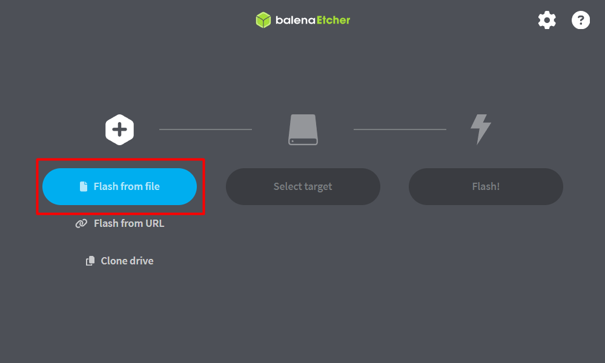
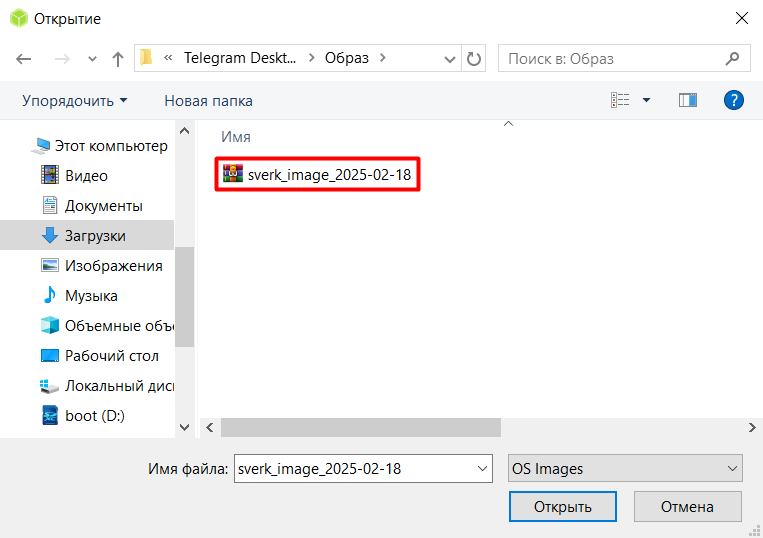
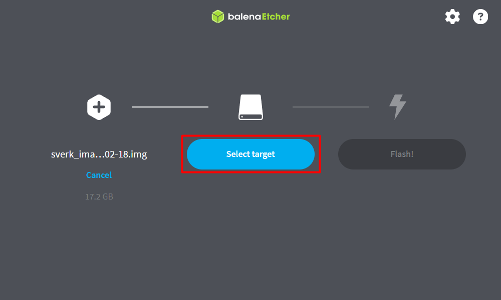
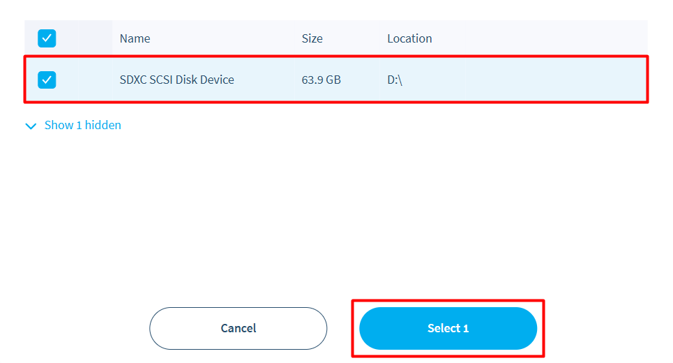
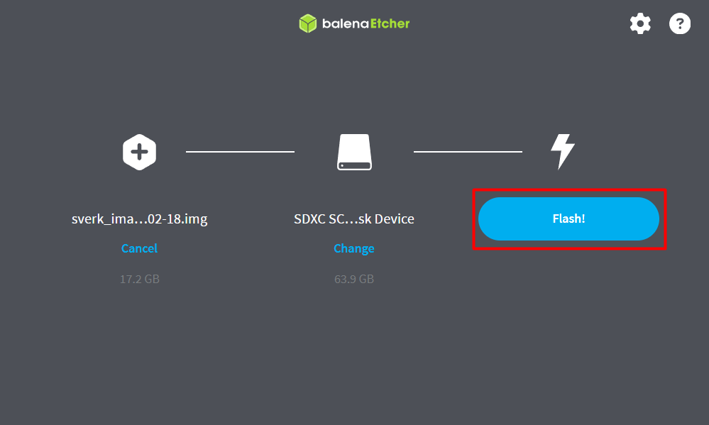
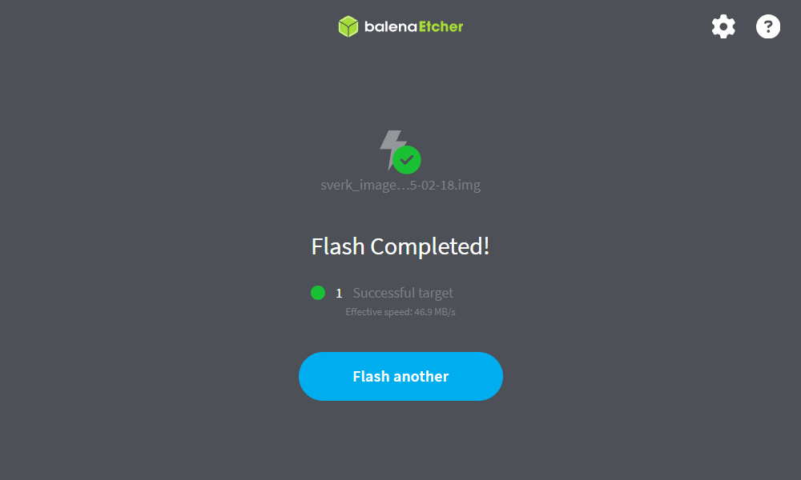

# Установка образа на бортовой компьютер

Этот раздел описывает запись операционной системы на SD-карту и первое включение Обрика.

---

## Что такое «образ»

Образ диска — это снимок настроенной операционной системы со всем необходимым программным обеспечением. Его записывают на карту памяти, и она становится готовой к работе системой.

В образ Обрика уже включены Ubuntu 22.04, ROS 2 Humble и все нужные пакеты. Вам не нужно ничего устанавливать вручную.

---

## Что понадобится

- MicroSD-карта (от 32 ГБ, класс 10 или выше)
- Адаптер для подключения MicroSD к компьютеру
- Компьютер под управлением Windows, macOS или Linux

---

## Шаг 1. Скачайте образ

> **Примечание** Это делается на хосте (один раз при настройке). После настройки вы будете работать только внутри контейнера `sverk_ros2`. На хост возвращаться не нужно.

Ссылка на актуальный образ появится здесь.

---

## Шаг 2. Запишите образ на карту

Для записи используется программа **Balena Etcher** — она умеет правильно «разворачивать» образ на карту памяти. Обычное копирование файлов сюда не подойдёт.

1. Скачайте и установите [Balena Etcher](https://www.balena.io/etcher/) для вашей операционной системы. Запустите программу.

2. Нажмите **Flash from file** и выберите скачанный файл образа.

    
    

3. Нажмите **Select target**.

    

4. В списке выберите вашу MicroSD-карту и нажмите **Select 1**.

    

> **Внимание** Убедитесь, что выбрали именно SD-карту, а не жёсткий диск компьютера. Если ошибиться, все данные на выбранном диске сотрутся. Обычно SD-карта в списке отображается с маленьким объёмом (16 или 32 ГБ), а системный диск — гораздо больше.

5. Нажмите **Flash!** и подождите. Это займёт несколько минут.

    

6. Когда программа покажет **Flash Complete!** и зелёную галочку — запись завершена.

    

7. Извлеките карту безопасно через «Безопасное извлечение устройства» в вашей операционной системе.

---

## Шаг 3. Установите SD-карту в Обрик и включите его

1. Найдите слот для MicroSD-карты на плате расширения бортового компьютера.
2. Вставьте карту в слот до щелчка.
3. Подключите питание и подождите 30-60 секунд: система загружается.

### Что означают светодиоды

На плате два световых индикатора. По ним можно понять, всё ли в порядке.

| Светодиод | Состояние | Что происходит |
|-----------|-----------|----------------|
| PWR (красный) | Горит непрерывно | Питание в норме, 5 В поступает |
| PWR (красный) | Мигает или гаснет | Проблема с питанием (просадка напряжения) |
| ACT (зелёный) | Мигает | Идёт загрузка, компьютер читает карту — это нормально |
| ACT (зелёный) | Не горит | Нет обращения к карте или карта не читается |
| ACT (зелёный) | Горит постоянно | Сбой загрузки или карта пустая |

Если ACT мигает в первые 30-60 секунд после включения — всё идёт как надо. После окончания загрузки мигание станет редким или прекратится.

!!! Обозначение светодиодов вариьируется от компьютера к компьютеру нужно написать общие данные а подробнее внутри документаций для каждого компьютера в отдельности !!!