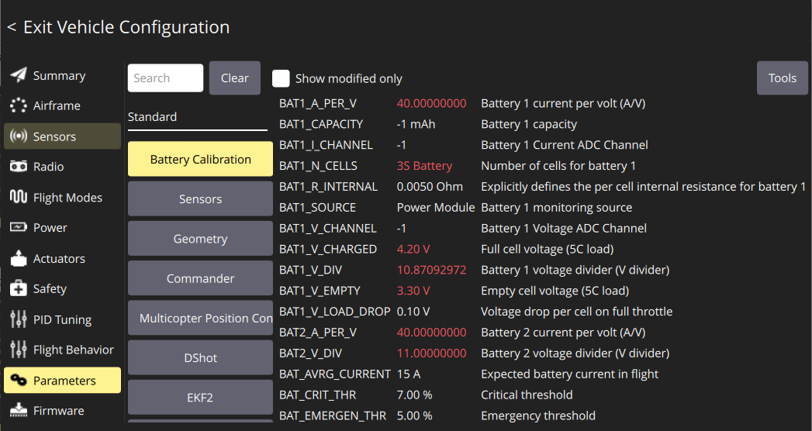
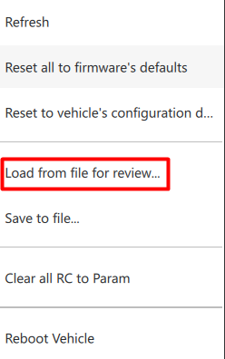
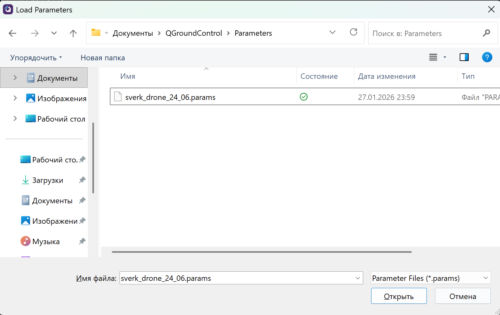
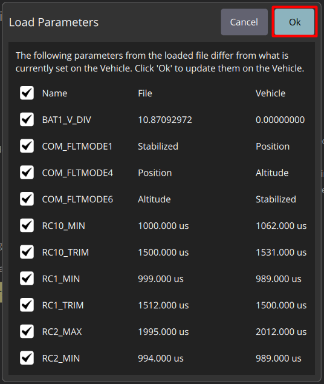
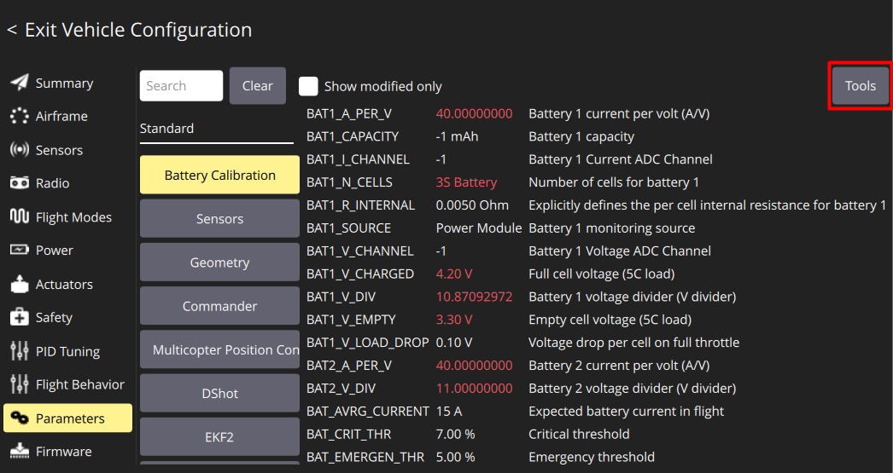
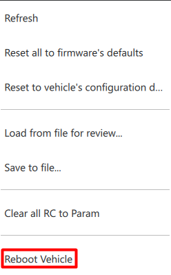
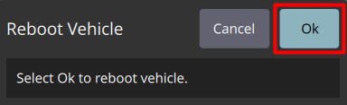

# Загрузка параметров полётного контроллера

Готовый файл параметров переносит все настройки полётного контроллера за один шаг. Этот раздел описывает его загрузку в Обрик.

---

## Параметры PX4

Полётный контроллер **PX4** управляется через сотни параметров — числовых значений, которые определяют поведение дрона:

- как быстро реагировать на отклонение стика,
- как сильно наклоняться при повороте,
- какой уровень батареи считать критическим,
- с каких датчиков брать данные о высоте.

Вкладка **Parameters** в QGC показывает все эти параметры. Их там так много, что настраивать их вручную с нуля — долго. Поэтому мы используем **файл параметров** — готовую «подборку» правильных значений для Обрика.

> **Примечание** Файл параметров — это список значений, которые уже проверены и работают на Обрике. После загрузки файла вам останется только откалибровать датчики и пульт (они у каждого дрона немного разные).

---

## Загружаем параметры из файла

1. Откройте вкладку **Parameters** в Vehicle Configuration

2. Нажмите кнопку **Tools** (в правом верхнем углу вкладки Parameters)

3. В открывшемся меню выберите **Load from file for review**

   > **Зачем «for review»?** Эта опция сначала показывает вам, какие параметры изменятся, и только потом применяет их. Это безопаснее, чем слепая загрузка.

4. Выберите скачанный [файл с параметрами](https://drive.google.com/file/d/1392MPugvBD1SA4eytPBsy4nv05whPwLh/view?usp=drive_link)

5. Посмотрите на список изменяемых параметров в открывшемся окне, затем нажмите **Ok**

---

## Перезагружаем Обрик

После загрузки параметров нужно перезагрузить полётный контроллер, чтобы новые настройки вступили в силу.

1. Снова нажмите кнопку **Tools**

2. Выберите **Reboot Vehicle**

3. В появившемся диалоге нажмите **Ok**

4. Дождитесь перезагрузки — Обрик отключится и снова появится в QGC через 20–30 секунд

---

## Дальнейшие шаги

После перезагрузки параметры применены. Теперь нужно откалибровать датчики — гироскоп, акселерометр и уровень горизонта. Это делается индивидуально для каждого Обрика, потому что датчики у каждого дрона немного отличаются.
