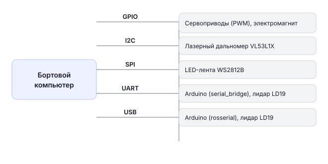

# Периферия

Периферия — это любые внешние устройства, которые подключаются к бортовому компьютеру и работают под управлением программы: светодиоды, сервоприводы, датчики, электромагниты, Arduino. Управлять ими можно из программы на Python или через ROS 2.

---

!!! Схема странная !!!

## Схема подключений

---

## Что можно подключить

### GPIO — цифровые входы и выходы

GPIO (General Purpose Input/Output) — это контакты на плате, через которые можно подключать разные устройства: светодиоды, кнопки, датчики, сервоприводы. Как гнёзда для периферии.

Управление выполняется через библиотеку `libgpiod` прямо из Python.

> **Примечание** Физически устройство подключено к пинам платы (хоста). Контейнер `sverk_ros2` видит эти устройства через `/dev` благодаря пробросу в docker compose. Работайте через `drone.gpio.*` / `drone.image.*` — выходить из контейнера не нужно.

> **Примечание** Имена устройств (`/dev/...`) у каждого интерфейса зависят от платы. Полная таблица интерфейсов по бортовым компьютерам с пояснениями → [Бортовые компьютеры](knowledge_base/boards-overview.md).

→ [Работа с GPIO](gpio.md)
- [Подключение сервоприводов](servo-hardware.md)
- [Подключение электромагнита](magnet.md)

---

### Светодиодная лента WS2812B

Адресуемая лента — каждым светодиодом можно управлять отдельно. Лента подключена по SPI и управляется через ROS 2 ноду `led_control`. Можно задавать эффекты (радуга, мигание, плавное угасание) или конкретный цвет каждого диода.

Лента автоматически показывает состояние дрона: арм, режим полёта, низкий заряд батареи.

→ [Работа со светодиодной лентой](led-strip.md)

---

### Лазерный дальномер VL53L1X

Датчик измеряет расстояние до объекта лазерным лучом — от нескольких сантиметров до 4 метров, с точностью ±1 мм. Подключается по шине I2C — одновременно можно использовать несколько датчиков.

→ [Использование лазерных дальномеров VL53L1X](sensor-vl53l1x.md)

---

### Arduino

Arduino — это небольшая плата-микроконтроллер. Её можно использовать как умный посредник: подключить к ней дополнительные датчики или моторы, а затем передавать данные на Обрик по UART или USB.

> **Примечание** На дроне два UART:
> **Примечание** Для подключения используйте `UART_B` — `UART_A` занят полётным контроллером PX4.

Для связи Arduino с ROS 2 есть два способа:
- **serial_bridge** — простой текстовый обмен командами → [Работа с Arduino через serial_bridge](arduino-serial.md)
- **rosserial_ros2** — Arduino становится полноценным ROS 2 узлом → [Обзор rosserial_ros2](arduino-rosserial.md)

---

### Лидар LD19

Лазерный сканер, который крутится и рисует «карту» окружения. Видит препятствия на расстоянии до нескольких метров по кругу. Подключается по USB или UART.

→ [Подключение лидара LD19](lidar-ld19.md)

---

### Камера

Работа с изображением через ROS 2: подписка на топики, публикация, cv_bridge.

→ [Работа с камерой](camera.md)
