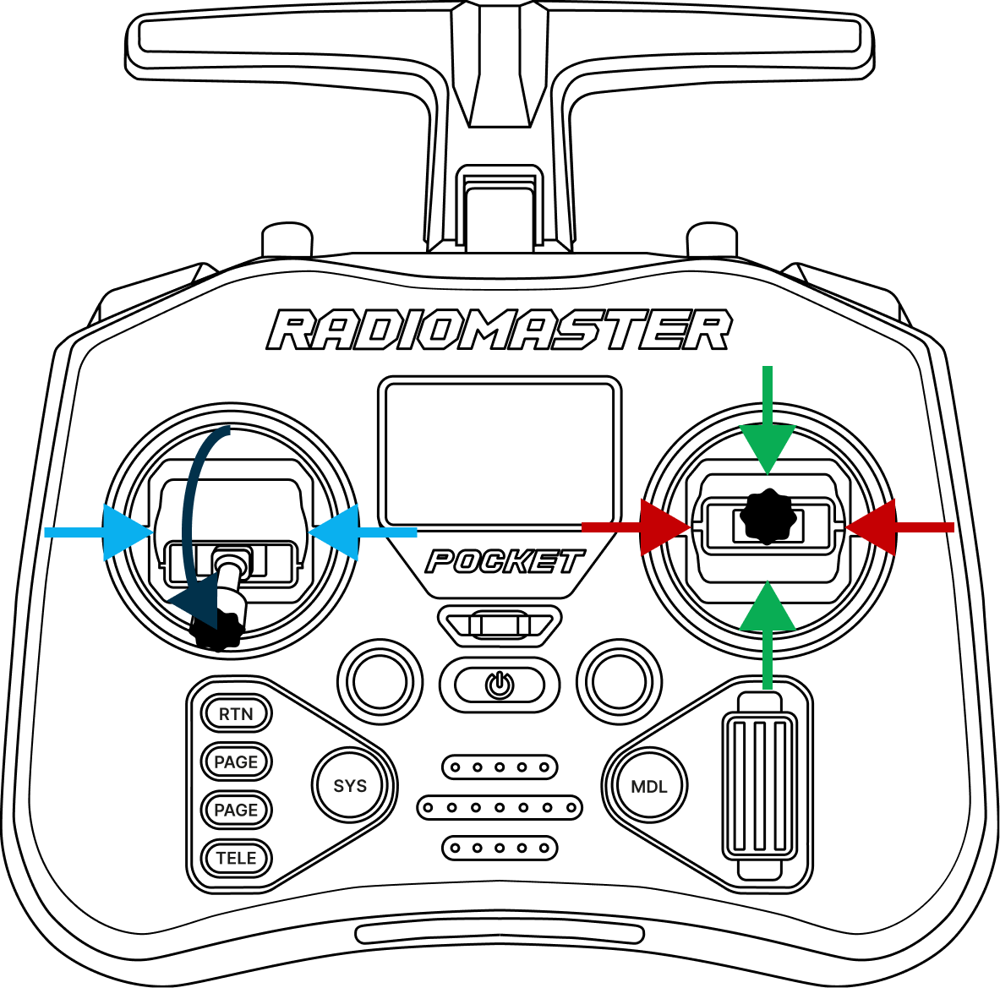
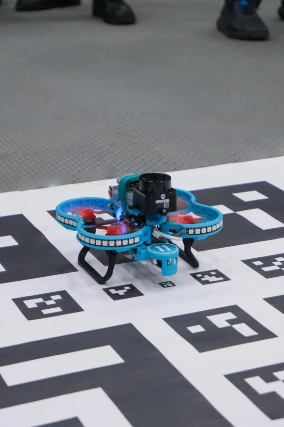
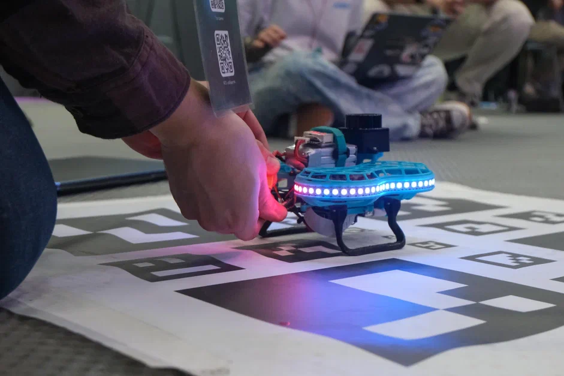

# Проверка перед полётом

Перед каждым взлётом запускайте автоматическую проверку — программа `selfcheck.py` проверяет все ключевые системы Обрика за одну команду. Это занимает меньше минуты и помогает предотвратить аварию.

Если хотя бы один пункт выдаёт ошибку — взлёт запрещён.

---

## Подготовка

1. Разместите карту ArUco-меток в центре полётной зоны.

2. Включите аппаратуру управления.

3. Переведите левый стик вниз, правый — в центральное положение.



4. Установите Обрик на точку взлёта.



5. Подключите [АКБ](knowledge_base/battery-li-po.md) к Обрику.



6. Дождитесь полного включения Обрика.

   > **Примечание** Обрик полностью включён, когда его Wi-Fi сеть появилась в списке доступных сетей.

7. Подключитесь к [Обрику по Wi-Fi](qgc-wifi.md).

8. Откройте веб-интерфейс и запустите терминал.

---

## Запуск проверки

```bash
ros2 run self_check selfcheck.py
```

---

## Что проверяется

| Проверка | Что контролируется |
|---|---|
| Связь с PX4 (FMU) | Наличие данных от полётного контроллера: статус, режим, failsafe-флаги |
| Батарея | Уровень заряда, напряжение на банку, ток, температура |
| IMU и ориентация | Обновление гироскопа и акселерометра, предупреждение при сильном наклоне |
| Локальная позиция PX4 | Текущие координаты и скорости от оценщика PX4 |
| Камера | Поступление кадров с камеры |
| ArUco-маркеры | Обнаружение маркеров в поле зрения камеры |
| ArUco-позиция | Поступление позиции от системы навигации по маркерам |
| Скорость (VPE) | Сравнение визуальной одометрии от ArUco с данными PX4 |
| Здоровье SBC | Свободное место на диске и температурный троттлинг бортового компьютера |
| CPU | Загрузка процессора |

Обращайте особое внимание на строки `WARNING`. Особенно важна проверка **Velocity estimation (VPE)**: если оценка скоростей работает некорректно, автономные полёты лучше не запускать.

Критические пункты — должны быть зелёными перед взлётом:

- **ArUco** — маркеры распознаются
- **Local position** — позиция вычислена
- **FMU** — связь с полётным контроллером есть
- **Velocity estimation** — скорость определена

> **Примечание** При ошибках обращайтесь в [техподдержку](https://t.me/sverk_support).

---

## Параметры

По умолчанию программа использует стандартные топики Обрика. При необходимости их можно переопределить.

### Батарея

| Параметр | По умолчанию | Описание |
|---|---|---|
| `--battery-cells` | 0 | Количество банок АКБ (0 — не проверять напряжение на банку) |
| `--battery-min-cell-v` | 3.50 В | Минимальное допустимое напряжение на банку |
| `--battery-min-remaining` | 0.20 | Минимальный уровень заряда (20%) |
| `--battery-warn-level` | 2 | Уровень предупреждения от PX4 |
| `--battery-max-current-a` | 0 | Максимальный ток (0 — отключено) |
| `--battery-max-temp-c` | 0 | Максимальная температура (0 — отключено) |

### Топики камеры и ArUco

| Параметр | По умолчанию | Описание |
|---|---|---|
| `--pose-topic` | `/aruco/loc/pose_cov` | Топик позиции от ArUco |
| `--image-topic` | `/camera_1/image_raw` | Топик камеры |
| `--markers-topic` | `/aruco/det/markers` | Топик массива маркеров |

### Топики PX4 DDS

| Параметр | По умолчанию | Описание |
|---|---|---|
| `--vehicle-status-topic` | `/fmu/out/vehicle_status` | Статус аппарата |
| `--vehicle-local-position-topic` | `/fmu/out/vehicle_local_position` | Локальная позиция |
| `--attitude-topic` | `/fmu/out/vehicle_attitude` | Ориентация |
| `--battery-topic` | `/fmu/out/battery_status` | Статус батареи |

### VPE

| Параметр | По умолчанию | Описание |
|---|---|---|
| `--visual-odom-topic` | `/fmu/in/vehicle_visual_odometry` | Входная одометрия от ArUco |
| `--vehicle-odometry-topic` | `/fmu/out/vehicle_odometry` | Одометрия от PX4 |
| `--vpe-compare-window` | 1.5 | Окно сравнения в секундах |
| `--vpe-pos-threshold` | 0.5 | Порог расхождения позиции в метрах |
| `--vpe-yaw-threshold-deg` | 8.0 | Порог расхождения угла в градусах |

### Отключение отдельных проверок

```bash
ros2 run self_check selfcheck.py --no-vpe --no-sbc-health
```

!!! Впринципе избыточно описание переопределения лучше просто вывести пример прохода и объяснить что это значит с примера плохихи и хороших прогонов. Пока в разработке !!!