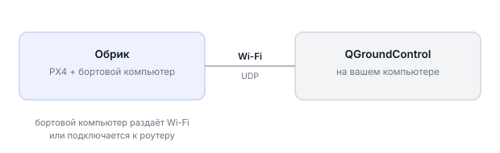
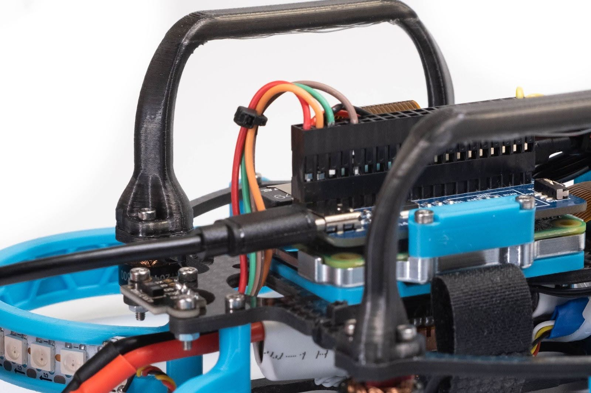
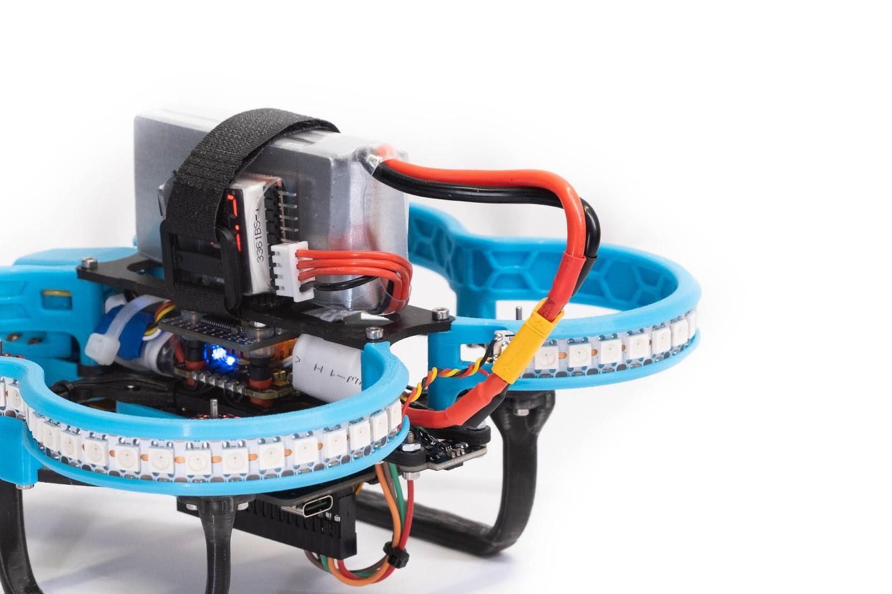
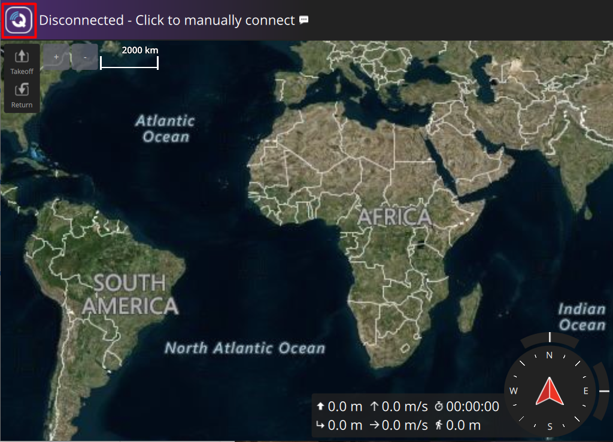
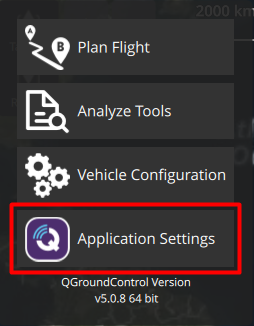
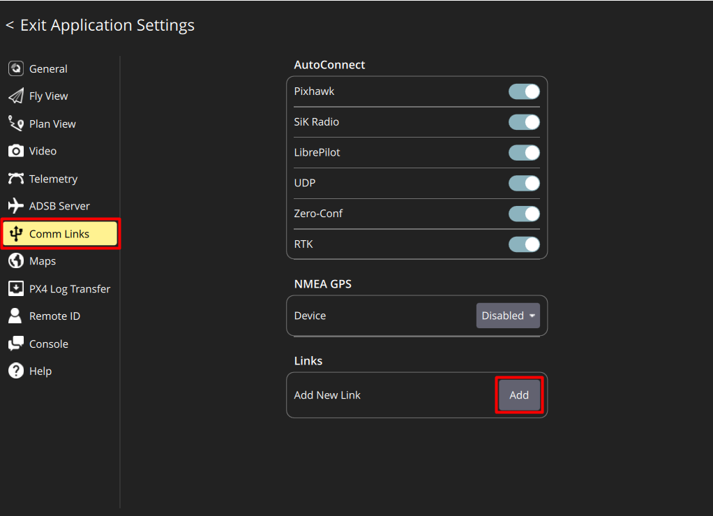
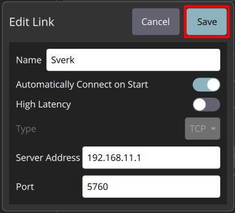
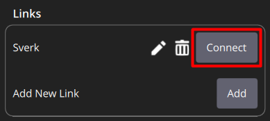
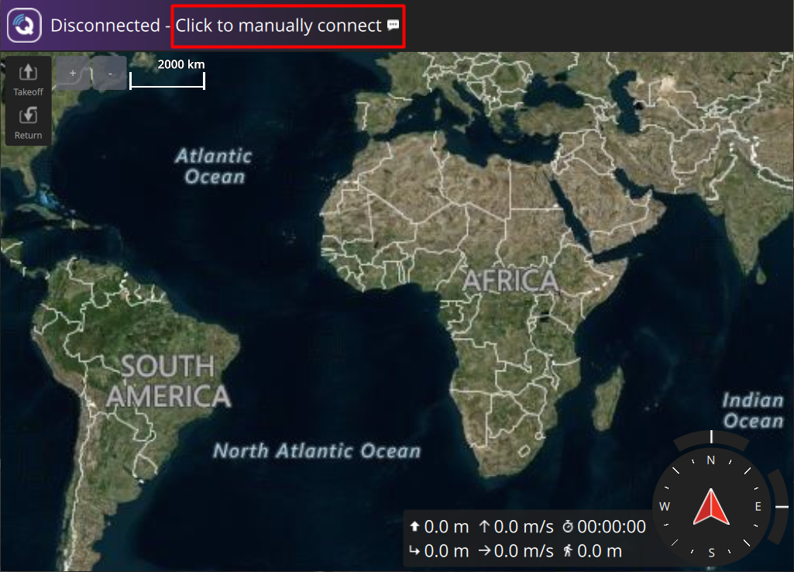
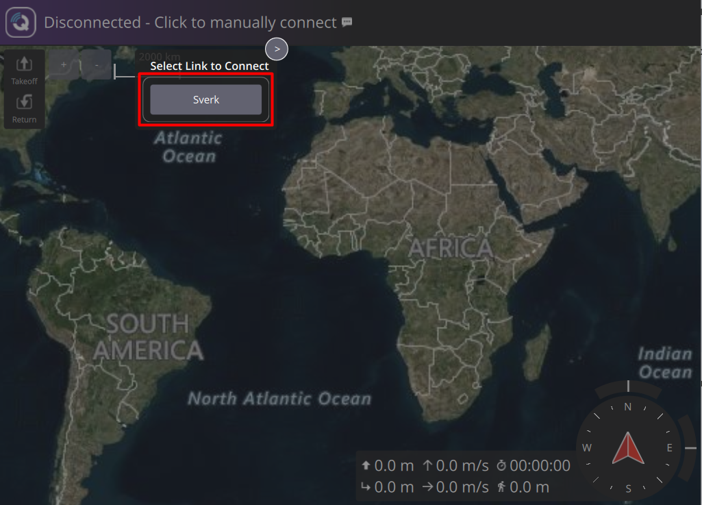

# Подключение к QGroundControl по Wi-Fi

Через Wi-Fi программа QGroundControl на вашем компьютере связывается с полётным контроллером Обрика: позволяет настраивать его, следить за состоянием дрона и видеть данные с датчиков в реальном времени.

!!! Нужно поменять картинки на UDP поключение, TCP пока в разработке потом будет как тут - https://klever-doc.tech/ROS1/ru/gcs_bridge.html !!!
---

## QGroundControl

**QGroundControl (QGC)** — бесплатная программа для настройки и мониторинга дронов. Она показывает телеметрию (данные с датчиков), позволяет менять параметры полётного контроллера PX4, калибровать датчики и запускать автоматические полёты.

---

## Как работает подключение

Бортовой компьютер Обрика после включения делает одно из двух:
- **Подключается к роутеру** — к известной Wi-Fi сети (в нашем случае сеть называется **Poletka**)
- **Раздаёт собственную Wi-Fi точку доступа** — создаёт сеть, к которой подключаются другие устройства

Через Wi-Fi бортовой компьютер «пробрасывает» команды и данные между QGC на вашем компьютере и полётным контроллером PX4 внутри Обрика по протоколу **UDP** (протокол быстрой передачи данных через сеть).

---

## Безопасное включение дрона

> **Внимание** Снимите воздушные винты перед включением. Во время настройки моторы могут случайно запуститься — без пропеллеров это безопасно.

1. Включите Обрик, используя АКБ или кабель USB Type-C

   > **Подсказка** Для первого подключения рекомендуем использовать USB — так не нужен заряженный аккумулятор

   

2. Подождите 30–60 секунд — бортовой компьютер загружается, загорится светодиодная лента

---

## Шаг 1: Подключитесь к Wi-Fi сети Обрика

**Сценарий с роутером** (используется в классе):

- Обрик автоматически подключается к сети Wi-Fi **Poletka**
- Подключите свой компьютер к той же сети с паролем: **poletka1**
- Узнайте IP-адрес своего Обрика в сети:
  - Скачайте и установите программу [Advanced IP Scanner](https://www.advanced-ip-scanner.com/ru/)
  - Запустите программу, нажмите кнопку **IP** — она автоматически определит диапазон адресов вашей сети
  - Нажмите **Сканировать** и дождитесь результатов
  - Найдите в списке устройство с именем Обрика и запомните его IP-адрес (например, `192.168.1.105`)

> **Примечание** IP-адрес — уникальный адрес устройства в сети. У каждого устройства в Wi-Fi сети он свой.

---

## Шаг 2: Настройте подключение в QGC

> **Примечание** По умолчанию Обрик готов к подключению QGC по протоколу **UDP** через порт **14550**.

1. Запустите программу **QGC**
2. Нажмите на **логотип QGC** в левом верхнем углу

   

3. В открывшемся списке выберите **Application Settings**

   

4. Выберите меню **Comm Links** и в окне **Links** нажмите **Add** — добавляем новое подключение

   

5. Введите параметры подключения:
   - **Name:** любое название, например `Sverk`
   - **Automatically Connect on Start:** включите ползунок (тогда QGC будет подключаться к Обрику автоматически при запуске)
   - **Type:** `UDP`
   - **Server Address:** `IP-адрес вашего Обрика` (тот, что нашли в Advanced IP Scanner)
   - **UDP Port:** `14550`

   

6. Нажмите **Save** для сохранения, затем выберите созданное подключение и нажмите **Connect**

   

> **Примечание** Если «Automatically Connect on Start» включено — при следующем запуске QGC подключится к Обрику автоматически.

---

## Подключение вручную (если автоматическое не включено)

1. На главном экране QGC нажмите **Click to manually connect**

   

2. Нажмите на название своего подключения к Обрику

   

3. В левом верхнем углу QGC пропадёт надпись **DISCONNECTED** и появятся данные с датчиков: температура аккумулятора, уровень сигнала и т.д.
