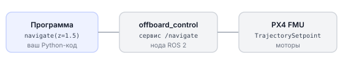
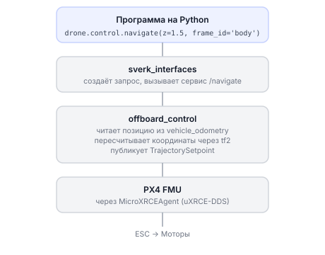

# Основы ROS 2

ROS 2 (Robot Operating System 2) — это не операционная система в привычном смысле, а набор инструментов и соглашений для написания программ, которые управляют роботами. На Обрике именно ROS 2 связывает вашу Python-программу с полётным контроллером PX4.

**Официальная документация**: [docs.ros.org/en/humble](https://docs.ros.org/en/humble/)

---

## Ноды — программы, которые разговаривают друг с другом

**Нода** — это отдельная запущенная программа в ROS 2. Каждая нода решает свою задачу: нода камеры снимает картинку, нода навигации считает маршрут, нода `offboard_control` отправляет команды в PX4. Ноды работают независимо, но обмениваются данными.

Документация по нодам: [ROS 2 Nodes](https://docs.ros.org/en/humble/Concepts/Basic/About-Nodes.html)

Все программы для Обрика — это ROS 2 ноды.

### Схема: как ноды общаются на Обрике

!!! Тут только узел Offboard а не все ноды !!!



### Пример: минимальная нода на Python

**Что мы делаем:** создаём ноду, которая запускается и ждёт команд.

```python
import rclpy               # главная библиотека ROS 2 для Python
from rclpy.node import Node  # класс Node — основа любой ноды

rclpy.init()               # запускаем ROS 2 (всегда первым делом)
node = Node('my_node')     # создаём ноду с именем 'my_node'
rclpy.spin(node)           # нода работает, пока не нажмёте Ctrl+C
rclpy.shutdown()           # корректно выключаем ROS 2
```

После запуска нода появляется в системе. Проверьте командой `ros2 node list` — вы увидите `/my_node` в списке.

> **Примечание** Эти команды выполняются **внутри контейнера** `sverk_ros2`.

---

## Топики

**Топик** — именованный канал передачи данных: одни ноды публикуют в него сообщения, другие подписываются и читают. Камера публикует кадры в топик `/camera_1/image_raw`, программа подписывается и получает их. Топик работает в одну сторону и постоянно — никто не ждёт ответа. Этим он отличается от сервиса.

Документация: [ROS 2 Topics](https://docs.ros.org/en/humble/Tutorials/Beginner-CLI-Tools/Understanding-ROS2-Topics.html)

Популярные типы сообщений:

| Тип | Описание |
|-----|----------|
| `std_msgs/msg/Int64` | Целое число |
| `std_msgs/msg/String` | Текстовая строка |
| `geometry_msgs/msg/PoseStamped` | Позиция + ориентация + система координат |
| `geometry_msgs/msg/TwistStamped` | Скорость + система координат |
| `sensor_msgs/msg/Image` | Кадр с камеры |

### Публикация в топик (Python)

**Что мы делаем:** нода отправляет текстовое сообщение в топик `/foo`.

```python
from std_msgs.msg import String  # тип сообщения — строка

# создаём publisher: хотим публиковать String в топик '/foo'
# число 10 — размер очереди (сколько сообщений хранить, если получатель не успевает)
pub = node.create_publisher(String, '/foo', 10)

msg = String()            # создаём пустое сообщение
msg.data = 'Привет, ROS!' # заполняем поле data
pub.publish(msg)          # отправляем в топик
```

### Подписка на топик (Python)

**Что мы делаем:** нода принимает каждое новое сообщение из `/foo`.

```python
def callback(msg):
    # эта функция вызывается каждый раз, когда приходит новое сообщение
    print('Получено:', msg.data)

# подписываемся: слушаем String из '/foo', вызываем callback при каждом сообщении
sub = node.create_subscription(String, '/foo', callback, 10)
```

### Работа с топиками из терминала

```bash
# смотреть что публикует топик /fmu/out/vehicle_status (статус PX4)
ros2 topic echo /fmu/out/vehicle_status

# с какой частотой приходят сообщения (в Гц)
ros2 topic hz /fmu/out/vehicle_status

# краткая информация о топике
ros2 topic info /fmu/out/vehicle_status

# список всех активных топиков
ros2 topic list
```

> **Примечание** Эти команды выполняются **внутри контейнера** `sverk_ros2`.

!!! Прописать во всем файле режим работы с API sverk_ws\src\sverk_drone\sverk_interfaces, без него на rclpy и через терминал !!!
!!! Добавить все команды для взаимодействия с ros2 через терминал !!!

---

## Сервисы — звонок с ответом

**Сервис** — обмен «запрос-ответ»: нода отправляет запрос («взлети») и ждёт ответа («выполнено» или «ошибка, не заармирован»). В отличие от топика, сервис двусторонний и разовый. Через сервисы работает управление Обриком: `/navigate`, `/land`, `/get_telemetry`.

Документация: [ROS 2 Services](https://docs.ros.org/en/humble/Tutorials/Beginner-CLI-Tools/Understanding-ROS2-Services.html)

### Вызов сервиса из Python

```python
import sverk_interfaces
drone = sverk_interfaces.init(Nodename="ros2_example")
# получить телеметрию в системе координат 'map'
telem = drone.control.get_telemetry(frame_id="map")
print(f"Позиция: x={telem.x:.2f}, y={telem.y:.2f}, z={telem.z:.2f}")
drone.close()
```

Подробнее про все сервисы Обрика: [Команды управления полётом](offboard-commands.md)

> **Примечание** Вызов сервисов из терминала (для отладки) → [база знаний: ros2-raw.md](knowledge_base/ros2-raw.md)

---

## Установка ROS 2

ROS 2 уже установлен на [образе для бортового компьютера Обрика](os-image-flash.md). Если вы работаете на своём компьютере с Ubuntu 22.04:

```bash
sudo apt install ros-humble-desktop
echo "source /opt/ros/humble/setup.bash" >> ~/.bashrc
source ~/.bashrc
```

Хотите попробовать прямо сейчас без дрона? Читайте про [симулятор](knowledge_base/simulation.md).

---

## Имена топиков и сервисов

Документация: [ROS 2 Names](https://docs.ros.org/en/humble/Concepts/Basic/About-Namespaces.html)

| Форма | Пример | Когда использовать |
|-------|--------|--------------------|
| Глобальное | `/foo` | Всегда работает, независимо от места запуска |
| Относительное | `foo` | Относительно namespace текущей ноды |
| Приватное | `~/foo` | Принадлежит только этой ноде |

Обычно в программах для Обрика используются глобальные имена: `/navigate`, `/land`, `/get_telemetry`.

---

## Несколько дронов в одной сети

Документация: [ROS 2 Multi-machine](https://docs.ros.org/en/humble/Tutorials/Advanced/Multi-machine.html)

Если запустить два дрона в одной Wi-Fi сети без настройки, они начнут «мешать» друг другу — сервисы и топики перемешаются. Чтобы этого не происходило, каждому дрону назначают свой домен (число от 0 до 232):

```bash
export ROS_DOMAIN_ID=1  # команды для дрона 1
export ROS_DOMAIN_ID=2  # команды для дрона 2
```

Эта переменная указывается один раз перед запуском программы. Дроны с разными `ROS_DOMAIN_ID` не видят друг друга.

---

## Схема: полный путь команды на Обрике


