# Калибровка датчиков

Калибровка датчиков — гироскопа, акселерометра и уровня горизонта — задаёт полётному контроллеру точку отсчёта. От её точности напрямую зависит, насколько ровно и стабильно летит дрон.

---

## Назначение калибровки

Любой датчик имеет небольшие погрешности из-за производственных допусков, температуры и вибраций при сборке. Калибровка обнуляет эти погрешности, чтобы измерения были точными.

> **Внимание** От точности калибровки датчиков зависит качество полёта — стабильность удержания позиции и горизонта.

---

## Датчики Обрика

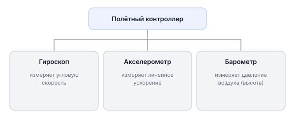

!!! Нужно пометить что у нас Компас по дефолту выключен объяснить зачем !!!

### Гироскоп

**Физика:** Гироскоп — это датчик, который измеряет **угловую скорость** — как быстро тело вращается вокруг оси. Внутри стоит маленький кристалл, который меняет электрические свойства при скручивании (пьезоэлектрический эффект). Когда дрон наклоняется или поворачивается, гироскоп «чувствует» эту вращение и передаёт данные.

**Зачем дрону:** Без гироскопа PX4 не знал бы, что дрон накренился, и не мог бы это исправить. Гироскоп — основа стабилизации.

**Почему нужна калибровка:** В состоянии покоя гироскоп должен показывать «0» по всем осям. На практике он показывает небольшое ненулевое значение — это называется «дрейф нуля». Калибровка запоминает это смещение и вычитает его из всех дальнейших измерений.

### Акселерометр

**Физика:** Акселерометр измеряет **линейное ускорение** — как быстро меняется скорость движения. Он также «чувствует» гравитацию: когда дрон стоит горизонтально, акселерометр видит ускорение силы тяжести (9,8 м/с²) строго вертикально вниз. Если дрон наклонить, вектор гравитации «сдвинется» — и акселерометр измерит наклон.

**Зачем дрону:** PX4 использует акселерометр, чтобы знать, как наклонён дрон относительно земли, и вычислять горизонтальное положение.

**Почему нужна калибровка в 6 положениях:** Акселерометр должен правильно «знать» все направления. Ставя дрон в каждое из 6 положений (носом вниз, носом вверх, на бок, на спину и т.д.), мы показываем датчику, как выглядит гравитация с каждой стороны. Это позволяет точно пересчитывать показания при любом наклоне.

### Барометр

**Физика:** Барометр измеряет **давление воздуха**. С высотой давление убывает: чем выше — тем меньше воздуха над вами, тем меньше давление. PX4 использует это для оценки высоты полёта.

**Зачем дрону:** Основной датчик высоты. Позволяет держать режим «Altitude» — автоматическое удержание высоты.

!!! Стоит пометить что у нас он отключен так как в помещении он дает большие погрешности вместо этого используем данные с MicoAir MTF-02 !!!
---

## Открываем раздел Sensors

Перейдите во вкладку **Sensors** в Vehicle Configuration.

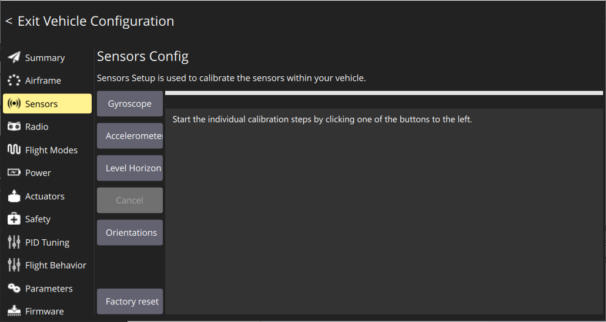

Здесь три калибровки, которые нужно пройти по порядку.

---

## Шаг 1: Калибровка гироскопа

**Что происходит:** PX4 измеряет «дрейф нуля» — показания гироскопа в состоянии абсолютного покоя, чтобы вычитать эту погрешность в дальнейшем.

**Почему нужно ставить на ровную поверхность:** Дрон должен стоять абсолютно неподвижно — любое движение исказит измерение нуля.

1. Выберите меню **Gyroscope**

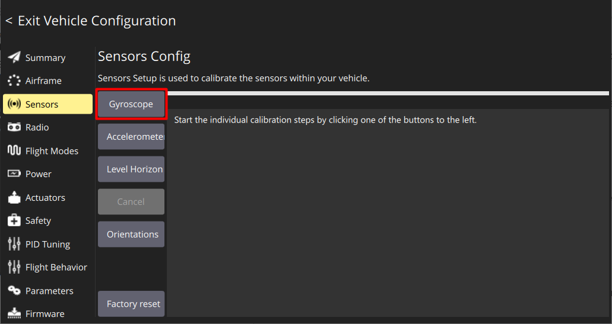

2. Поставьте Обрик на ровную горизонтальную поверхность (стол, пол)
3. Убедитесь, что никто не трогает дрон и нет вибраций
4. Нажмите **Ok**

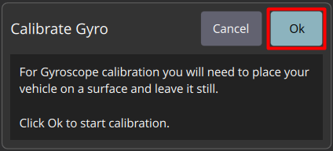

5. Дождитесь окончания — займёт несколько секунд

После успешной калибровки рамка самолёта станет **зелёной**, снизу появится надпись *"Completed"*. Если рамка красная — повторите калибровку.

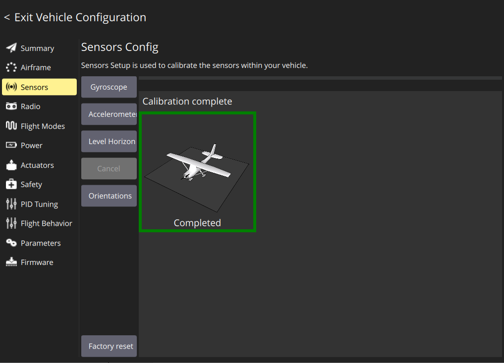

---

## Шаг 2: Калибровка акселерометра

**Что происходит:** Дрон ставится в 6 различных положений, и PX4 записывает показания акселерометра для каждого. Так создаётся точная «карта» всех направлений.

**Почему 6 положений:** У трёхмерного пространства 6 граней (как у кубика): верх, низ, перед, зад, право, лево. Показав датчику гравитацию с каждой стороны, PX4 может точно вычислять наклон при любом положении дрона.

> **Примечание** При калибровке акселерометра необходимо устанавливать Обрик в каждую из указанных ориентаций и удерживать неподвижно до световой индикации.

1. Выберите меню **Accelerometer**

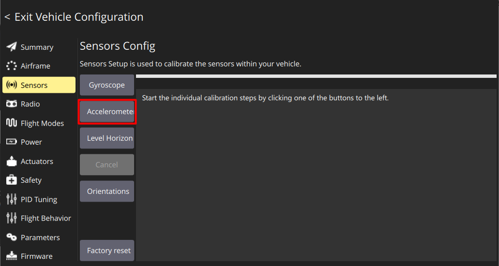

2. Установите параметры ориентации контроллера: **Autopilot Orientation** → **Pitch 180°, Yaw 90°** (это говорит PX4, как физически повёрнута плата внутри Обрика)

   > **Почему Pitch 180° и Yaw 90°?** Плата полётного контроллера внутри Обрика установлена не «по умолчанию», а повёрнута. Эти углы сообщают PX4, как пересчитывать показания датчиков с учётом физического поворота платы.

3. Нажмите **Ok**

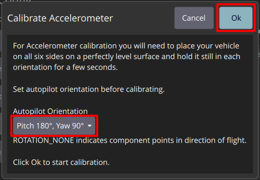

4. QGC будет показывать картинки с нужным положением дрона. Для каждого положения:
   - Поставьте Обрик в показанное положение
   - Дождитесь появления **жёлтой рамки** (QGC увидел, что дрон в правильном положении)

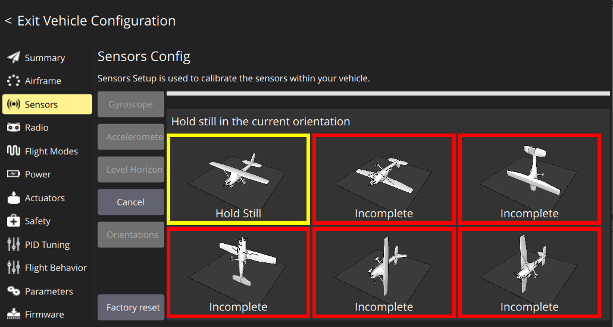

   - Держите неподвижно до появления **зелёной рамки** (измерение завершено)

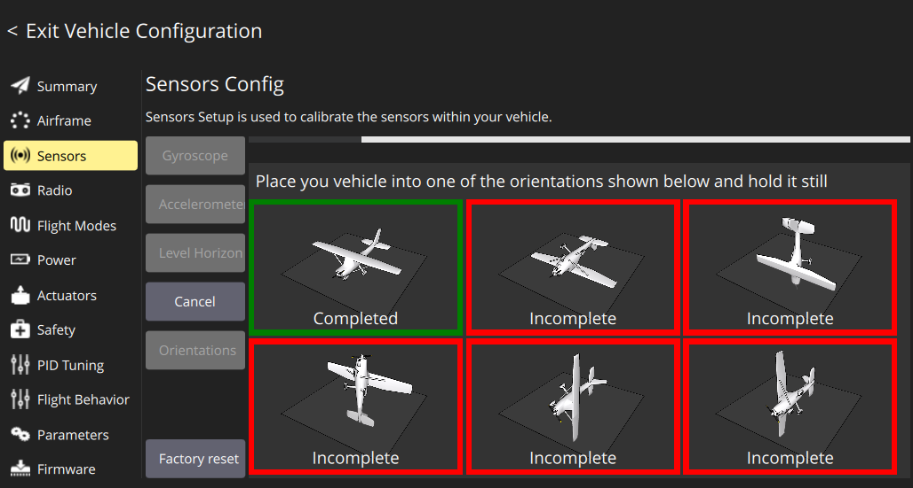

5. Повторите для всех 6 положений по очереди

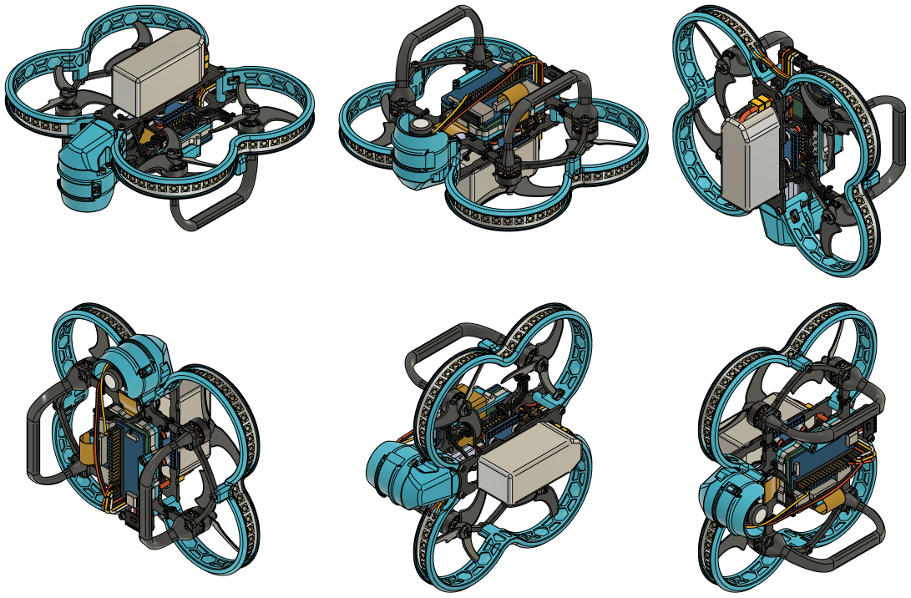

После завершения все 6 рамок станут **зелёными** с надписью *"Completed"*. Если возникла ошибка — калибровка сбросится, начните заново.

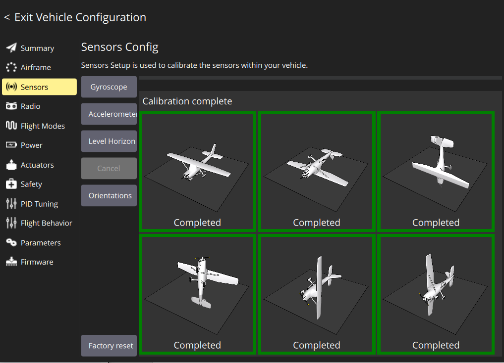

---

## Шаг 3: Калибровка уровня горизонта (Level Horizon)

**Что происходит:** PX4 запоминает, как выглядят показания акселерометра, когда дрон стоит точно горизонтально. Это «ноль» для определения наклона.

**Почему это важно:** Если уровень горизонта не откалиброван, дрон будет «думать», что он наклонён, и постоянно пытаться исправить несуществующий крен — это приводит к дрейфу в полёте.

**Почему нужно ставить на ровную поверхность:** Именно это положение PX4 запомнит как «горизонт». Если поверхность кривая — горизонт будет кривой.

1. Выберите меню **Level Horizon**

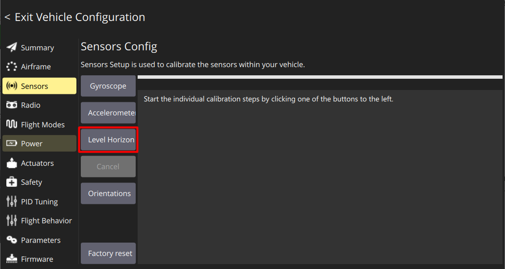

2. Поставьте Обрик на **ровную горизонтальную поверхность**
3. Нажмите **Ok**

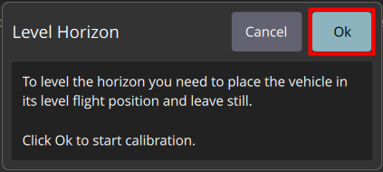

4. Дождитесь окончания калибровки

После завершения внизу появится надпись **Completed** и рамка станет **зелёной**. Если рамка осталась красной — повторите калибровку.

---

## Итог

После всех трёх калибровок:

| Датчик | Что откалибровано |
|--------|-----------------|
| Гироскоп | Дрейф нуля — нет ложных показаний в покое |
| Акселерометр | Все 6 направлений — точное определение наклона |
| Уровень горизонта | Базовое горизонтальное положение — нет дрейфа в полёте |
