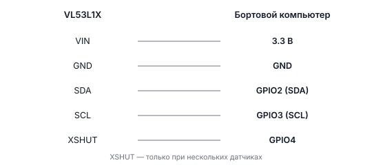
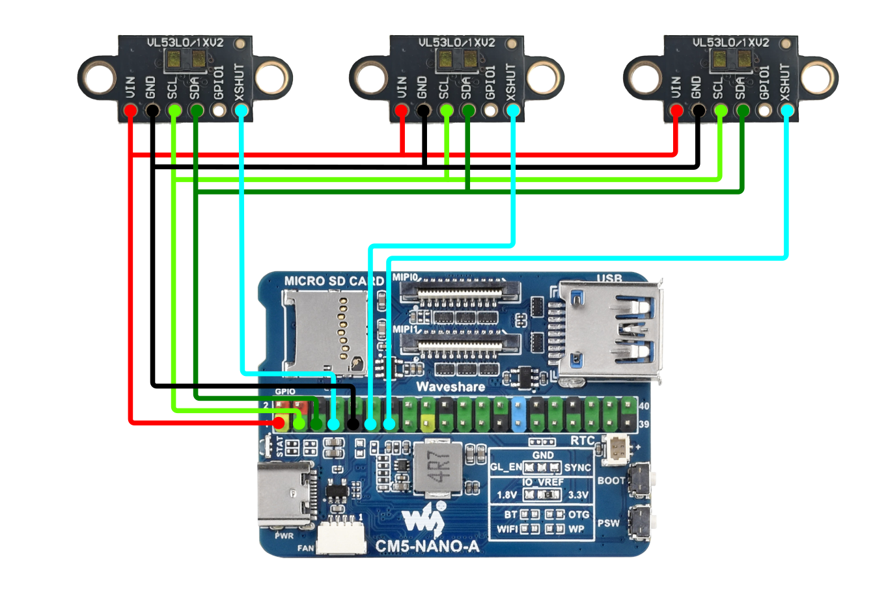
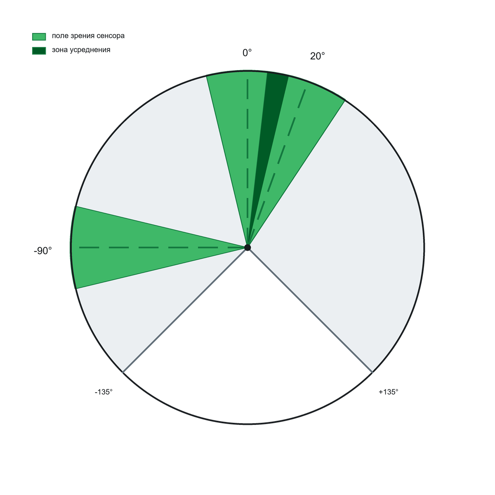

# Лазерный дальномер VL53L1X

## Описание

**VL53L1X** — маленький датчик, который измеряет расстояние лазерным лучом. Он невидимым лазером «щупает» поверхность и по времени отражения считает расстояние.

- Дальность: до **4 метров**
- Точность: **±1 мм**
- Интерфейс: **I2C** — шина для датчиков, когда надо подключить несколько устройств к двум проводам

---

## Применение на дроне

- **Точная посадка** — знать расстояние до земли
- **Облёт препятствий** — если несколько датчиков смотрят в разные стороны
- **Удержание высоты** — автопилот видит высоту сантиметровой точностью
- **Сканирование** — несколько датчиков образуют «лидарный скан»

---

## Подключение





> **Примечание** Физически устройство подключено к пинам платы (хоста). Контейнер `sverk_ros2` видит эти устройства через `/dev` благодаря пробросу в docker compose. Работайте через `drone.gpio.*` / `drone.image.*` — выходить из контейнера не нужно.

> **Примечание** Линия **XSHUT** нужна только если у вас несколько датчиков на одной шине I2C — она позволяет «будить» датчики по одному и назначать им разные адреса.

---

## Подготовка

> **Внимание** Это делается на хосте (самой плате), а не в контейнере. По обычному SSH вы попадаете сразу в контейнер `sverk_ros2` (порт 22). Чтобы выйти на хост, подключитесь на порт **2222**: `ssh -p 2222 <пользователь>@<IP_дрона>`. Имя пользователя зависит от платы: `pi` (Raspberry Pi), `orangepi` (Orange Pi), `rock` (Radxa CM5), `sunrise` (RDK X3). После настройки снова заходи обычным `ssh` (порт 22).

Убедитесь, что I2C включён:

```bash
sudo raspi-config
```

В меню: `Interface Options → I2C` — должно быть включено.

---

## Проверка без ROS 2

Перед запуском ноды удобно проверить датчик напрямую. Программы лежат в:

```bash
scripts/vl53l1x_checks
```

Установка зависимостей:

```bash
python3 -m venv .venv
source .venv/bin/activate
pip install -r scripts/vl53l1x_checks/requirements.txt
```

Проверка одного датчика:

```bash
python3 scripts/vl53l1x_checks/check_single_sensor.py
```

Проверка нескольких датчиков (XSHUT на GPIO4, GPIO17 и GPIO27):

```bash
python3 scripts/vl53l1x_checks/check_multi_sensors.py --pins 4 17 27
```

---

## Запуск через ROS 2

### Один датчик

**Что мы делаем:** запускаем ноду, которая читает расстояние и публикует его в топик.

```bash
# Запуск ноды для одного датчика
ros2 run sensors_broadcaster multi_vl53_node
```

Проверить данные диагностически:

```bash
# Смотрим расстояние в метрах (обновляется в реальном времени)
ros2 topic echo /sensor_1/range
```

### Три датчика одновременно

```bash
# Запуск с тремя датчиками — XSHUT подключён к GPIO4, GPIO17, GPIO27
ros2 run sensors_broadcaster multi_vl53_node --ros-args -p xshut_pins:="[4, 17, 27]"
```

Каждый датчик публикует в своём топике:
- `/sensor_1/range` — расстояние от первого датчика (метры)
- `/sensor_2/range` — расстояние от второго
- `/sensor_3/range` — расстояние от третьего

---

## Чтение данных дальномера в Python

### Однократное чтение расстояния

```python
import sverk_interfaces
from sensor_msgs.msg import Range

drone = sverk_interfaces.init(Nodename="vl53l1x_example")

msg = drone.topic.wait_for_message(Range, '/sensor_1/range', timeout=5.0)
if msg:
    print(f"Расстояние: {msg.range:.3f} м")
else:
    print("Нет данных от датчика")

drone.close()
```

### Непрерывное чтение (подписка)

```python
import sverk_interfaces
from sensor_msgs.msg import Range

drone = sverk_interfaces.init(Nodename="vl53l1x_example")

def on_range(msg):
    print(f"Расстояние: {msg.range:.3f} м")

drone.topic.subscribe(Range, '/sensor_1/range', on_range)
drone.topic.spin()

drone.close()
```

### Чтение с нескольких датчиков одновременно

```python
import sverk_interfaces
from sensor_msgs.msg import Range

drone = sverk_interfaces.init(Nodename="vl53l1x_example")

def on_sensor_1(msg):
    print(f"Датчик 1: {msg.range:.3f} м")

def on_sensor_2(msg):
    print(f"Датчик 2: {msg.range:.3f} м")

def on_sensor_3(msg):
    print(f"Датчик 3: {msg.range:.3f} м")

drone.topic.subscribe(Range, '/sensor_1/range', on_sensor_1)
drone.topic.subscribe(Range, '/sensor_2/range', on_sensor_2)
drone.topic.subscribe(Range, '/sensor_3/range', on_sensor_3)
drone.topic.spin()

drone.close()
```

---

## Синтетический лидарный скан

Если несколько датчиков расположены по кругу или дуге, их данные можно объединить в один «лидарный» скан формата `LaserScan`. Это нужно для алгоритмов, которые работают с лидарами.

**Что мы делаем:** объединяем три датчика в скан с углами -90°, 0° и +90°.

```bash
ros2 run sensors_broadcaster vl53_scan_fuser_node --ros-args \
  -p input_topics:="['sensor_1/range', 'sensor_2/range', 'sensor_3/range']" \
  -p sensor_angles_deg:="[-90.0, 0.0, 90.0]" \
  -p projection_mode:="point" \
  -p output_topic:="scan" \
  -p frame_id:="vl53l1x_scan"
```



Проверка диагностически:

```bash
ros2 topic echo /scan --once --full-length
```

Читать скан в Python:

```python
import sverk_interfaces
from sensor_msgs.msg import LaserScan

drone = sverk_interfaces.init(Nodename="vl53l1x_example")

msg = drone.topic.wait_for_message(LaserScan, '/scan', timeout=5.0)
if msg:
    print(f"Диапазон углов: {msg.angle_min:.2f} — {msg.angle_max:.2f} рад")
    print(f"Количество точек: {len(msg.ranges)}")
    print(f"Дистанции: {msg.ranges}")

drone.close()
```

---

## Запуск всего пайплайна одной командой

```bash
ros2 launch sensors_broadcaster vl53_scan_pipeline.launch.py \
  xshut_pins:="[4, 17, 27]" \
  input_topics:="['sensor_1/range', 'sensor_2/range', 'sensor_3/range']" \
  sensor_angles_deg:="[-90.0, 0.0, 90.0]" \
  projection_mode:="point" \
  angle_min_deg:="-90.0" \
  angle_max_deg:="90.0" \
  angle_increment_deg:="1.0" \
  output_topic:="scan" \
  frame_id:="vl53l1x_scan"
```

---

## Параметры ноды multi_vl53_node

| Параметр | Тип | По умолчанию | Описание |
|----------|-----|--------------|----------|
| `xshut_pins` | int[] | `[]` | Список GPIO для линий XSHUT. Пустой список = один датчик без XSHUT |

## Параметры ноды vl53_scan_fuser_node

| Параметр | Тип | По умолчанию | Описание |
|----------|-----|--------------|----------|
| `input_topics` | string[] | `[]` | Топики с расстояниями от датчиков |
| `sensor_angles_deg` | float[] | `[]` | Углы расположения датчиков (градусы) |
| `projection_mode` | string | `point` | Режим: `point` — один угол, `fov` — зона обзора |
| `overlap_mode` | string | `average` | При пересечении зон: `average` — среднее, `min` — минимум |
| `output_topic` | string | `scan` | Имя выходного топика LaserScan |
| `angle_min_deg` | float | `-90.0` | Минимальный угол скана |
| `angle_max_deg` | float | `90.0` | Максимальный угол скана |
| `range_min` | float | `0.04` | Минимальная дистанция (м) |
| `range_max` | float | `4.0` | Максимальная дистанция (м) |
| `publish_rate_hz` | float | `20.0` | Частота публикации скана |

---

## Практические советы

- Начните с одного датчика и команды `ros2 topic echo /sensor_1/range` — убедитесь, что данные приходят
- Режим `point` проще для отладки — сначала проверьте геометрию в нём
- Если топик пустой — проверьте, что I2C включён и датчик виден через `i2cdetect -y 1`

> **Примечание** Эти команды выполняются **внутри контейнера** `sverk_ros2`. Устройства видны благодаря пробросу `/dev` через docker compose.

---

## См. также

Низкоуровневые примеры с `ros2 service call` и прямым rclpy:
→ [knowledge_base/devices-raw.md](knowledge_base/devices-raw.md)
