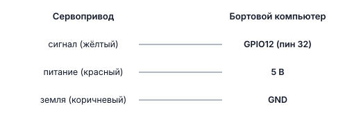
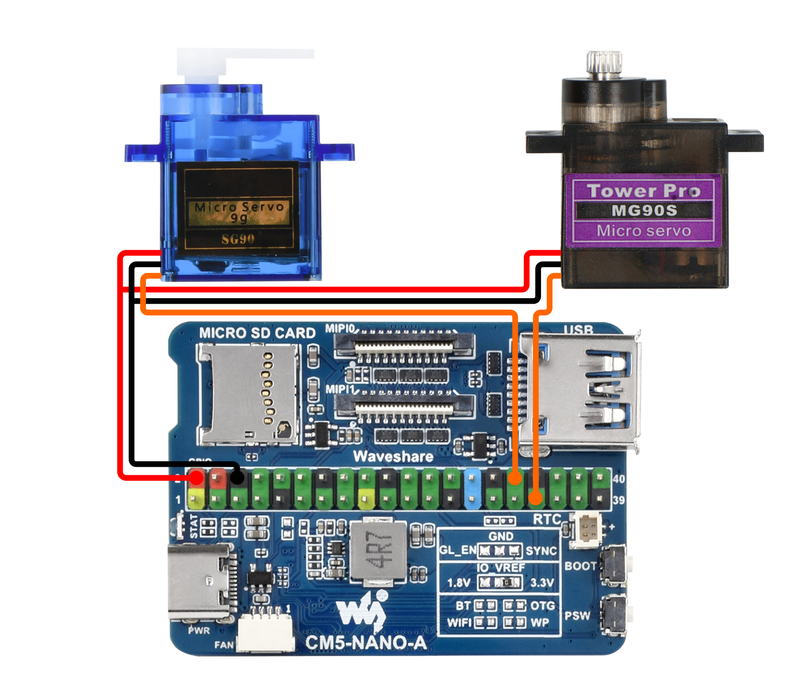

# Подключение сервоприводов

## Сервопривод

**Сервопривод** — это маленький моторчик с редуктором, который умеет поворачиваться в точно заданное положение. Обычно диапазон — от 0° до 180°. Используется для поворота камеры, открытия захвата, управления рулями.

**PWM** (Широтно-импульсная модуляция) — способ управлять мощностью через быстрое включение/выключение. Сервопривод понимает, в какое положение повернуться, по длительности импульса: короткий импульс (~1 мс) = одна крайняя позиция, длинный (~2 мс) = другая крайняя.

---

## Подключение

На Обрике сервоприводы подключаются к GPIO через аппаратный PWM.

Доступные PWM-пины:

| GPIO | Физический пин | PWM канал |
|------|---------------|-----------|
| GPIO12 | пин 32 | pwmchip0 / pwm0 |
| GPIO13 | пин 33 | pwmchip0 / pwm1 |

### Схема подключения



> **Примечание** Если используете внешний источник питания для сервопривода — его GND тоже нужно соединить с GND Обрика.



> **Примечание** Физически устройство подключено к пинам платы (хоста). Контейнер `sverk_ros2` видит эти устройства через `/dev` благодаря пробросу в docker compose. Работайте через `drone.gpio.*` / `drone.image.*` — выходить из контейнера не нужно.

---

## Применение на дроне

- **Управление захватом** — взять и положить предмет
- **Управление распылителем** — распыление краски из болончика
- **Поворот камеры** — направить камеру в нужную сторону
- **Управление спасательным грузом** — сбросить в нужный момент
- **Управление рулями** — на планерах или самолётах

---

## Настройка PWM

> **Внимание** Это делается на хосте (самой плате), а не в контейнере. По обычному SSH вы попадаете сразу в контейнер `sverk_ros2` (порт 22). Чтобы выйти на хост, подключитесь на порт **2222**: `ssh -p 2222 <пользователь>@<IP_дрона>`. Имя пользователя зависит от платы: `pi` (Raspberry Pi), `orangepi` (Orange Pi), `rock` (Radxa CM5), `sunrise` (RDK X3). После `sudo reboot` снова заходи обычным `ssh` (порт 22).

Перед использованием нужно включить PWM в конфигурации системы. Добавьте строку в файл `/boot/firmware/config.txt`:

```bash
sudo nano /boot/firmware/config.txt
```

Добавьте строку:

```ini
dtoverlay=pwm-2chan,pin=12,func=4,pin2=13,func2=4
```

Сохраните файл и перезагрузите Обрик:

```bash
sudo reboot
```

---

## Проверка подключения

После настройки запустите простой тест — сервопривод должен двигаться:

```python
import time
from rpi_hardware_pwm import HardwarePWM

# Инициализируем PWM на канале 0 (GPIO12), частота 50 Гц (стандарт для сервоприводов)
pwm = HardwarePWM(pwm_channel=0, hz=50, chip=0)

try:
    pwm.start(7.5)              # центральное положение (90°)
    time.sleep(2.0)

    pwm.change_duty_cycle(5.0)  # крайнее положение (0°)
    time.sleep(2.0)

    pwm.change_duty_cycle(10.0) # другое крайнее положение (180°)
    time.sleep(2.0)

    pwm.change_duty_cycle(7.5)  # вернуться в центр
    time.sleep(2.0)
finally:
    pwm.stop()
```

Для второго сервопривода на GPIO13 замените `pwm_channel=0` на `pwm_channel=1`.

---

## Следующий шаг

После проверки подключения переходите к управлению через ROS 2:

→ [Управление сервоприводами через ROS 2](servo-control.md)
