# Настройка аппаратуры управления

Аппаратура управления RadioMaster Pocket связывается с Обриком по радиоканалу. Этот раздел описывает привязку пульта к дрону для ручного управления.

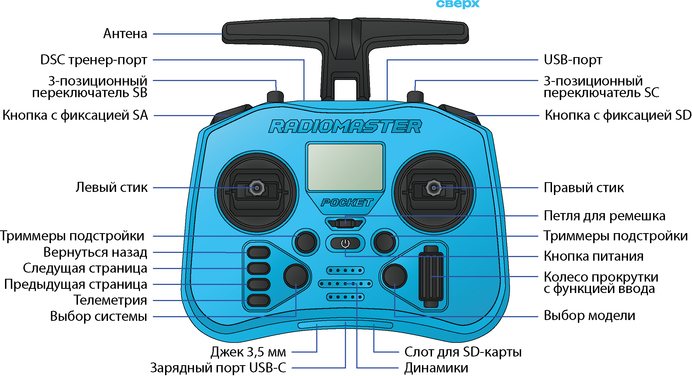

> **Примечание** Чтобы загрузить профиль настроек и активировать русскую озвучку — читайте статью [Настройка пульта RadioMaster Pocket](knowledge_base/transmitter-voice.md)

---

## Как работает радиосвязь между пультом и дроном

Пульт (аппаратура управления) и дрон общаются по радиоканалу — похоже на то, как рация связывается с другой ракцией. Для этого используется протокол **ELRS (ExpressLRS)** — современный быстрый и надёжный протокол для управления дронами.

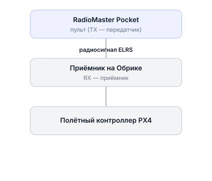

Чтобы пульт и приёмник «нашли» друг друга среди множества других дронов, используется **Binding Phrase** — общая секретная кодовая фраза. Это как пароль: только те устройства, у которых совпадает фраза, могут связаться между собой.

> **Примечание** Binding Phrase — уникальная фраза, которая связывает именно ваш передатчик (TX, пульт) с именно вашим приёмником (RX, дрон). Они должны содержать одинаковую фразу, чтобы найти друг друга в эфире.

---

## Подготовка аппаратуры управления

1. Снимите чёрные резиновые накладки с задней стороны пульта
2. Вставьте АКБ, соблюдая полярность (+ к +, − к −)
3. Переведите все стики и переключатели в исходное (безопасное) положение:
   - **Левый стик** — вниз (газ на нуле)
   - **Тумблеры SB, SC** — от себя (нижнее положение)
   - **Переключатели SA, SD** — в положение выкл.

   > **Почему это важно?** При включении пульт проверяет положение всех органов управления. Если стик газа (Throttle) не внизу — пульт выдаст предупреждение, потому что это опасно: при случайном включении дрон мог бы резко взлететь.

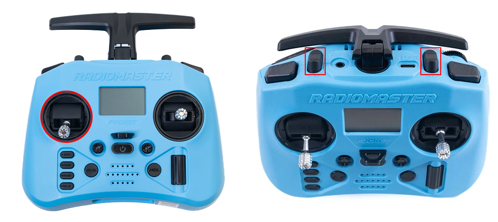

4. Подключите зарядное устройство через порт USB Type‑C (можно использовать во время полётов)
5. Включите пульт — зажмите **кнопку питания** до появления на экране 4-х точек

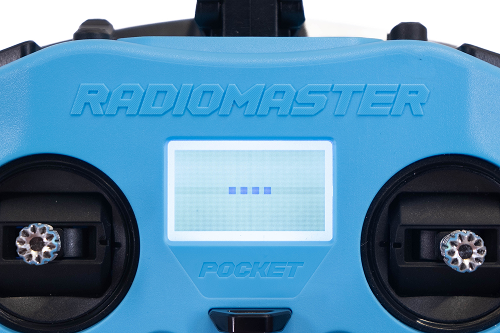

> **Подсказка** Если при включении появляется предупреждение — перепроверь положение стиков и тумблеров

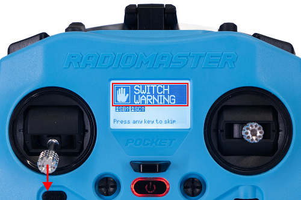

---

## Настройка передатчика (TX) — пульта

Здесь мы устанавливаем Binding Phrase на пульте (передатчике).

1. Нажмите кнопку **SYS**

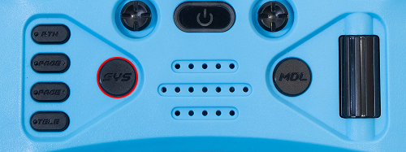

2. Перейдите в меню **ExpressLRS**

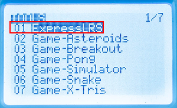

   > **Внимание** Чтобы выйти из меню ExpressLRS, нужно зажать кнопку **RTN** (не просто нажать, а именно зажать)

3. Выберите пункт **Wifi Connectivity**

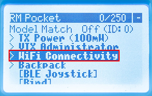

4. Выберите пункт **Enable Wifi** — пульт начнёт раздавать свою Wi-Fi сеть

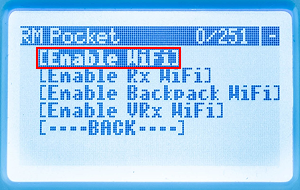

5. Подключитесь к сети Wi-Fi **ExpressLRS TX** на своём устройстве (телефон, ноутбук или компьютер) с паролем `expresslrs`

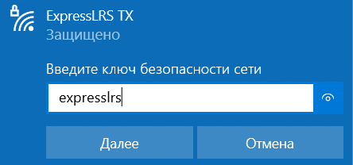

6. Откройте браузер и перейдите на адрес `10.0.0.1`

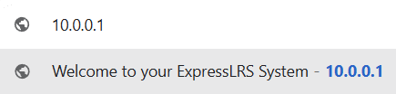
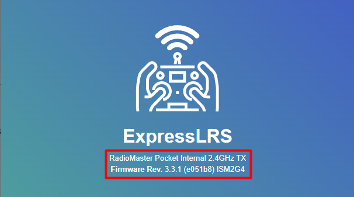

   > **Примечание** В шапке страницы можно узнать название передатчика TX (первая строка) и версию прошивки (вторая строка). Если версия прошивки ниже [3.3.1](https://drive.google.com/file/d/1OUVBTHfTgQ36D4WrX5AeVcz1UwrWtQMS/view?usp=drive_link) — обновите её через [веб-прошивальщик](https://expresslrs.github.io/web-flasher/).

7. В поле **Binding Phrase** введите свою уникальную фразу и нажмите **SAVE**

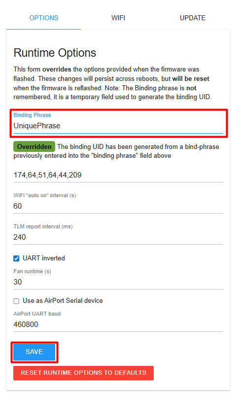

   > **Внимание** Придумайте действительно уникальную фразу — например, сочетание вашего имени и числа: `vasya_drone_42`. Это нужно, чтобы ваш пульт случайно не подключился к чужому дрону в классе. После сохранения дополнительных действий не нужно — связь установится автоматически.

8. В открывшемся окне нажмите **REBOOT** для перезагрузки передатчика

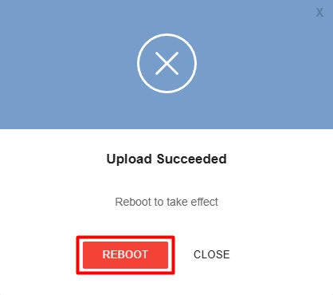

---

## Настройка приёмника (RX) — модуля на дроне

Теперь устанавливаем **ту же самую** Binding Phrase на приёмнике Обрика.

1. Включите Обрик

   > **Внимание** Если включаете Обрик с помощью [АКБ](knowledge_base/battery-li-po.md) — убедитесь, что воздушные винты сняты

2. Подождите 60 секунд — после этого приёмник перейдёт в режим раздачи Wi-Fi
3. Подключитесь к сети Wi-Fi **ExpressLRS RX** на своём устройстве с паролем `expresslrs`

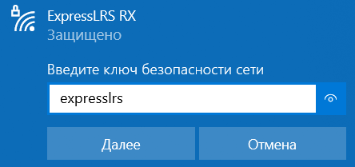

4. Перейдите на адрес `10.0.0.1` в браузере

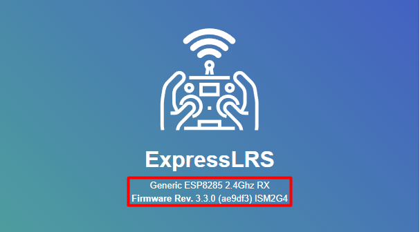

   > **Примечание** В шапке страницы — название приёмника RX и версия прошивки. Если версия ниже [3.3.1](https://drive.google.com/file/d/1OUVBTHfTgQ36D4WrX5AeVcz1UwrWtQMS/view?usp=drive_link) — обновите через [веб-прошивальщик](https://expresslrs.github.io/web-flasher/).

5. В поле **Binding Phrase** введите **точно такую же** фразу, как вводили в передатчике (с учётом регистра букв), и нажмите **SAVE**

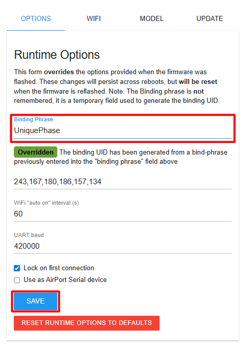

6. В открывшемся окне нажмите **REBOOT** для перезагрузки приёмника

---

## Проверка связи

После перезагрузки:
- Аппаратура управления **коротко завибрирует** — это знак успешного сопряжения
- **Светодиод на приёмнике** перестанет мигать и начнёт гореть постоянно
- На **главном экране пульта** появится индикация связи и прозвучит оповещение

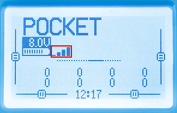

> **Подсказка** Если связь не устанавливается, убедитесь, что Binding Phrase на передатчике (TX) и приёмнике (RX) совпадает **полностью** — каждая буква, каждый символ, включая регистр (заглавные/строчные буквы различаются).

> **Подсказка** Если пульт видит Обрик, но QGC не реагирует на движения стиков — в меню **ExpressLRS** на пульте измените параметр **Model Match** с положения **off** в положение **on**, а затем обратно в **off**. Это сбрасывает «привязку к модели» и помогает в большинстве случаев.
