# Калибровка аппаратуры управления и настройка полётных режимов

Калибровка пульта RadioMaster Pocket в QGC настраивает соответствие стиков командам дрона. Этот раздел также описывает назначение полётных режимов на переключатели.

---

> **Внимание** Отключите аккумулятор от Обрика (питание только через USB) и снимите пропеллеры с моторов.

---

## Каналы управления

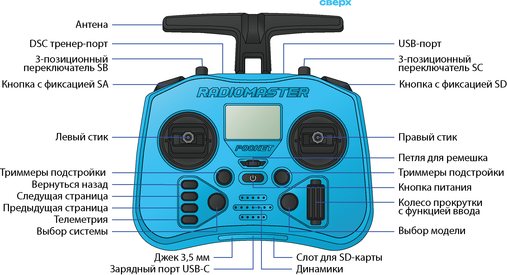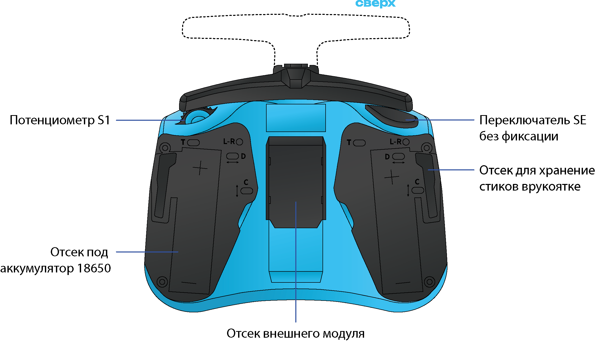

Пульт RadioMaster Pocket отправляет на дрон данные по **10 каналам** — по каждому каналу идёт своё значение. Каждый канал соответствует одному органу управления:

| Канал | Орган управления |
|---|---|
| 1 | Roll (крен) |
| 2 | Pitch (тангаж) |
| 3 | Throttle (газ) |
| 4 | Yaw (рысканье) |
| 5 | SA (арминг) |
| 6 | SB (режимы полёта) |
| 7 | SC |
| 8 | SD (Kill Switch) |
| 9 | SE |
| 10 | S1 (крутилка) |

- **Roll** (крен) — наклон влево/вправо → правый стик, горизонтально
- **Pitch** (тангаж) — наклон вперёд/назад → правый стик, вертикально
- **Throttle** (газ) — скорость моторов → левый стик, вертикально
- **Yaw** (рыскание) — поворот вокруг вертикальной оси → левый стик, горизонтально
- **SA–SD** — переключатели для режимов, арминга и аварийного отключения

---

## Калибровка пульта (Radio Calibration)

Откройте вкладку **Radio** в Vehicle Configuration.

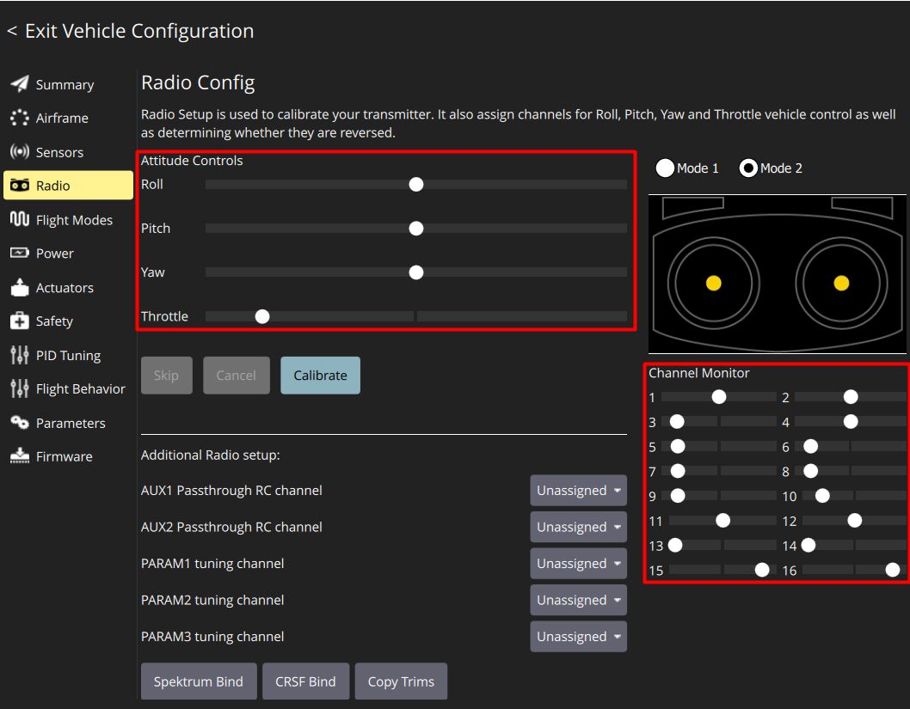

> **Подсказка** Перемещая стики и переключатели, вы можете в реальном времени видеть, как движутся полоски каналов на экране. Это полезно для проверки связи.
>
> **Примечание** Если пульт показывает связь с Обриком, но QGC не видит движений стиков — в меню SYS пульта, раздел ExpressLRS, измените **Model Match** с **off** на **on**, затем обратно на **off**.

### Назначение калибровки пульта

Каждый стик немного отличается: один может ходить чуть дальше в одну сторону, у другого центр смещён. Калибровка сообщает PX4 точные минимальные, центральные и максимальные значения каждого стика и переключателя. Без этого дрон может «думать», что вы держите стик не в центре, когда он на самом деле по центру.

### Выполняем калибровку

1. Выставите **Mode 2** (стандартный режим: газ слева, крен/тангаж справа)

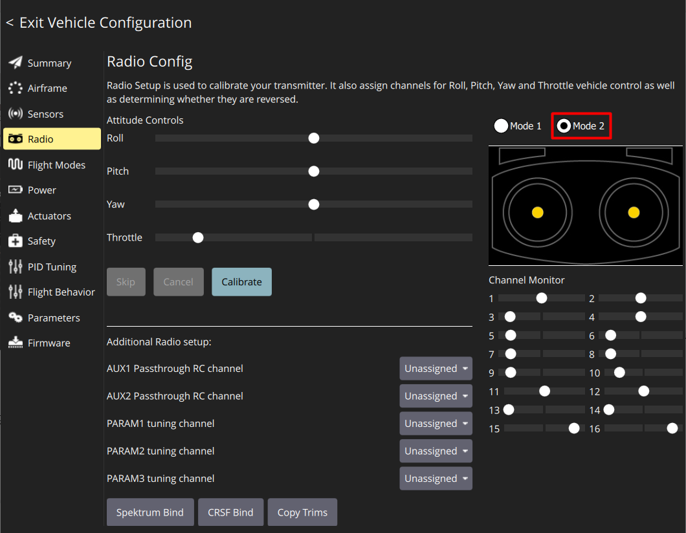

2. Нажмите кнопку **Calibrate**

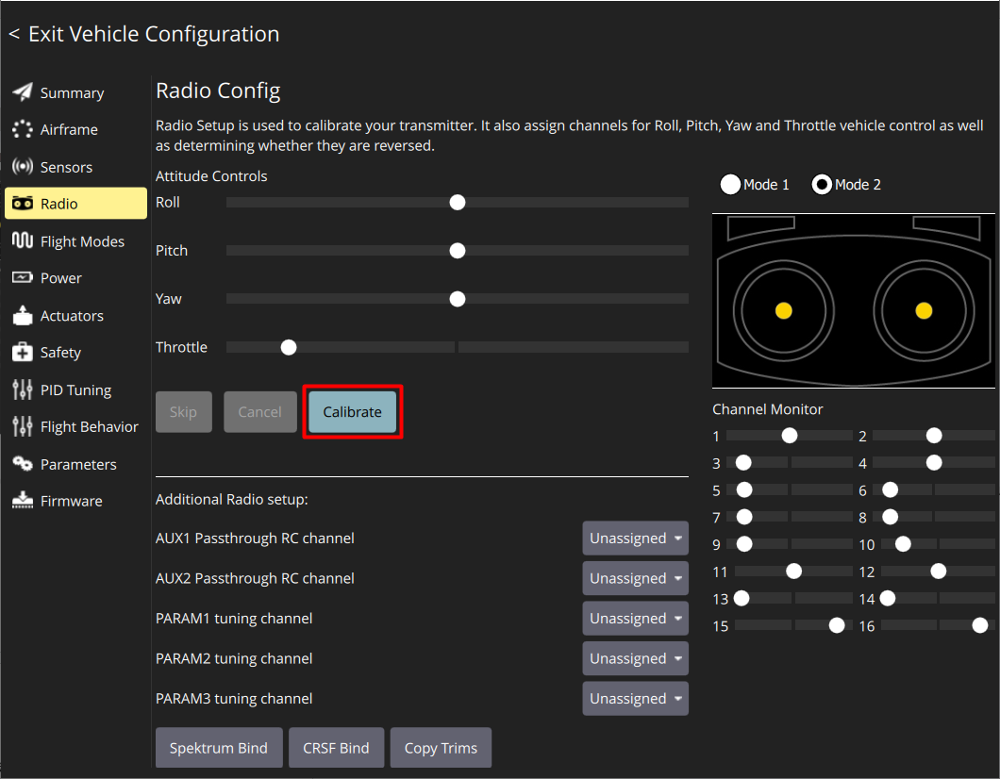

3. Установите все триммеры в ноль — переведите **оба стика в центральное положение**

   > **Подсказка** Правый стик возвращается в центр автоматически. Для левого стика (Throttle) совместите риски на стике с рисками на корпусе пульта — это и есть центр.

4. Нажмите **Ok**

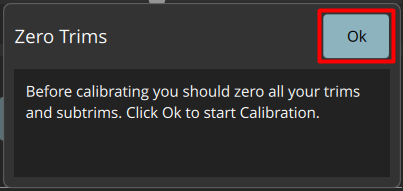

5. Переведите **левый стик (Throttle) в нижнее положение**, как показано в правом окне, и нажмите **Next**

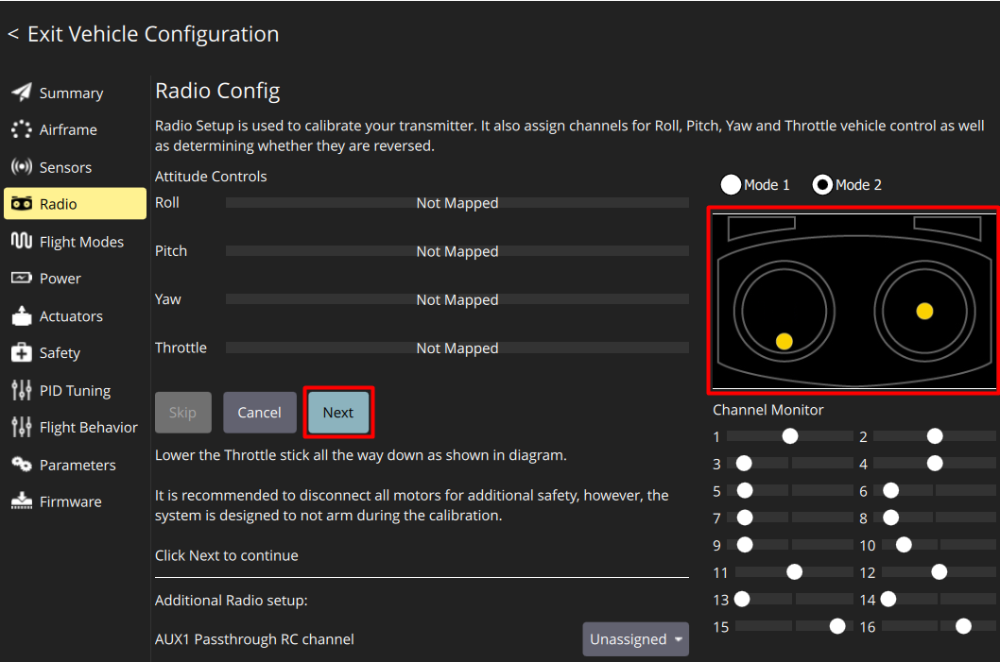

6. Двигайте стиками вслед за анимацией на экране

   > **Подсказка** Чем точнее вы следуете анимации — тем лучше калибровка. Доводите стики до упора в каждом направлении.

7. Когда появится надпись **"Move all transmitter switches and/or dials back and forth to their extreme positions"** — переключите все тумблеры **SA, SB, SC, SD, SE, S1** в их крайние положения (туда и обратно)

8. Нажмите **Next**

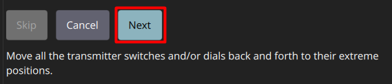

9. Когда появится **"All settings have been captured. Click Next to write the new parameters to your board"** — нажмите **Next**

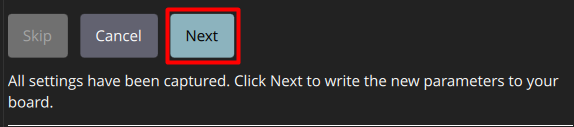

Калибровка завершена.

---

## Настройка полётных режимов (Flight Modes)

**Что такое полётные режимы?** PX4 умеет летать по-разному в зависимости от режима:

| Режим | Что делает |
|-------|-----------|
| **Stabilized** (Стабилизированный) | Дрон автоматически держит горизонтальное положение. Вы управляете наклоном, высоту держите сам газом |
| **Altitude** (По высоте) | Дрон держит горизонт и автоматически удерживает высоту. Вы управляете только горизонтальным движением |
| **Position** (По позиции) | Дрон держит горизонт, высоту и позицию (GPS + оптопоток). При отпускании стиков зависает на месте |

Откройте вкладку **Flight Modes** в Vehicle Configuration.

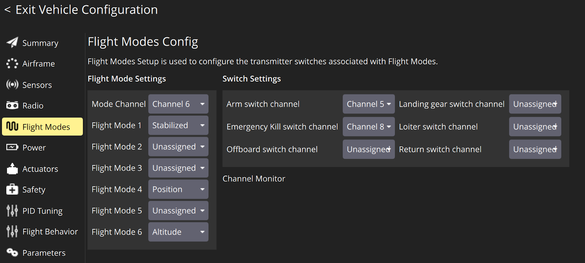

### Настройка режимов на переключатель SB

Тумблер **SB** имеет 3 положения → 3 режима полёта.

В разделе **Flight Mode Settings**:

- **Mode Channel** → установите **Channel 6** (это тумблер SB)
- **Flight Mode 1** → **Stabilized** (SB сверху — первое положение)
- **Flight Mode 4** → **Position** (SB посередине — второе положение)
- **Flight Mode 6** → **Altitude** (SB снизу — третье положение)

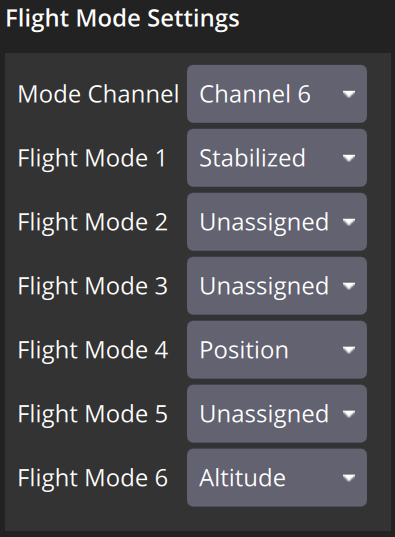

> **Подсказка** Жёлтым подсвечивается тот режим, который сейчас активен согласно положению тумблера SB. Переключите SB на пульте и посмотрите, как меняется подсветка.

### Настройка переключателей арминга и аварийного отключения

**Arming (арминг)** — активация моторов. Пока дрон «не заармлен», моторы не запустятся даже при газе.
**Kill switch (аварийное отключение)** — мгновенное отключение моторов. Используется только в экстренных ситуациях.

В разделе **Switch Settings**:

- **Arm switch channel** → **Channel 5** (переключатель **SA**)
- **Emergency Kill switch channel** → **Channel 8** (переключатель **SD**)

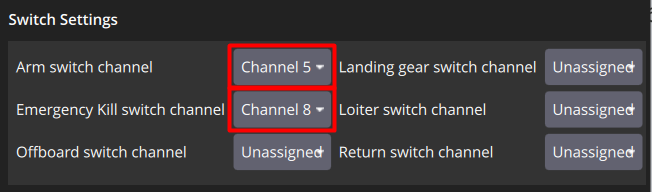

> **Внимание** Kill switch — экстренная кнопка. Нажимайте только если дрон вышел из-под контроля. При нажатии моторы мгновенно останавливаются — дрон упадёт.
