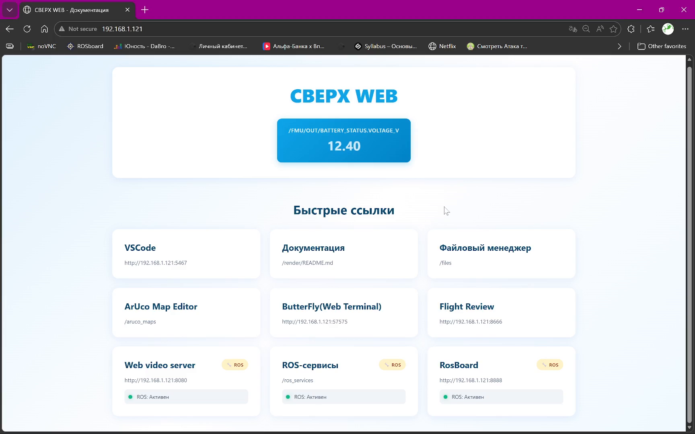
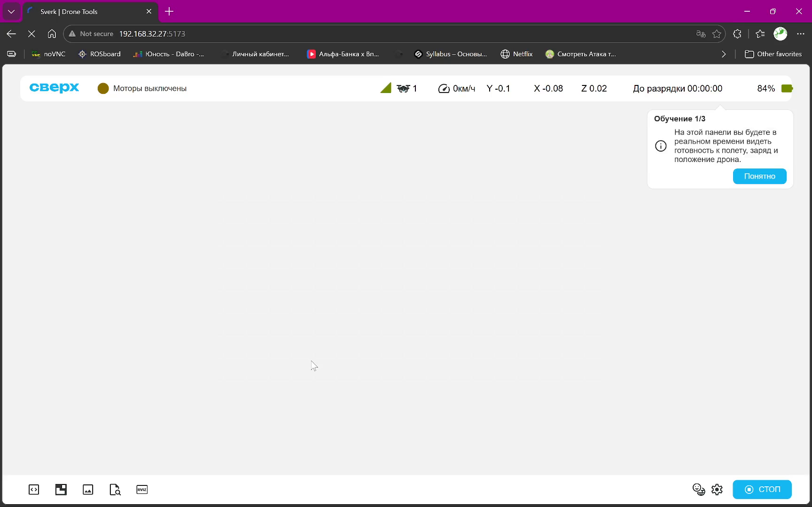
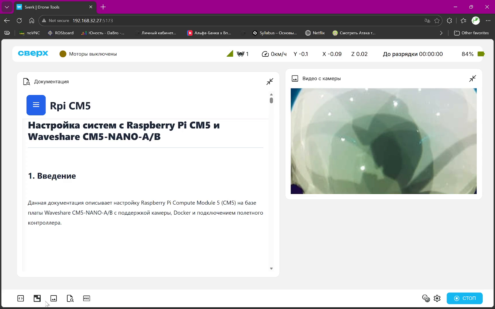
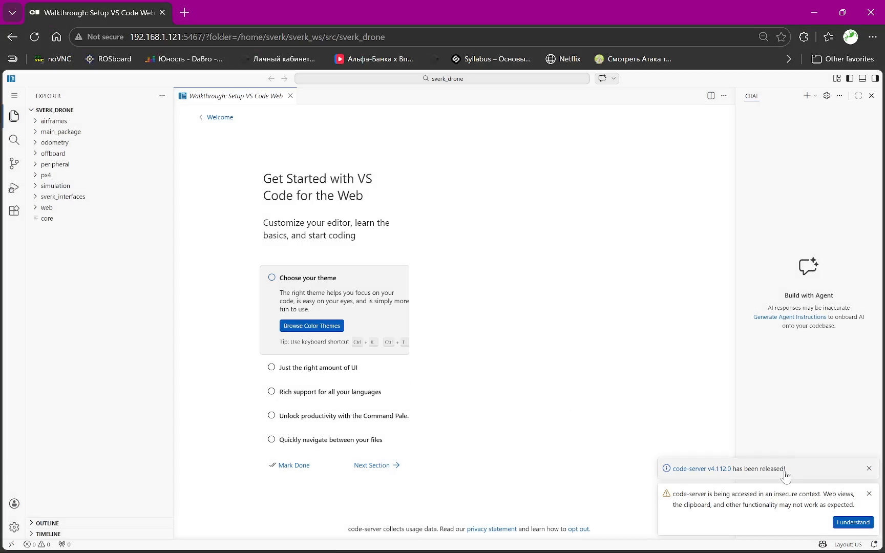
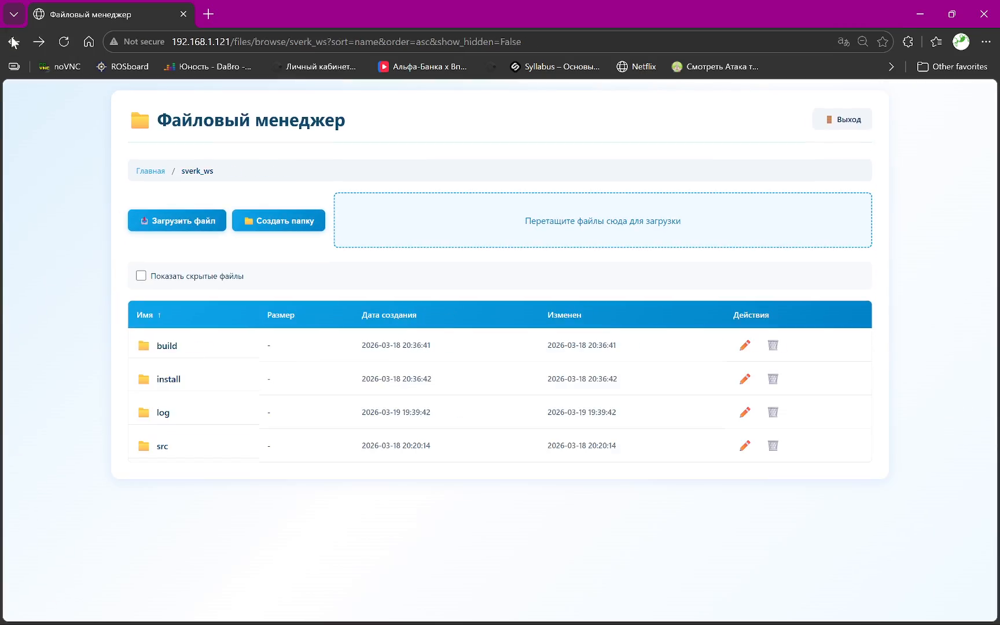
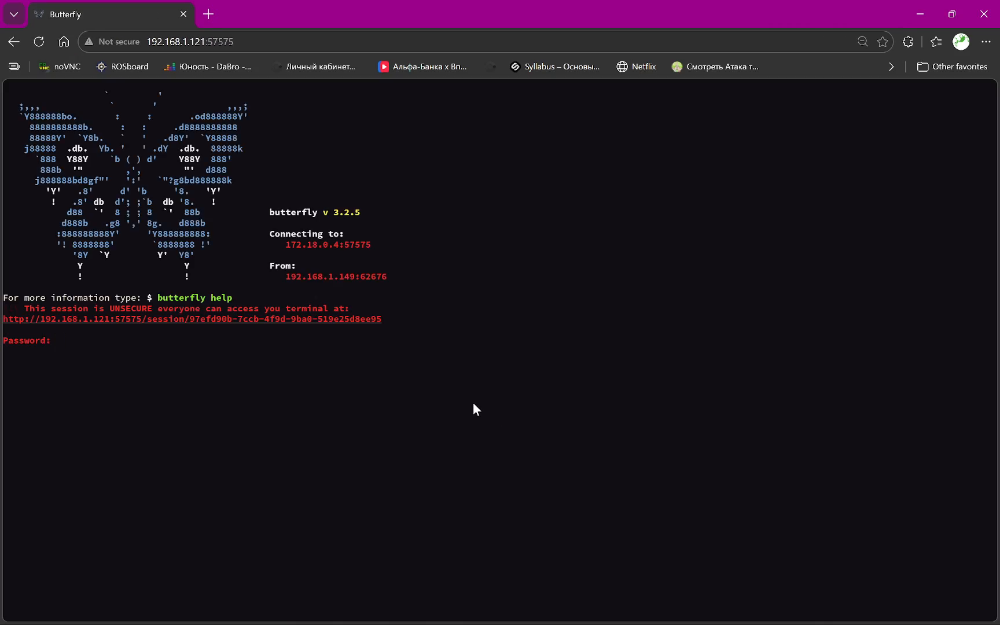
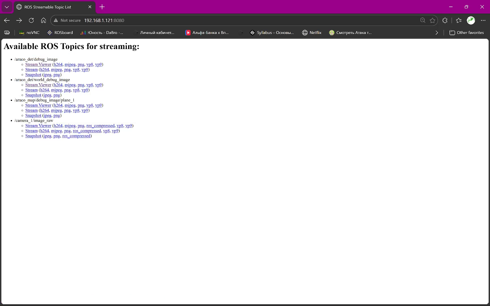
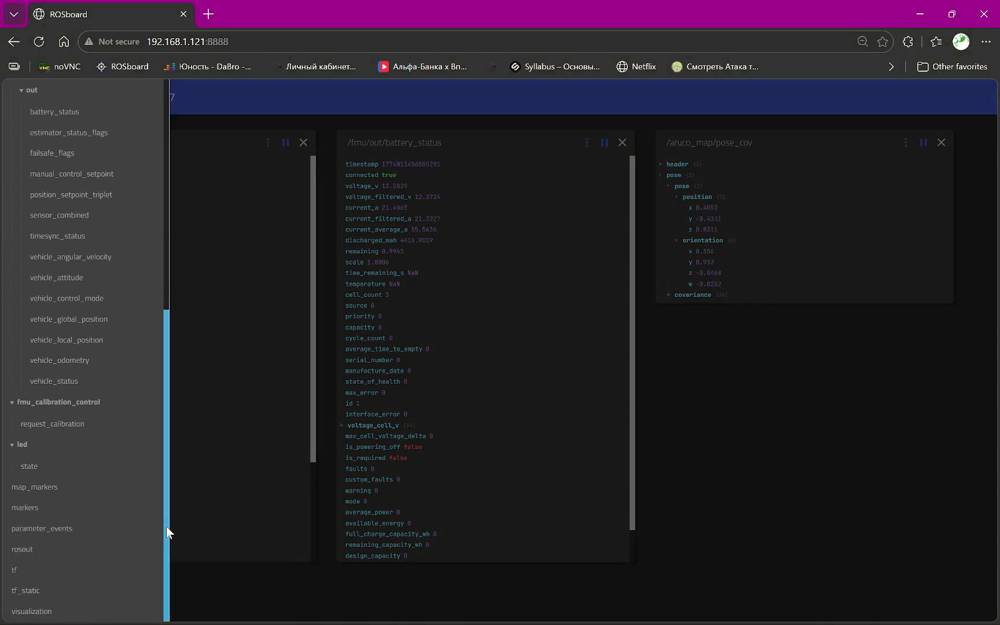

# Веб-интерфейс Обрика

После запуска системы бортовой компьютер открывает два веб-интерфейса, доступных с любого устройства в той же сети.

| Адрес | Что открывается |
|---|---|
| `http://192.168.X.X` | СВЕРХ WEB — стартовая страница со ссылками на все инструменты |
| `http://192.168.X.X:5173` | Sverk Drone Tools — интерфейс управления и мониторинга дрона |

IP-адрес бортового компьютера уточните в настройках вашей сети или на дисплее, если он подключён.

---

## СВЕРХ WEB

Стартовая страница открывает доступ ко всем инструментам разработки.



| Инструмент | Описание |
|---|---|
| **VSCode** | Редактор кода прямо в браузере — открывает папку `~/sverk_ws` |
| **Документация** | Встроенная документация Обрика |
| **Файловый менеджер** | Загрузка, скачивание и переименование файлов |
| **Aruco Map Editor** | Редактор карты ArUco-маркеров |
| **Butterfly (Web Terminal)** | Веб-терминал для выполнения команд в оболочке |
| **Flight Review** | Просмотр и анализ логов полётов |
| **Web video server** | Стриминг ROS-топиков с изображением в браузере |
| **ROS-сервисы** | Список и вызов ROS 2 сервисов |
| **ROSboard** | Визуализация данных из ROS-топиков |

---

## Sverk Drone Tools

Основной интерфейс управления и мониторинга. Открывается на порту `:5173`.

### Шапка статуса



В верхней строке отображается состояние дрона в реальном времени:

| Поле | Значение |
|---|---|
| Статус моторов | Моторы выключены / вооружён / в полёте |
| Уровень сигнала | Качество связи с пультом |
| Скорость | Текущая скорость, км/ч |
| X, Y, Z | Координаты дрона в системе `map`, м |
| До разрядки | Оставшееся время до разряда батареи |
| Заряд | Процент заряда батареи |

В нижней панели — иконки для открытия виджетов: документации, VSCode, камеры, файлового менеджера и терминала.

### Панели



Каждый виджет открывается кнопкой на нижней панели. Можно открыть несколько сразу. Панель **«Видео с камеры»** показывает поток с `/camera_1/image_raw` или топика `/out_detection`, если запущена обработка.

---

## VSCode в браузере

Полноценный редактор кода, открывает рабочее пространство `~/sverk_ws` напрямую на бортовом компьютере.



Встроенный терминал позволяет запускать программы, не выходя из браузера:

```bash
cd ~/sverk_ws
source install/setup.bash
python3 src/sverk_drone/sverk_interfaces/examples/simple_takeoff_land.py
```

---

## Файловый менеджер

Позволяет загружать файлы на бортовой компьютер и скачивать с него без SSH.



Перетащите файл в область загрузки или нажмите **Загрузить файл**. Удобно для загрузки своих программ в `~/sverk_ws/src`.

---

## Butterfly — веб-терминал

Полноценный терминал в браузере. Подключается к оболочке бортового компьютера.



> **Внимание** Соединение незашифрованное — не вводите пароли и ключи в этом терминале.

---

## Просмотр ROS-топиков с видео

**Web video server** публикует ROS-топики с изображением как HTTP-поток — смотреть можно прямо в браузере без ROS.



Доступные топики: `/aruco/vis/debug_image`, `/aruco/vis/map_debug_image/plane_1`, `camera_1/image_raw`. Нажмите **Stream Viewer** рядом с нужным топиком.

---

## ROSboard

Визуализирует данные из любых ROS-топиков в виде графиков, карт и таблиц.



На скриншоте открыты топики `/fmu/out/battery_status` (напряжение, заряд, ток) и `/aruco/loc/pose_cov` (положение дрона). Кликните по топику в левой панели, чтобы открыть его виджет.

!!! Тут не все модули вебки нужно будет лучше прописать и подробнее по каждому блоку как и для чего. Пока в разработке !!!
