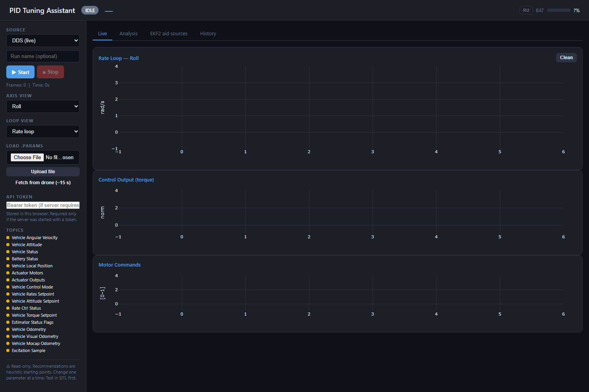
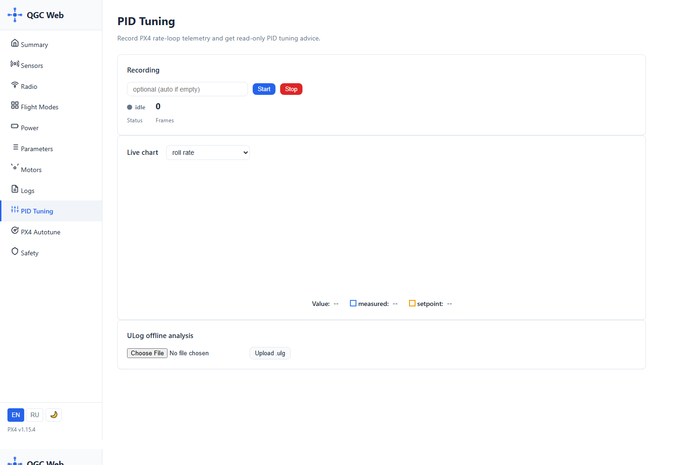
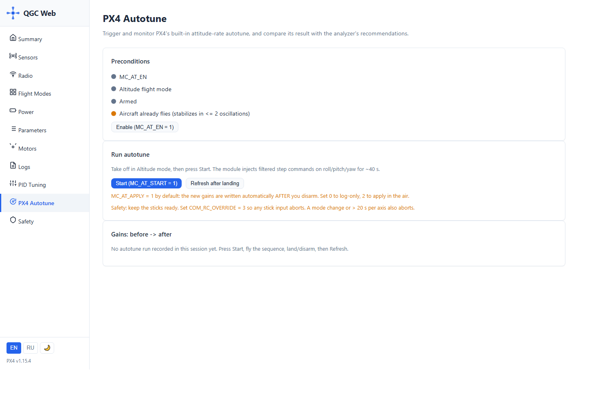
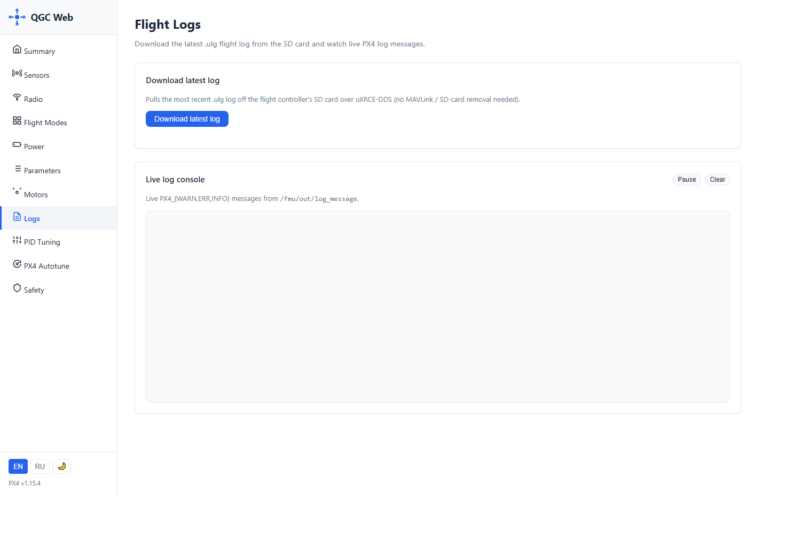
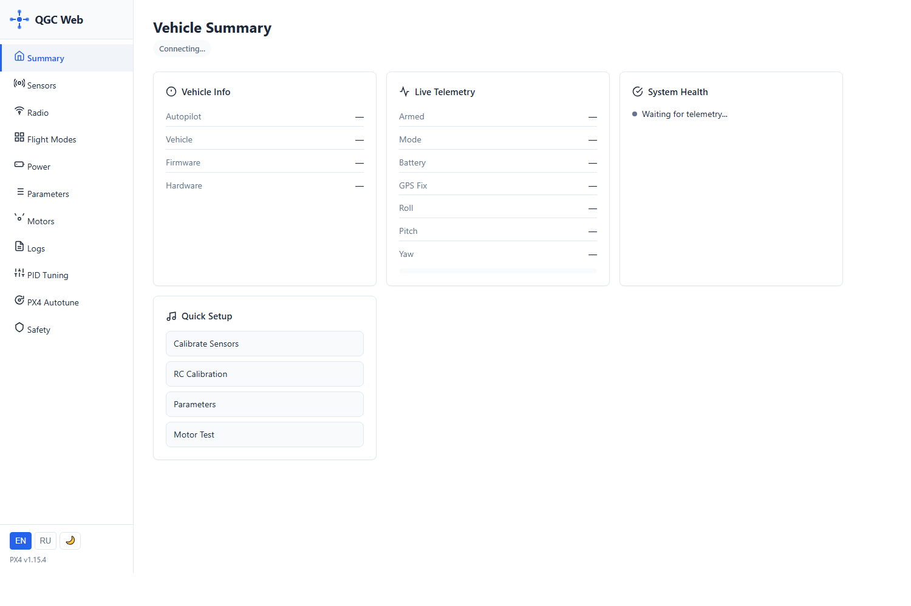

# PID-тюнинг на реальном дроне в полётном кубе 2×2×2 м — пошаговая инструкция

> Что это: практическое руководство «куда нажимать» для снятия PID-аналитики и
> прогона возбуждений на реальном дроне через веб-интерфейсы стека
> (qgc-web `:8085` и PID Tuning Assistant `:8086`). Проверено в SITL 2026-07-10
> (ветка `docker_test_v2`); скриншоты сняты с живого стека.
>
> **Правило куба**: в объёме 2×2×2 м разрешены ТОЛЬКО возбуждения
> **Pattern A** (attitude, дрон сам держит позицию) и **штатный автотюн PX4**.
> **Pattern B (rate-chirp) в кубе ЗАПРЕЩЁН** — он не держит горизонталь
> (в SITL дрейф 8 м за 13 с). Первый заход — на страховочном тросе.

---

## 0. Интерфейсы: что где живёт

| Адрес | Что это | Зачем в этой инструкции |
|---|---|---|
| `http://<дрон>:8085` | **qgc-web** — наземная станция (DDS) | страницы *PID Tuning*, *PX4 Autotune*, *Logs*, *Parameters* |
| `http://<дрон>:8086` | **PID Tuning Assistant** — анализатор | live-запись, анализ, загрузка ULog, рекомендации |
| `http://<дрон>:8666` | flight_review | просмотр ULog глазами (опционально) |

Ассистент поднимается только при `ENABLE_PID_TUNING = True` в
`full_system_real.launch.py`. Страница qgc *PID Tuning* — прокси к ассистенту
(`PID_ASSIST_URL`), можно пользоваться любым из двух.

---

## 1. Предусловия (один раз перед сессией)

1. **Прошивка `pid_on`** (`fmu/matek_h743-slim_pid_on.px4`) — обычная (lean)
   не публикует rate-loop топики, и аналитике нечего слушать.
   Проверка: `ros2 topic hz /fmu/out/vehicle_angular_velocity` → ≥100 Гц.
2. **RC-abort**: `COM_RC_OVERRIDE=3`, `COM_OBL_RC_ACT=0` (или 5),
   `COM_OF_LOSS_T=1` (страница *Parameters* в qgc). Пилот держит палец на kill.
3. **Позиционирование**: ArUco-карта куба и VPE работают; перед полётом
   `xy_valid: true`, `z_valid: true` в `/fmu/out/vehicle_local_position`.
4. **Лог высокого разрешения**: `SDLOG_PROFILE = 17` + перезагрузка FMU —
   без этого оффлайн-анализ (FRF/автотюн-сравнение) откажется работать.
5. Ассистент открывается и в блоке **TOPICS** (левая колонка, скриншот ниже)
   все rate-loop топики зелёные.

---

## 2. PID Tuning Assistant (`:8086`) — обзор интерфейса



| Элемент | За что отвечает |
|---|---|
| Бейдж **IDLE / REC** в шапке | состояние записи |
| **SOURCE → DDS (live)** | источник данных: живая телеметрия. После загрузки `.ulg` переключается на ULog |
| **Run name + ▶ Start / ■ Stop** | запись live-телеметрии. Stop сразу запускает step-анализ |
| **AXIS VIEW / LOOP VIEW** | какая ось и какой контур (Rate/Attitude) на графиках |
| **LOAD .PARAMS → Upload file / Fetch from drone (~15 s)** | загрузить текущие гейны: без них рекомендации будут «направлением», без абсолютных значений. *Fetch* тянет прямо с FMU |
| **TOPICS** (список с точками) | зелёная точка = данные идут. Если `Vehicle Rates Setpoint`/`Rate Ctrl Status` не зелёные — прошивка не `pid_on` |
| Вкладки **Live / Analysis / EKF2 aid sources / History** | Live — графики Rate Loop, Control Output (torque), Motor Commands; Analysis — метрики и рекомендации после Stop или загрузки ULog; EKF2 aid sources — здоровье VIO/EV; History — прошлые прогоны |
| Приписка *Read-only* внизу | ассистент **никогда сам не пишет параметры** — только советует |

---

## 3. Ветка A: возбудитель offboard + аналитика

### 3.1 Запись

1. Ассистент → **Fetch from drone (~15 s)** (или Upload `.params`).
2. **Run name** → например `cube_roll_01` → **▶ Start** (бейдж станет REC,
   счётчик Frames пойдёт).

То же самое есть на странице qgc **PID Tuning** (блок *Recording* → Start/Stop,
статус и Frames):



Блок **Live chart** — выбор сигнала (roll rate и т.д.), линии *measured* /
*setpoint*. Блок **ULog offline analysis** — загрузка `.ulg` (см. §5).

### 3.2 Возбуждение (пока только из терминала)

Кнопки запуска возбуждения в UI нет — цели отправляются ROS-action'ом
`run_excitation` (нода `offboard_control`). С дрона/станции:

```bash
# взлёт в центр куба ~1.1–1.2 м, затем per-axis цели Pattern A:
ros2 action send_goal /run_excitation offboard_interfaces/action/RunExcitation \
  "{axis: roll, signal: doublet, loop: 0, amplitude: 0.05, f_max: 3.0,
    taper: 0.15, auto_arm: false, hold_alt: 0.0, max_tilt_deg: 10.0,
    geofence_radius: 0.6, confirm: I_UNDERSTAND_WHAT_I_AM_DOING}"
```

**Капы для куба** (не превышать): `loop: 0` (только Pattern A!),
`amplitude ≤ 0.05–0.08` рад, `hold_alt: 0.0` (текущая высота — НИКОГДА не
абсолютная), `geofence_radius: 0.6`, `max_tilt_deg: 10`, потолок предохранителя
`excite_agl_ceil:=1.7` (параметр ноды). Оси по очереди: roll → pitch → yaw,
пауза 4–6 с. Для частотного анализа можно добавить короткий chirp Pattern A:
`signal: chirp, duration: 8.0, f_min: 0.5, f_max: 3.0`, амплитуда та же.

### 3.3 Стоп и быстрый результат

Посадка → **■ Stop** → вкладка **Analysis**: step-метрики (overshoot, rise,
settling) и рекомендации по осям с уровнем доверия. Данные live-канала — 100 Гц,
этого хватает для step-эвристики; частотный анализ смотри по ULog (§5).

---

## 4. Ветка B: штатный автотюн PX4 (страница PX4 Autotune)



| Элемент | За что отвечает |
|---|---|
| **Preconditions** | светофор готовности: `MC_AT_EN`, режим Altitude, Armed, «дрон уже летает стабильно» |
| **Enable (MC_AT_EN = 1)** | включить модуль автотюна (требует перезагрузки FMU) |
| **Start (MC_AT_START = 1)** | запустить последовательность: модуль ~40–60 с сам качает roll → pitch → yaw фильтрованными ступенями |
| **Refresh after landing** | после посадки/disarm подтянуть новые гейны |
| **Gains: before → after** | таблица что изменилось |

Порядок: **Enable** → перезагрузка FMU → взлёт пилотом в **Altitude/Position
режиме с RC** ( не в offboard — в offboard yaw-фаза гарантированно падает по
таймауту и модуль отбрасывает ВСЁ) → ховер в центре куба → **Start** → держать
стики в покое, палец на kill (`COM_RC_OVERRIDE=3`: любое движение стика —
аборт) → модуль закончил → посадка, disarm → гейны применяются автоматически
(`MC_AT_APPLY=1`) → **Refresh after landing** → смотреть *before → after*.

---

## 5. ULog: скачать лог и получить полный анализ



1. Страница **Logs** → **Download latest log** — тянет последний `.ulg` с
   SD-карты FMU по uXRCE-DDS (без снятия карты). Ниже — **Live log console**
   (сообщения `/fmu/out/log_message`, полезно ловить абортыпредохранителей).
2. Полученный `.ulg` → страница **PID Tuning**, блок *ULog offline analysis* →
   **Choose File** → **Upload .ulg** (или то же в ассистенте).
3. Смотреть в ассистенте:
   - **Analysis** — step-метрики и рекомендации по логу;
   - `/api/hifi` / FRF-блок — частотный анализ (нужен `SDLOG_PROFILE=17`);
   - **сравнение калибровок** — если в логе был прогон автотюна PX4, вкладка
     сравнения покажет колонки *current / px4_autotune / analyzer* — колонка
     `px4_autotune` восстанавливается из бортовой идентификации даже если
     модуль сам гейны не применил (например, из-за сорванной yaw-фазы).

> Известное ограничение (2026-07-10): формальные гейты оффлайн-автотюна
> (free-run VAF ≥60%) на замкнутом контуре практически непроходимы — колонка
> analyzer может быть пустой при хороших данных. Это дыра анализатора, не
> полёта. Пока опирайтесь на графики и ручную оценку, не только на гейты.

---

## 6. Чек-лист безопасности куба (повторение — мать учения)

- Pattern A, амплитуда ≤0.05–0.08 рад, geofence 0.6 м, `hold_alt: 0`
- пилот с RC, kill под пальцем, `COM_RC_OVERRIDE=3`
- ховер 1.1–1.2 м (пол предохранителя 1.0 м, потолок 1.7 м < крыша куба)
- первый прогон — на тросе; амплитуду поднимать только если дрейф < 0.3 м
- Pattern B (rate) — до внедрения velocity-демпфирования запрещён
- автотюн в offboard-режиме — только Altitude/Position с RC

---

## Приложение: страница Summary



Обзорная телеметрия (arming, режим, батарея, GPS, углы) и Quick Setup
(калибровки, Motor Test) — быстрый способ убедиться, что дрон жив и валиден,
не открывая терминал. На скриншоте страница поймана в момент «Connecting…» —
при живом линке поля заполняются через пару секунд.
